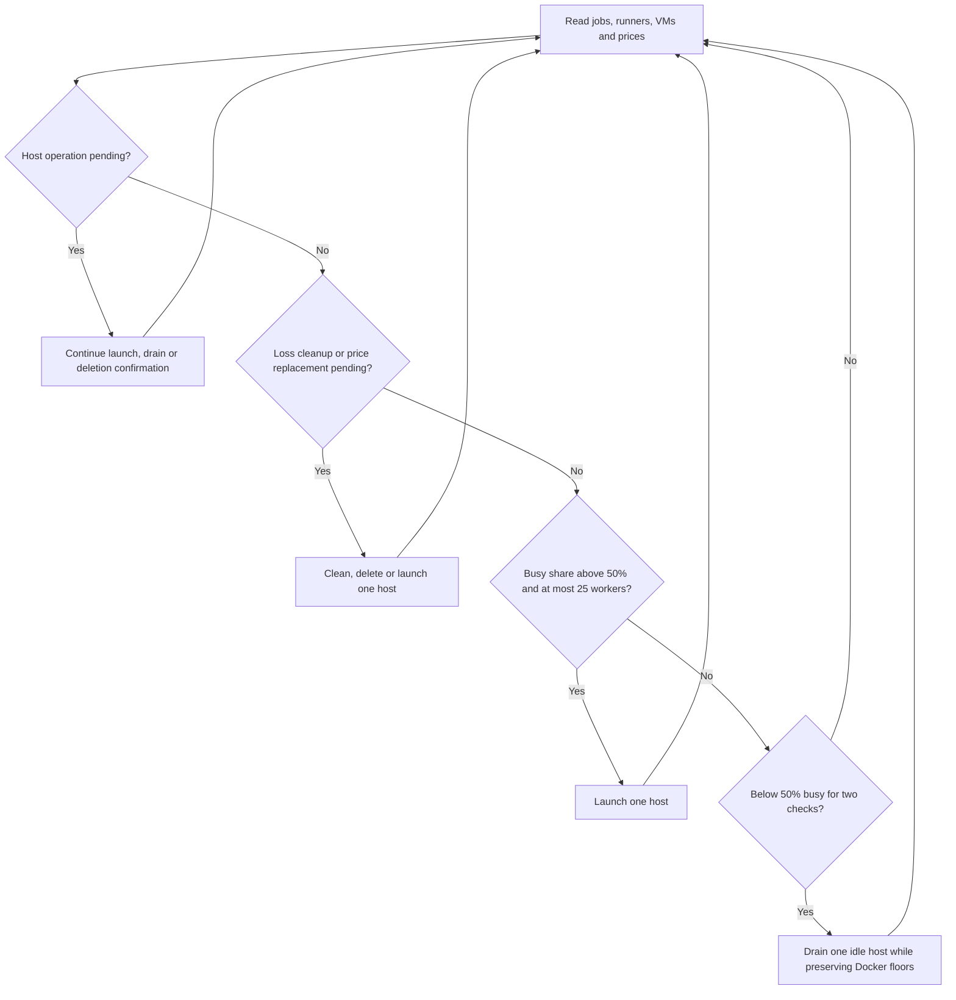

# Spot runner fleet

This repository contains Python tools for finding affordable GCP Spot
VMs, provisioning persistent GitHub Actions runners, and restoring runner
capacity after interruptions. The fleet belongs to the `swack-tools`
organization and uses the repository-scoped `oxidex-m4air` runner group for
`swack-tools/oxidex`.

The runner image includes `zstd` for generated-table artifact compression.
The separate [M4 Air configuration](m4air/README.md) provides Docker access
for the two ARM64 runners through the OrbStack socket.

## How the fleet works



The autoscaler scales the GCP Spot fleet with observed job usage.
Docker builders use the separate `docker` label and never receive the `spot`
label. GitHub
adds the standard `self-hosted`, `Linux`, and `X64` labels to both pools. Spot
runners also receive `spot` and optional machine and region labels. Docker
runners receive `docker` and optional machine and region labels. The autoscaler
changes one host at a time and checks again every five minutes. When more than
half of the online GCP runners are busy and 25 or fewer are online, it adds one
Spot VM. It waits for that host's eight runner slots to be online, then checks
fresh utilization before another change. Lower demand cancels further scale-up.
When fewer than half are busy for two consecutive checks, it drains one host
and waits for both the VM and its assigned GitHub runner records to be absent.
It repeats the two-check debounce before another reduction, keeping at least
one Spot VM. It selects a host only after observing all eight runner slots online
and idle, and preserves the Docker runner and distinct-host floors. It removes
all custom scheduling labels and moves the host's runners into a temporary
group with no repository access. This also blocks assignments using GitHub's
built-in labels. Existing jobs can finish while the host remains running.
Fresh observations must show every runner idle and every tracked CI job
completed before deregistration. The controller then requires a fresh inventory
with all assigned runner records absent and verifies the VM identity before
deleting it and its attached disks. It removes the empty temporary group after
confirming VM absence. GitHub group and label management require organization
self-hosted runner write permissions through `gh`.
Each added host contributes eight runner containers, including two Docker
workers and six Spot workers. Spot VM prices cover compute only. Persistent
disks and network use have separate charges.

Every loop fetches current regional Spot prices and checks each running managed
VM against `--max-daily-usd` (default: $5 per VM per day for compute).
Prices are shared within one loop for VMs of the same family and region, then
fetched again on the next loop. The launch price is not a price guarantee.

If a VM's current compute price exceeds the cap, the autoscaler deletes that VM
and its attached disks immediately, even if its runners have active jobs. Those
jobs can fail and need to be rerun. It then searches for affordable replacements
one host at a time and uses the deployment manager to check prices again before launch.
Pending replacements survive process restarts and are retried when no eligible
capacity is available. Utilization scaling waits during replacement work.
If GCP cannot provide a valid price, the autoscaler logs the failed
check, keeps that VM, and retries on the next loop.

## Storage layout

The attached persistent disk mounts at `/mnt/runner-data`. Bootstrap configures
all large and job-related storage there:

| Data | Path |
| --- | --- |
| Docker images and build cache | `/mnt/runner-data/docker` |
| containerd image layers and overlays | `/mnt/runner-data/containerd` |
| Runner configuration and credentials | `/mnt/runner-data/instances/<runner>` |
| Runner workspace and job files | `/mnt/runner-data/work/<runner>` |

Moving only Docker's `data-root` leaves containerd snapshots on the boot disk.
The bootstrap copies existing containerd data to the attached disk, configures
containerd to use that path, restarts Docker, then removes the old default storage.
Each runner's `/` filesystem should report about 98 GiB because its container
overlay uses the attached disk. Only the two `docker` pool runners receive the
host Docker socket; Docker runners do not receive the `spot` label. The manager checks
the runner filesystem and socket separation before it reports success. The boot
disk keeps the operating system and packages; increase the data disk only when
its observed free space requires it.

## Runner sizing

Runner count depends on vCPU capacity. Each runner receives four vCPU. Reserve
8 GiB of host RAM, then divide the remaining memory evenly:

```text
runner_count = host_vCPU // 4
runner_RAM_GiB = (host_RAM_GiB - 8) // runner_count
```

For a 32-vCPU, 128-GiB VM, the calculation is `(128 - 8) / 8 = 15 GiB` per
runner. A 32-vCPU, 256-GiB VM gives 31 GiB per runner. `--fixed-runner-sizing`
uses the explicit values for runner count, vCPU, and RAM.

## Requirements and credentials

Install and authenticate the GCP and GitHub command-line tools:

- `gcloud` needs permission to inspect Compute Engine prices, quotas, VMs, and
disks in project `homelab-424523`.
- `gh` needs permission to manage organization Actions runners in
  `swack-tools`.
- The runner group must be selected-repository scoped and include
  `swack-tools/oxidex`.

The manager obtains a short-lived runner registration token when it deploys a
host. Do not save that registration token in `.env`; it expires quickly. Set
`GH_TOKEN` in the local, ignored `.env` file to a renewable GitHub credential
with the required organization permissions. The manager passes the one-use
registration token through temporary startup metadata, waits for the exact
bootstrap run to finish, then removes the metadata key. It does not write the
token to the image or persistent disk.

Copy `.env.example` to `.env`, then add the GitHub credential. The `.env` file
is ignored by Git. The autoscaler also reads optional `GOOGLE_CLOUD_API_KEY` for
GCP Billing Catalog price lookup. GCP API calls use the active
`gcloud` credentials.

## Preview a deployment

The preview checks the live machine type, Spot compute price, and available CPU
quota. It does not create a disk or VM.

```bash
python3 src/spot_runner_manager.py \
  --max-cost 0.4 \
  --instance-type n2-standard-32 \
  --region asia-south2 \
  --ram 128 --cpu 32
```

`--max-cost` is the strict hourly compute limit for one VM. The manager refuses
to provision at a price greater than or equal to that limit. Disk charges are separate.

## Deploy a host

```bash
python3 src/spot_runner_manager.py \
  --max-cost 0.208333333 \
  --instance-type n2-standard-32 \
  --region northamerica-northeast2 --zone northamerica-northeast2-a \
  --ram 128 --cpu 32 \
  --disk-size-gb 100 \
  --instance-name oxidex-runners-nane2-example \
  --disk-device-name runner-data-example \
  --runner-prefix oxidex-example \
  --runner-label spot \
  --apply
```

The manager verifies current Spot rates and quota before creating resources. It
uses a Spot VM with a 40-GiB boot disk and a 100-GiB data disk configured to
delete with its VM. C4, C4D, N4, and N4D use Hyperdisk Balanced boot and data
disks with NVMe and gVNIC. Both disks explicitly provision the included
3,000 IOPS and 140 MiB/s throughput baseline. N2, N2D, C2D, and E2 retain
`pd-balanced` defaults. An incompatible existing data disk or explicit disk
type is rejected before attachment. New Spot VMs use the `DELETE` preemption
action, with automatic deletion explicitly enabled for both boot and data
disks. Adopting a VM also enables automatic deletion on its boot and runner
data disks. An ordinary stop preserves disks; existing VMs that use the
`STOP` preemption action retain the controller's loss cleanup behavior.
Deleting a VM removes its boot and runner data disks. Before deployment,
the manager also removes unattached disks carrying its ownership label in the
target zone when they are at least six hours old. This avoids racing an active
provisioning operation. It never deletes attached disks or disks without its
ownership label. GCE startup metadata installs Docker and Compose, configures Docker and
containerd storage, builds the runner image, and registers the persistent
containers. The manager waits for a deployment-specific completion marker and
checks that each runner root uses the data disk and has at least 20 GiB free,
then verifies Docker access is limited to the Docker pool.

Pass `--existing-instance` only when adopting a Spot VM with a supported machine
type and disk configuration. The manager restarts the host to apply the current
bootstrap script. It waits for that script's unique completion marker before
removing startup metadata, so old runner registrations cannot masquerade as a
completed update.

## Inspect fleet status

```bash
python3 src/runner_fleet.py \
  --org swack-tools \
  --project homelab-424523 \
  --label spot \
  --minimum-runners 25 \
  --runners-per-vm 8
```

The `src/lib/runner_fleet.py` module exposes functions to list and count online
organization runners, list and count running GCP VMs, observe both
systems, and calculate scale-out capacity. These functions do not create or
delete resources.

## Run the autoscaler

Run one check and scale pass:

```bash
python3 src/spot_runner_autoscaler.py --once
```

Run continuously with a target of 25 online runners across the Spot and Docker
pools, two Docker hosts, a five-minute interval, and a $10 per-VM daily compute and storage
cap:

```bash
python3 src/spot_runner_autoscaler.py
```

The autoscaler considers supported x86 Spot offers with exactly 32 vCPU and
at least 110 GiB of RAM that cost less than the daily total cost cap. It prefers
C4D (AMD Turin), N4D (AMD Turin), C4 (Intel Granite Rapids),
C4 (Intel Emerald Rapids), N4 (Intel Emerald Rapids), C2D (AMD Milan),
N2D (AMD Milan), N2 (Intel Ice Lake), then N2 (Intel Cascade Lake).
Within each family/platform preference it chooses the cheapest regional offer,
including 40 GiB of boot storage and the configured data disk size.
These are provisional hardware estimates; Rust build performance is unmeasured.
E2 hosts remain recognized, but automatic launches exclude E2 because GCP does
not allow requesting a CPU platform for that family. C4's 120 GiB and C4D's 124 GiB qualify; ARM, Local SSD,
and bare-metal variants are excluded. Boot and data disks use the cheapest
supported baseline storage: Standard/Balanced/SSD Persistent Disk for older
families and Hyperdisk Balanced for C4/C4D/N4/N4D. Data disks of at least 2 TiB
also compare Hyperdisk Throughput where supported, including its minimum
provisioned throughput charge. Hyperdisk Balanced uses its included 3,000 IOPS
and 140 MiB/s throughput. Monthly SKU storage prices use Google's 730-hour month for the
daily estimate. The running-VM price guard includes actual attached disk sizes
and provisioned performance; missing prices or disk details pause price-based
decisions. Every deployment verifies fresh regional prices using
the selected host's actual CPU and RAM counts. New runner names use the short `gha`
prefix and are checked against GitHub's 64-character name limit. The autoscaler
stores its idle-loop counters, restoration targets, and pending host operation in
`~/Library/Application Support/Spot Runner Autoscaler/state.json`.

Each launch passes an explicit `--min-cpu-platform` request to GCP. The manager
checks that the observed platform meets the requested minimum before confirming a running host, and the controller
preserves that request across restarts. Failed launches fall back through zones,
regions, and platform preferences only after confirming that no VM, disks, or
runner records remain. Uncertain results pause fallback. Logs include the
requested platform, observed platform, preference rank, and compute/storage prices.
At startup the controller reads each zone's available CPU platforms from GCP
and saves the map in state. A restart refreshes it. This zone inventory does not
prove platform support for a particular shape: small C4 Granite Rapids launches
are additionally limited to Google's documented minimum-platform zones.
For manual provisioning, `--min-cpu-platform` can select a compatible platform;
omitting it defaults to the family's first preference.

Before provisioning, the manager logs project-wide costs for the rolling last
24 hours, 7 days, and 30 days, both before credits and after credits. This requires
a standard or detailed [Cloud Billing usage export to BigQuery](https://docs.cloud.google.com/billing/docs/how-to/export-data-bigquery-setup).
Set `GCP_BILLING_EXPORT_TABLE=project.dataset.table` in `.env`, or pass
`--billing-export-table project.dataset.table` to the controller or manager.
The current `gcloud` identity needs BigQuery table read access and permission to
run query jobs in the managed project. Queries use the table's location and a
1 GiB billed-bytes limit. The lookup uses the BigQuery REST API without requiring
the `bq` CLI. Missing configuration, empty history, or failed lookups produce an
unavailable warning and do not prevent provisioning. Export timestamps and
partial-history warnings accompany totals because reporting can lag and a new
export may not contain the complete 30-day window. SKU rates cannot substitute
for historical project spend.

To install a per-user macOS LaunchAgent that starts at login and restarts the
process if it exits, run:

```bash
python3 src/spot_runner_autoscaler.py --install-launch-agent
```

The LaunchAgent needs the Mac to be powered on, awake, and logged in. It uses
the current user's `gcloud` and `gh` credentials. Review its status with
`launchctl print gui/$(id -u)/com.swacktools.spot-runner-autoscaler` and its log
at `~/Library/Logs/spot-runner-autoscaler.log`.

The controller appends timestamped events to `~/spot-ghrunner.log` on each run.
It records startup, shutdown, live prices, scaling decisions, VM deletion attempts
and completions, deployment attempts and completions, and changes in VM status.
Every event occupies one physical line, including errors and tracebacks.
Google API errors show their HTTP code, message, and reason instead of an error
JSON dump. VM events include the instance name, zone, machine type, vCPU, RAM,
root and data disk sizes and types, storage interfaces such as NVMe, and GPUs
when present. Specifications come from provider inventory; unavailable fields
are marked unknown. The controller saves this inventory to keep specifications
available when a VM disappears after a restart.
A missing VM does not prove Spot preemption; check the earlier deletion events
to identify controller actions. The log reports an unconfirmed cause for other
disappearances or terminated VMs.

The controller also tracks CI jobs assigned to managed Spot VMs. It saves job IDs,
runner names, attempts, and job links in the same state file before a VM disappears.
The default repository is `swack-tools/oxidex`; use `--job-repository OWNER/REPO`
(repeat the flag for multiple repositories) to change the tracked set. These
repositories require Actions read/write and Checks read permissions through `gh`.

When a VM disappears or reaches `TERMINATED`, the controller logs the jobs that
were running on it. It waits for GitHub to report a failed job with a runner-loss
error before logging that the VM loss caused a CI crash. Successful jobs, user
cancellations, ordinary code failures, and controller-initiated deletions do not
trigger automatic crash retries. Job failures completed before the last observed
VM presence are also excluded. A one-hour startup discovery window and retained
in-progress run IDs (including workflows with queued jobs) cover jobs that finish
between controller polls. Each repository retains its own discovery watermark.

After the workflow run completes, it requests an individual crashed-job rerun.
GitHub may also rerun jobs that depend on it. Multiple crashed jobs from the same
run are submitted one at a time. The controller recognizes newer job attempts
submitted manually, logs accepted requests and eventual results, and saves its
request intent before calling GitHub. A shared state-file lock prevents concurrent
controllers from submitting the same requests. If a request loses its response,
the controller checks for a newer job attempt and holds automatic resubmission;
its log requests a manual GitHub check when the receipt remains uncertain. A
confirmed HTTP rejection can be retried on the next loop. Unconfirmed crash
investigations expire after one day; job records are retained for up to 30 days.

When a managed VM terminates or disappears, the controller logs its replacement
search and checks its saved disk attachments before launching replacement
capacity. For a terminated host that still exists, it verifies the instance ID
and current attachments, then deletes the host and its disks. For surviving
persistent drives, it deletes only the recorded auto-delete disks in the same
project whose IDs still match and which are ready and unattached. It verifies
that all recorded drives are gone before launching a replacement. Attached,
retained, or recreated drives, incomplete legacy inventories, and failed API
calls leave recovery pending with a reason in the log. Cleanup and replacement
work survive restarts. Intentional scale-down and price evictions have their own
saved records, so they do not trigger an extra interruption replacement.

The controller saves each host operation's name, zone, and observed instance ID
before cloud actions. Pending registration, draining, or deregistration blocks all other
host changes, including price eviction and interruption replacement, across
restarts. Drain progress, group identity, and individual deregistration requests
survive restarts and uncertain API responses. A preemption before the controller
requests deletion remains eligible for interruption recovery. Deletion retries
target the same host; stale runner removal after loss requires
fresh VM absence and offline, idle runner records. An uncertain launch with no
VM receipt, a surviving failed deployment, or leftover deployment disks keeps
scaling paused for verification. Failed launches can try another zone only
after VM, disk, and runner inventories confirm that no resources remain.

Launch logs show candidate specifications and failure details for each zone.
The manager logs the first observation of an online runner and elapsed seconds
from starting VM deployment. This measures the first GitHub poll that observes
registration; it does not claim the exact provider-side registration instant.
The controller separately logs elapsed time through complete deployment,
registration, label, and storage verification. Manager diagnostics are included
as individual one-line events in the controller log.

Use `--log-file PATH` to change the event log location. The LaunchAgent preserves
this option. Existing log content is retained across restarts. To follow events:

```bash
tail -f ~/spot-ghrunner.log
```

Graceful exits and `SIGTERM` or `SIGINT` signals write shutdown events. Power loss
and `SIGKILL` cannot write a final event. The event log has no automatic rotation;
service diagnostics also remain in the LaunchAgent log.

## Repository layout

- `src/spot_runner_manager.py` is the provisioning command-line entry point.
- `src/spot_runner_autoscaler.py` is the continuous scale-out entry point.
- `src/runner_fleet.py` is the fleet status command-line entry point.
- `src/spot_finder.py` is the Spot offer search command-line entry point.
- `src/lib/` contains reusable fleet, pricing, provisioning, and autoscaling methods.
- `src/lib/runner_assets.py` embeds the startup script, image definition, and entrypoint.
- `tests/` contains unit tests for pricing and capacity rules.

Run the Python checks from the repository root:

```bash
PYTHONPATH=src python3 -m unittest discover -s tests -v
python3 -m py_compile src/*.py src/lib/*.py
```

## Safety and workflow routing

The runner group is limited to the OxiDex repository. Keep untrusted pull
request code off persistent self-hosted runners. Route macOS signing and release
jobs to macOS hosts; the Spot VMs in this fleet run Linux. Before changing CI to use
`runs-on: [self-hosted, linux, x64, spot]`, keep at least 25 online runners
across both pools for 10 minutes, and verify that runner filesystem checks pass.
Docker build jobs should use
`runs-on: [self-hosted, linux, x64, docker]`.
