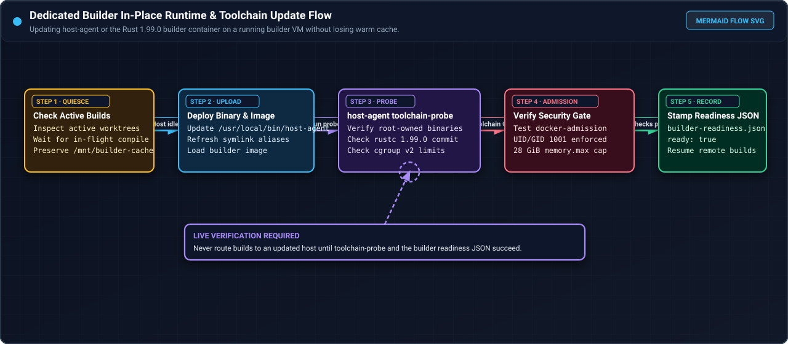
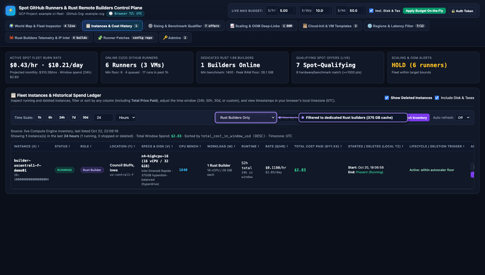
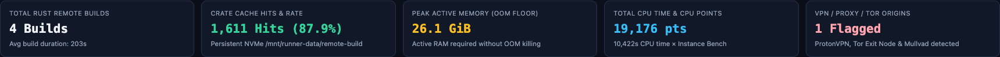
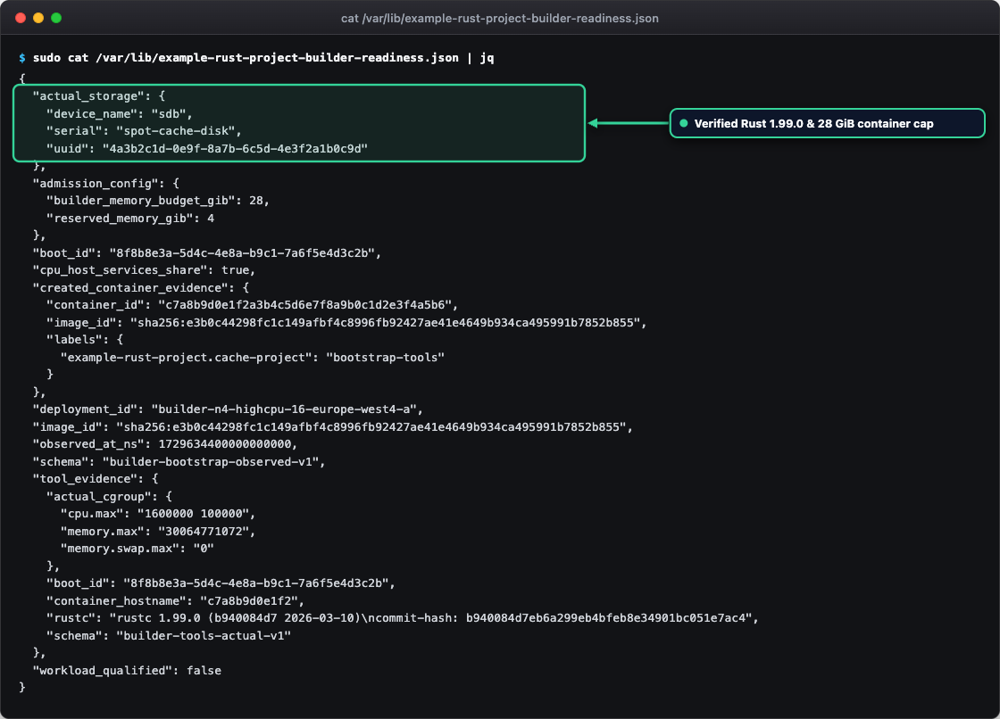

# Update an existing builder runtime

Use this administrative guide when updating the runtime binary or container image on a dedicated builder. For fresh instance provisioning and routine build client usage, see [Dedicated remote builders](dedicated-builders.md).

## Dedicated builder architecture

<div class="carousel" markdown>
<div class="carousel-track" markdown>
<figure class="shot" markdown>

<figcaption markdown>Flowchart for updating `host-agent` and the Rust `1.99.0` builder container in place on a running builder VM while preserving the warm `375 GB` cache disk.</figcaption>
</figure>
<figure class="shot" markdown>

<figcaption markdown>Instances view filtered to dedicated Rust builders, highlighting the persistent `375 GB` cache disk attached to `builder-uscentral1-f-demo01`.</figcaption>
</figure>
<figure class="shot" markdown>

<figcaption markdown>Rust builder KPI summary cards showing total builds, `87.9%` crate cache hit rate, `26.1 GiB` peak active memory, and total CPU points.</figcaption>
</figure>
</div>
</div>
<!-- /shot -->

Dedicated builders are single-purpose build VMs (`builder-*`) using the `n4-highcpu-16` machine shape (16 vCPUs, 32 GiB RAM) without registering GitHub runner listeners. The pure-Rust architecture separates immutable compute from persistent storage:

- **Persistent cache disk**: A 100 GiB Hyperdisk Balanced disk provisioned with `auto-delete=no` and mounted at `/mnt/runner-data`. This disk retains Cargo downloads (`/mnt/runner-data/remote-build/cargo`), per-project worktree build targets (`/mnt/runner-data/remote-build/targets`), and local Docker data (`/mnt/runner-data/docker`). The cache disk survives VM recreation.
- **Native host agent**: the multi-call binary `/usr/local/bin/host-agent` handles memory admission, Docker container restrictions, root command execution, and toolchain verification through symlink aliases.
- **Container build environment**: builds run inside the unprivileged container image `example-rust-project-remote-builder:1.99.0` pinned by SHA-256 digest in `/etc/example-rust-project-remote-build.json`.

Runtime updates apply when upgrading the `host-agent` binary, compiler toolchains, website audit tools, or container admission rules.

## Rotation with persistent cache disk retention

The standard and recommended procedure for updating a dedicated builder is VM rotation. Because the persistent cache disk survives VM deletion, rotating the compute instance applies updated startup payloads cleanly without risk of dirty host state.

### 1. Drain active builds

Place the build drain marker to refuse incoming builds while allowing active compilations, leases, and cache locks to complete:

```bash
sudo touch /run/example-rust-project-build-draining
```

Inspect active memory leases and verify allocatable headroom:

```bash
host-agent admission headroom --json
```

Wait until active leases reach zero.

### 2. Delete the builder VM

Delete the running builder instance. Because the cache disk has `auto-delete=no`, the disk device remains available in the GCP project:

```bash
gcloud compute instances delete "builder-old-name" \
  --project="your-project" \
  --zone="asia-east2-a"
```

### 3. Launch the replacement builder

Render `cloud-init/builder-startup.sh` with the updated parameters, referencing the existing persistent cache disk device name:

```bash
INSTANCE_NAME="builder-new-name"
PROJECT="your-project"
ZONE="asia-east2-a"
DISK_DEVICE_NAME="builder-cache-disk"
DEPLOYMENT_ID="${INSTANCE_NAME}"
UPLOADER_MAPPING="/path/to/approved-uploader-mapping.json"
UPLOADER_CONFIG=$(jq -c . "$UPLOADER_MAPPING")
UPLOADER_SHA=$(printf '%s' "$UPLOADER_CONFIG" | sha256sum | awk '{print $1}')
HOST_AGENT_VERSION="v0.1.0"
HOST_AGENT_SHA=$(sha256sum /usr/local/bin/host-agent | awk '{print $1}')
BUILD_CONFIG='{"approved_image_id":null,"cpus":16,"image":"example-rust-project-remote-builder:1.99.0","memory_gib":28,"role":"builder"}'
ADMISSION_CONFIG='{"builder_cpus":16,"builder_gib":28,"host_cpus":16,"role":"builder","runner_gib":0,"runner_names":[],"work_gib":28}'

# Prepare builder asset writes script to stage configuration and download host-agent without exceeding GCE's 256 KiB metadata limit
cat << EOF > /tmp/builder_assets.sh
install -d -m 0755 /usr/local/bin /opt/example-rust-project-builder/image
# Download native host-agent binary from immutable versioned release and verify pinned checksum
curl -fsSL --retry 3 --retry-connrefused "https://github.com/swack-tools/spot-github-runners/releases/download/${HOST_AGENT_VERSION}/host-agent" -o /usr/local/bin/host-agent
echo "${HOST_AGENT_SHA}  /usr/local/bin/host-agent" | sha256sum -c -
chmod 0755 /usr/local/bin/host-agent

cat << 'ASSET_EOF' > /opt/example-rust-project-builder/image/Dockerfile
EOF
cat builder/standalone/Dockerfile >> /tmp/builder_assets.sh
cat << 'EOF' >> /tmp/builder_assets.sh
ASSET_EOF

cat << 'ASSET_EOF' > /opt/example-rust-project-builder/image/website-package.json
EOF
cat builder/standalone/website-package.json >> /tmp/builder_assets.sh
cat << 'EOF' >> /tmp/builder_assets.sh
ASSET_EOF

cat << 'ASSET_EOF' > /opt/example-rust-project-builder/image/website-package-lock.json
EOF
cat builder/standalone/website-package-lock.json >> /tmp/builder_assets.sh
cat << 'EOF' >> /tmp/builder_assets.sh
ASSET_EOF

sed -e "s/{{INSTANCE_NAME}}/${INSTANCE_NAME}/g" \
    -e "s/{{PROJECT}}/${PROJECT}/g" \
    -e "s/{{ZONE}}/${ZONE}/g" \
    -e "s/{{DISK_DEVICE_NAME}}/${DISK_DEVICE_NAME}/g" \
    -e "s/{{DEPLOYMENT_ID}}/${DEPLOYMENT_ID}/g" \
    -e "s|{{UPLOADER_CONFIG}}|${UPLOADER_CONFIG}|g" \
    -e "s/{{UPLOADER_SHA}}/${UPLOADER_SHA}/g" \
    -e "s|{{BUILD_CONFIG}}|${BUILD_CONFIG}|g" \
    -e "s|{{ADMISSION_CONFIG}}|${ADMISSION_CONFIG}|g" \
    -e '/{{ASSET_WRITES}}/{' -e 'r /tmp/builder_assets.sh' -e 'd' -e '}' \
    cloud-init/builder-startup.sh > /private/builder-startup.sh
rm -f /tmp/builder_assets.sh

gcloud compute instances create "${INSTANCE_NAME}" \
  --project="${PROJECT}" \
  --zone="${ZONE}" \
  --machine-type="n4-highcpu-16" \
  --provisioning-model="SPOT" \
  --instance-termination-action="STOP" \
  --metadata-from-file="startup-script=/private/builder-startup.sh"
```

During bootstrap, `builder-startup.sh`:
- Detects the existing ext4 filesystem on the cache disk and mounts it at `/mnt/runner-data` without reformatting.
- Configures Docker and containerd data roots on `/mnt/runner-data`.
- Copies and symlinks the updated `host-agent` binary.
- Builds the `example-rust-project-remote-builder:1.99.0` container image and records its digest in `/etc/example-rust-project-remote-build.json`.
- Runs `example-rust-project-toolchain-probe` inside a bootstrap container to verify compiler commit hash `b940084d7eb6a299eb4bfeb8e34901bc051e7ac4`, tool versions, and cgroup limits (28 GiB RAM, 16 CPUs, zero swap).
- Records observed readiness telemetry in `/var/lib/example-rust-project-builder-readiness.json` and writes `/var/lib/example-rust-project-builder-bootstrap.complete`.

### 4. Verify builder readiness

Connect to the instance using authenticated SSH and confirm bootstrap completion and toolchain verification:

```bash
sudo cat /var/lib/example-rust-project-builder-readiness.json
```

Verify that the JSON payload contains `"workload_qualified": false` with valid `tool_evidence` matching schema `builder-tools-actual-v1`.

### 5. Update client configuration

Update the remote builder endpoint in `example-rust-project` `.cargo/config.toml` under the `[env]` table to point to the new builder instance name. Run a test compilation using `just build` to qualify the builder for project workloads.

## In-place runtime update procedure

<div class="carousel" markdown>
<div class="carousel-track" markdown>
<figure class="shot" markdown>

<figcaption markdown>Example `/var/lib/example-rust-project-builder-readiness.json` output verified after completing an in-place builder runtime update.</figcaption>
</figure>
<figure class="shot" markdown>

<figcaption markdown>Terminal capture of `host-agent toolchain-probe` verifying root-owned toolchain binaries, Rust commit hash, and cgroup v2 limits.</figcaption>
</figure>
</div>
</div>
<!-- /shot -->

If VM rotation is impractical and an administrator needs to update the `host-agent` binary or rebuild the container image directly on an existing VM:

### 1. Drain the builder and halt admission

Place the drain marker and confirm no builds or leases remain active:

```bash
sudo touch /run/example-rust-project-build-draining
host-agent admission headroom --json
```

Stop the admission daemon to prevent new leases during maintenance:

```bash
sudo systemctl stop gha-admission.service
```

### 2. Install updated host-agent binary

Copy the reviewed release binary and refresh host symlinks:

```bash
sudo install -m 0755 /path/to/new/host-agent /usr/local/bin/host-agent
sudo cp /usr/local/bin/host-agent /opt/example-rust-project-builder/image/host-agent

for alias in clean-target host-admission docker-wrapper docker-admission \
             host-launcher builder-entrypoint worktree-commands toolchain-probe \
             gha-runner-clean-target gha-host-admission example-rust-project-remote-build \
             example-rust-project-build-entrypoint example-rust-project-worktree-commands example-rust-project-toolchain-probe docker; do
  sudo ln -sf /usr/local/bin/host-agent "/usr/local/bin/$alias"
done
```

### 3. Rebuild the builder container image

Ensure the state directory exists and rebuild the unprivileged container image with bounded resource flags:

```bash
sudo install -d -m 0700 /var/lib/example-rust-project-builder
DOCKER_BUILDKIT=0 sudo docker build \
  --memory=28g --memory-swap=28g --cpu-period=100000 --cpu-quota=1600000 \
  --iidfile /var/lib/example-rust-project-builder/image-id \
  -t example-rust-project-remote-builder:1.99.0 /opt/example-rust-project-builder/image
```

Extract the newly built image ID and update the approved image configuration:

```bash
image=$(tr -d '[:space:]' </var/lib/example-rust-project-builder/image-id)
sudo jq --arg img "$image" '.image = "example-rust-project-remote-builder:1.99.0" | .approved_image_id = $img' /etc/example-rust-project-remote-build.json > /tmp/remote-build.json
sudo install -m 0644 /tmp/remote-build.json /etc/example-rust-project-remote-build.json
rm -f /tmp/remote-build.json
```

### 4. Run toolchain verification probe

Execute the toolchain probe using the root host launcher to verify compiler pins, website tools, and cgroup controller limits:

```bash
sudo /usr/local/bin/example-rust-project-remote-build bootstrap-tools prepare
sudo /usr/local/bin/example-rust-project-remote-build bootstrap-tools /usr/local/bin/example-rust-project-toolchain-probe
```

Verify that the output schema is `builder-tools-actual-v1` and that `commit-hash: b940084d7eb6a299eb4bfeb8e34901bc051e7ac4` is present.

### 5. Resume admission and remove drain

Restart the admission daemon and clear the drain marker:

```bash
sudo systemctl daemon-reload
sudo systemctl start gha-admission.service
sudo rm -f /run/example-rust-project-build-draining
```

Confirm that the admission socket `/run/gha-admission/socket` is active and ready:

```bash
host-agent admission headroom --json
```

## Interrupted update recovery

If an update or bootstrap operation is interrupted:

- **Check bootstrap logs**: inspect `/var/log/example-rust-project-builder-bootstrap.log` or run `sudo journalctl -u google-startup-scripts.service --no-pager`.
- **Inspect locks and drains**: check for `/run/example-rust-project-builder-bootstrap.lock` or `/run/example-rust-project-build-draining`. If an interrupted operation left a drain in place, verify container state with `docker ps -a` before clearing the marker.
- **Inspect admission state**: check `sudo systemctl status gha-admission.service` and review `/var/lib/gha-admission/leases.json`.
- **Fall back to rotation**: if host configuration is ambiguous or inconsistent, delete the VM instance and rotate to a fresh builder instance reusing the persistent cache disk.
