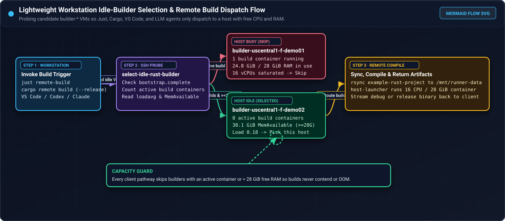
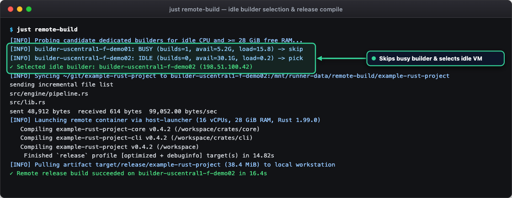
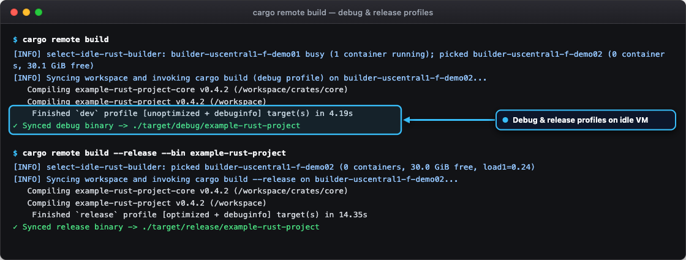
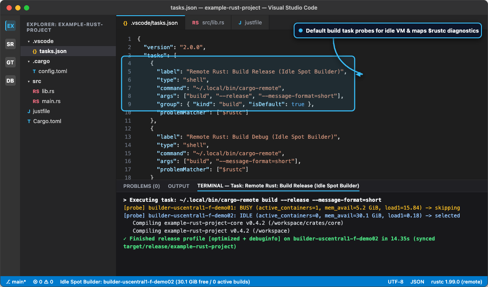
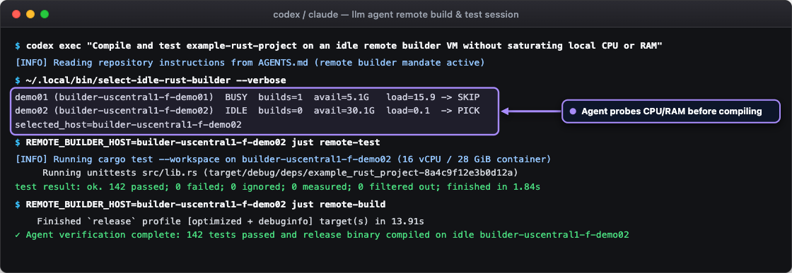

# Client workstation setup

A lightweight laptop or cloud development box does not need 16 local cores or 32 GiB of RAM to compile `example-rust-project`. By offloading compilation and test execution to the dedicated `builder-*` Spot VMs (`n4-highcpu-16`, 16 vCPU, 32 GiB RAM, 375 GB persistent cache disk), your local machine only edits source files, syncs incremental diffs over SSH, and receives compiled binaries.

Every build pathway on this page enforces a single capacity rule before dispatching work: **always probe the candidate `builder-*` instances first and select a VM that does not already have an active Rust build filling its CPU and RAM**.

<figure class="shot" markdown>
  
  <figcaption markdown>End-to-end client dispatch flow showing how `select-idle-rust-builder` probes candidate `builder-*` VMs over SSH, skips any host with a running build container or less than 28 GiB of available RAM, and routes `just`, `cargo`, Visual Studio Code, and AI agent builds to an idle builder.</figcaption>
</figure>

## Prerequisites

Before configuring build triggers on your development workstation, verify the following items:

- **Direct SSH key and pinned host keys**: you have an Ed25519 key pair authorized for the `example-rust-project-uploader` account on your dedicated builders, and the builder host public keys are recorded in `~/example-rust-project-ops/known_hosts`.
- **Local synchronization tools**: your workstation has `openssh`, `rsync` (`3.2+`), `jq`, and `just` installed.
- **Project identifier**: your repository slug (`example-rust-project`) matches the project pattern `^[a-zA-Z0-9][a-zA-Z0-9_-]{0,63}$` enforced by `host-agent host-launcher`.

## Configure SSH and the idle builder selector

Each dedicated builder runs builds inside a single container capped at 16 vCPUs and 28 GiB of RAM (`--cpus=16 --memory=28g --memory-swap=28g`). If two builds land on the same VM simultaneously, the second build either fails admission (`EX_TEMPFAIL`, exit code `75`) or contends for CPU and memory. To guarantee fast, contention-free builds, install a lightweight helper script that probes your candidate `builder-*` VMs and returns the first idle instance.

### 1. Add builder entries to `~/.ssh/config`

Configure OpenSSH to connect to your `builder-*` hosts as `example-rust-project-uploader` using connection multiplexing and your pinned `known_hosts` file:

```sshconfig
Host builder-*
    User example-rust-project-uploader
    IdentityFile ~/example-rust-project-ops/id_ed25519_builder
    IdentitiesOnly yes
    UserKnownHostsFile ~/example-rust-project-ops/known_hosts
    StrictHostKeyChecking yes
    BatchMode yes
    ConnectTimeout 4
    ControlMaster auto
    ControlPath ~/.ssh/cm-%r@%h:%p
    ControlPersist 10m
```

### 2. Install `~/.local/bin/select-idle-rust-builder`

Create `~/.local/bin/select-idle-rust-builder` and make it executable (`chmod 0755 ~/.local/bin/select-idle-rust-builder`). Every `just` recipe, `cargo` wrapper, VS Code task, and LLM coding agent calls this script before starting a remote build:

```bash
#!/usr/bin/env bash
set -euo pipefail

# Space-separated candidate dedicated builder hostnames or RFC 5737 / internal IPs
CANDIDATES=(${EXAMPLE_RUST_PROJECT_BUILDERS:-builder-uscentral1-f-demo01 builder-uscentral1-f-demo02 builder-europewest4-a-demo03})
MIN_AVAIL_KIB=29360128 # 28 GiB in KiB (matches the 28 GiB container cap)
MAX_LOAD1="4.0"
VERBOSE="${1:-}"

if [[ -n "${REMOTE_BUILDER_HOST:-}" ]]; then
  echo "${REMOTE_BUILDER_HOST}"
  exit 0
fi

echo "[INFO] Probing candidate dedicated builders for idle CPU and >= 28 GiB free RAM..." >&2

for host in "${CANDIDATES[@]}"; do
  # The launcher prints "OK|DRAINING|UNREADY <running builds> <MemAvailable KiB> <load1>" and fails
  # if it cannot count running builds, so an unknown host is skipped rather than treated as idle.
  probe_out="$(
    ssh -o ConnectTimeout=3 "${host}" 'sudo -n /usr/local/bin/example-rust-project-remote-build status' 2>/dev/null \
      || echo "UNREACHABLE 0 0 999.0"
  )"

  read -r state active avail_kib load1 <<< "${probe_out}"
  avail_gib="$(awk -v k="${avail_kib:-0}" 'BEGIN { printf "%.1f", k / 1048576 }')"

  if [[ "${state}" != "OK" ]]; then
    echo "[INFO]   ${host}: ${state} -> skipping" >&2
    continue
  fi

  is_low_load="$(awk -v l="${load1}" -v m="${MAX_LOAD1}" 'BEGIN { print (l < m) ? 1 : 0 }')"
  if [[ "${active}" -eq 0 ]] && [[ "${avail_kib}" -ge "${MIN_AVAIL_KIB}" ]] && [[ "${is_low_load}" -eq 1 ]]; then
    echo "[INFO]   ${host}: IDLE (builds=${active}, mem_avail=${avail_gib} GiB, load1=${load1}) -> selected" >&2
    if [[ "${VERBOSE}" == "--verbose" ]]; then
      echo "selected_host=${host}" >&2
    fi
    echo "${host}"
    exit 0
  else
    echo "[INFO]   ${host}: BUSY (builds=${active}, mem_avail=${avail_gib} GiB, load1=${load1}) -> skipping" >&2
  fi
done

echo "error: all candidate dedicated builders are currently running a Rust build or below 28 GiB free RAM" >&2
exit 75
```

Why this check prevents build contention:

1. **Zero running builds (`active == 0`)**: `sudo -n /usr/local/bin/example-rust-project-remote-build status` runs the root-owned launcher, which counts the build containers it started on the host. The uploader account has no Docker access of its own, and the launcher only needs the `sudo` rule that the builder bootstrap already installs for `prepare`, `cleanup`, and builds. If the launcher can't count the containers, the probe fails and the host is skipped.
2. **Full 28 GiB memory headroom (`MemAvailable >= 29360128` KiB)**: confirms that the host has at least 28 GiB of reclaimable memory available before `host-agent docker-admission` launches the container.
3. **Low CPU saturation (`load1 < 4.0`)**: confirms that background maintenance or a finishing build is not saturating the 16 vCPUs.
4. **Atomic server-side lock**: even if two workstations probe the same builder within milliseconds, `host-agent host-launcher` acquires `/run/example-rust-project-build.lock` on the builder and returns exit code `75` (`EX_TEMPFAIL`) to the second caller rather than overcommitting the VM.

---

## Build with `just` recipes

Adding remote build recipes to your project's `justfile` gives every developer a single command (`just remote-build`, `just remote-debug`, `just remote-test`, or `just remote-clippy`) that picks an idle builder, syncs the workspace, runs the build inside the pinned Rust 1.99.0 container, and streams the compiled binary back to `./target/`.

### Example `justfile` for `example-rust-project`

Save the following recipes in `~/git/example-rust-project/justfile`:

```makefile
set shell := ["bash", "-euo", "pipefail", "-c"]

project := "example-rust-project"
remote_root := "/mnt/runner-data/remote-build"

# Build optimized release binary on an idle dedicated builder
remote-build bin="example-rust-project":
    #!/usr/bin/env bash
    set -euo pipefail
    host="$(~/.local/bin/select-idle-rust-builder)"
    run_id="$(date +%s)-$$"
    echo "✓ Selected idle builder: ${host}"
    rsync -az --mkpath --delete \
      --exclude 'target/' \
      --exclude '.git/' \
      ./ "${host}:~/remote-staging-${run_id}/"
    ssh "${host}" "flock -n -E 75 /tmp/{{project}}-tx.lock bash -euo pipefail -c '
      trap \"rm -rf ~/remote-staging-${run_id}; sudo -n /usr/local/bin/example-rust-project-remote-build cleanup {{project}} >/dev/null 2>&1 || true\" EXIT
      sudo -n /usr/local/bin/example-rust-project-remote-build prepare {{project}}
      rsync -a --delete ~/remote-staging-${run_id}/ {{remote_root}}/sources/{{project}}/
      sudo -n /usr/local/bin/example-rust-project-remote-build {{project}} cargo build --release --locked --bin {{bin}}
      install -D -m 0755 {{remote_root}}/targets/{{project}}/release/{{bin}} ~/remote-exports-${run_id}/{{bin}}
    '"
    mkdir -p target/release
    rsync -az --remove-source-files "${host}:~/remote-exports-${run_id}/{{bin}}" ./target/release/{{bin}}
    echo "✓ Remote release build succeeded on ${host}"

# Build unoptimized debug binary on an idle dedicated builder
remote-debug bin="example-rust-project":
    #!/usr/bin/env bash
    set -euo pipefail
    host="$(~/.local/bin/select-idle-rust-builder)"
    run_id="$(date +%s)-$$"
    rsync -az --mkpath --delete --exclude 'target/' --exclude '.git/' \
      ./ "${host}:~/remote-staging-${run_id}/"
    ssh "${host}" "flock -n -E 75 /tmp/{{project}}-tx.lock bash -euo pipefail -c '
      trap \"rm -rf ~/remote-staging-${run_id}; sudo -n /usr/local/bin/example-rust-project-remote-build cleanup {{project}} >/dev/null 2>&1 || true\" EXIT
      sudo -n /usr/local/bin/example-rust-project-remote-build prepare {{project}}
      rsync -a --delete ~/remote-staging-${run_id}/ {{remote_root}}/sources/{{project}}/
      sudo -n /usr/local/bin/example-rust-project-remote-build {{project}} cargo build --bin {{bin}}
      install -D -m 0755 {{remote_root}}/targets/{{project}}/debug/{{bin}} ~/remote-exports-${run_id}/{{bin}}
    '"
    mkdir -p target/debug
    rsync -az --remove-source-files "${host}:~/remote-exports-${run_id}/{{bin}}" ./target/debug/{{bin}}

# Run workspace unit and integration tests on an idle dedicated builder
remote-test *args="--workspace":
    #!/usr/bin/env bash
    set -euo pipefail
    host="$(~/.local/bin/select-idle-rust-builder)"
    run_id="$(date +%s)-$$"
    rsync -az --mkpath --delete --exclude 'target/' --exclude '.git/' \
      ./ "${host}:~/remote-staging-${run_id}/"
    ssh "${host}" "flock -n -E 75 /tmp/{{project}}-tx.lock bash -euo pipefail -c '
      trap \"rm -rf ~/remote-staging-${run_id}; sudo -n /usr/local/bin/example-rust-project-remote-build cleanup {{project}} >/dev/null 2>&1 || true\" EXIT
      sudo -n /usr/local/bin/example-rust-project-remote-build prepare {{project}}
      rsync -a --delete ~/remote-staging-${run_id}/ {{remote_root}}/sources/{{project}}/
      sudo -n /usr/local/bin/example-rust-project-remote-build {{project}} cargo test {{args}}
    '"

# Run Clippy lints on an idle dedicated builder
remote-clippy:
    #!/usr/bin/env bash
    set -euo pipefail
    host="$(~/.local/bin/select-idle-rust-builder)"
    run_id="$(date +%s)-$$"
    rsync -az --mkpath --delete --exclude 'target/' --exclude '.git/' \
      ./ "${host}:~/remote-staging-${run_id}/"
    ssh "${host}" "flock -n -E 75 /tmp/{{project}}-tx.lock bash -euo pipefail -c '
      trap \"rm -rf ~/remote-staging-${run_id}; sudo -n /usr/local/bin/example-rust-project-remote-build cleanup {{project}} >/dev/null 2>&1 || true\" EXIT
      sudo -n /usr/local/bin/example-rust-project-remote-build prepare {{project}}
      rsync -a --delete ~/remote-staging-${run_id}/ {{remote_root}}/sources/{{project}}/
      sudo -n /usr/local/bin/example-rust-project-remote-build {{project}} cargo clippy --workspace --all-targets -- -D warnings
    '"

# Enqueue a long-running test suite on the remote build queue, poll ETA, and fetch log, binary, or target_zip
test-remote output="log" command="cargo test --workspace --locked":
    #!/usr/bin/env bash
    set -euo pipefail
    api_base="${SPOT_DASHBOARD_URL:-https://spot.swacktech.com}"
    repo="$(git config --get remote.origin.url | sed -E 's#.*[:/]([^/]+/[^/.]+)(\.git)?$#\1#')"
    branch="$(git rev-parse --abbrev-ref HEAD)"
    commit_sha="$(git rev-parse HEAD)"
    resp="$(curl -fsSL -X POST "${api_base}/api/rust-builds/enqueue" \
      -H "Content-Type: application/json" \
      -H "Cookie: ${SPOT_SESSION_COOKIE}" \
      -d "{\"repo\":\"${repo}\",\"branch\":\"${branch}\",\"commit_sha\":\"${commit_sha}\",\"command\":\"{{command}}\",\"requested_output\":\"{{output}}\"}")"
    build_id="$(printf '%s' "$resp" | jq -r '.build_id')"
    printf '%s\n' "$resp" | jq -r '.message'
    while true; do
      status_json="$(curl -fsSL "${api_base}/api/rust-builds/${build_id}" -H "Cookie: ${SPOT_SESSION_COOKIE}")"
      bstatus="$(printf '%s' "$status_json" | jq -r '.build_status')"
      printf '%s\n' "$status_json" | jq -r '.message'
      if [[ "$bstatus" == "completed" || "$bstatus" == "failed" ]]; then
        printf '%s\n' "$status_json" | jq '{selected_artifact_url, artifacts}'
        break
      fi
      sleep 10
    done
```

<figure class="shot" markdown>
  
  <figcaption markdown>Running `just remote-build` on a lightweight workstation; `select-idle-rust-builder` detects an active build on `builder-uscentral1-f-demo01`, selects the idle `builder-uscentral1-f-demo02` host with 30.1 GiB of free RAM, compiles the release target in 14.82 seconds, and pulls back the compiled binary.</figcaption>
</figure>

---

## Build with `cargo` in `release` and `debug` profiles

If you prefer running `cargo` directly—or have scripts and editor plugins that invoke `cargo build` and `cargo build --release`—install a `cargo-remote` subcommand wrapper and register aliases in `.cargo/config.toml`.

### 1. Create `~/.local/bin/cargo-remote`

Create `~/.local/bin/cargo-remote` and mark it executable (`chmod 0755 ~/.local/bin/cargo-remote`). Cargo automatically dispatches `cargo remote <args>` to `cargo-remote`:

```bash
#!/usr/bin/env bash
set -euo pipefail

# Strip leading "remote" when invoked as "cargo remote ..."
if [[ "${1:-}" == "remote" ]]; then
  shift
fi

PROJECT="${EXAMPLE_RUST_PROJECT_NAME:-example-rust-project}"
RUN_ID="$(date +%s)-$$"
REMOTE_ROOT="/mnt/runner-data/remote-build"
LAUNCHER="/usr/local/bin/example-rust-project-remote-build"
HOST="$(~/.local/bin/select-idle-rust-builder)"

# Work out which target directory and binary a build writes from the Cargo arguments.
profile="dev"
bin="${PROJECT}"
prev=""
for arg in "$@"; do
  case "${prev}" in
    --profile) profile="${arg}" ;;
    --bin) bin="${arg}" ;;
  esac
  case "${arg}" in
    --release | -r) profile="release" ;;
    --profile=*) profile="${arg#--profile=}" ;;
    --bin=*) bin="${arg#--bin=}" ;;
  esac
  prev="${arg}"
done
case "${profile}" in
  dev | test) profile_dir="debug" ;;
  bench) profile_dir="release" ;;
  *) profile_dir="${profile}" ;;
esac
if [[ ! "${profile_dir}" =~ ^[A-Za-z0-9_-]+$ || ! "${bin}" =~ ^[A-Za-z0-9_-]+$ ]]; then
  echo "error: unsupported profile or binary name: ${profile} ${bin}" >&2
  exit 64
fi

# Quote each argument so spaces and shell characters reach Cargo on the builder unchanged.
cargo_args="$(printf ' %q' "$@")"
export_bin=0
if [[ "${1:-}" == "build" ]]; then
  export_bin=1
fi

echo "[INFO] Syncing workspace and invoking cargo${cargo_args} on ${HOST}..." >&2
rsync -az --mkpath --delete \
  --exclude 'target/' \
  --exclude '.git/' \
  ./ "${HOST}:~/remote-staging-${RUN_ID}/" >&2

# The wrapper, rsync, and launcher setup write to stderr. Stdout carries only the build: the container's
# rustc and cargo version lines, then Cargo's own output.
remote_script="$(cat <<REMOTE
trap 'rm -rf ~/remote-staging-${RUN_ID}; sudo -n ${LAUNCHER} cleanup ${PROJECT} >/dev/null 2>&1 || true' EXIT
sudo -n ${LAUNCHER} prepare ${PROJECT} >&2
rsync -a --delete ~/remote-staging-${RUN_ID}/ ${REMOTE_ROOT}/sources/${PROJECT}/ >&2
sudo -n ${LAUNCHER} ${PROJECT} cargo${cargo_args}
if [[ ${export_bin} == 1 ]]; then
  install -D -m 0755 ${REMOTE_ROOT}/targets/${PROJECT}/${profile_dir}/${bin} ~/remote-exports-${RUN_ID}/${bin} >&2
fi
REMOTE
)"
ssh "${HOST}" "flock -n -E 75 /tmp/${PROJECT}-tx.lock bash -euo pipefail -c $(printf '%q' "${remote_script}")"

# If this was a build command, pull back the binary for the selected profile
if [[ "${export_bin}" == 1 ]]; then
  mkdir -p "./target/${profile_dir}"
  rsync -az --remove-source-files \
    "${HOST}:~/remote-exports-${RUN_ID}/${bin}" "./target/${profile_dir}/${bin}" >&2
  echo "✓ Synced ${profile_dir} binary -> ./target/${profile_dir}/${bin}" >&2
fi
```

The wrapper quotes every Cargo argument before it crosses SSH, reads `--release`, `-r`, and `--profile <name>` to find
the target directory (`dev` and `test` write to `target/debug`, `bench` to `target/release`, and a custom profile to
`target/<name>`), and copies back the binary named by `--bin`, or `${PROJECT}` when no `--bin` is given.

### 2. Add aliases to `.cargo/config.toml`

Add shorthand aliases to `~/git/example-rust-project/.cargo/config.toml` so you can run `cargo rdebug`, `cargo rrelease`, or `cargo rtest`:

```toml
[alias]
rdebug = ["remote", "build"]
rrelease = ["remote", "build", "--release"]
rtest = ["remote", "test", "--workspace"]
rclippy = ["remote", "clippy", "--workspace", "--all-targets"]
```

Run either profile from your terminal:

```bash
# Compile the unoptimized debug profile (target/debug/example-rust-project)
cargo remote build

# Compile the optimized release profile (target/release/example-rust-project)
cargo remote build --release --bin example-rust-project
```

<figure class="shot" markdown>
  
  <figcaption markdown>Executing `cargo remote build` (`dev` profile) and `cargo remote build --release` (`release` profile); both commands first probe candidate builders to pick an instance with zero active containers and at least 28 GiB of free RAM before syncing the resulting binary back to `./target/`.</figcaption>
</figure>

---

## Build from the Visual Studio Code editor

You can wire Visual Studio Code's default build shortcut (`Cmd+Shift+B` on macOS or `Ctrl+Shift+B` on Linux and Windows) directly to `~/.local/bin/cargo-remote`. By passing `--message-format=short` and attaching the built-in `$rustc` problem matcher, Visual Studio Code highlights compiler errors inline in your local editor while all compilation happens on the idle remote Spot VM.

### Configure `.vscode/tasks.json`

Create `.vscode/tasks.json` in your `example-rust-project` workspace:

```json
{
  "version": "2.0.0",
  "tasks": [
    {
      "label": "Remote Rust: Build Release (Idle Spot Builder)",
      "type": "shell",
      "command": "~/.local/bin/cargo-remote",
      "args": ["build", "--release", "--message-format=short"],
      "group": {
        "kind": "build",
        "isDefault": true
      },
      "presentation": {
        "reveal": "always",
        "panel": "shared",
        "clear": true
      },
      "problemMatcher": ["$rustc"]
    },
    {
      "label": "Remote Rust: Build Debug (Idle Spot Builder)",
      "type": "shell",
      "command": "~/.local/bin/cargo-remote",
      "args": ["build", "--message-format=short"],
      "group": "build",
      "presentation": {
        "reveal": "always",
        "panel": "shared",
        "clear": true
      },
      "problemMatcher": ["$rustc"]
    },
    {
      "label": "Remote Rust: Test Workspace (Idle Spot Builder)",
      "type": "shell",
      "command": "~/.local/bin/cargo-remote",
      "args": ["test", "--workspace", "--message-format=short"],
      "group": {
        "kind": "test",
        "isDefault": true
      },
      "problemMatcher": ["$rustc"]
    }
  ]
}
```

> [!TIP]
> If you run `rust-analyzer` on a lightweight laptop with limited RAM, set `"rust-analyzer.check.overrideCommand": ["~/.local/bin/cargo-remote", "check", "--workspace", "--message-format=json-diagnostic-rendered-ansi"]` in `.vscode/settings.json` so save-time type checking also runs on an idle remote builder instead of spawning local `cargo check` processes. `cargo-remote` sends its own progress output and the `rsync` and launcher setup output to stderr. Stdout carries the builder container's `rustc -vV` and `cargo -V` lines followed by Cargo's JSON messages; `rust-analyzer` skips lines that aren't JSON, so the version lines are harmless. Other JSON consumers, such as `jq`, should keep only JSON lines first: `cargo-remote build --message-format=json | grep '^{' | jq .`

<figure class="shot" markdown>
  
  <figcaption markdown>Visual Studio Code configured with `.vscode/tasks.json`; pressing the default build shortcut invokes `~/.local/bin/cargo-remote`, skips the busy `builder-uscentral1-f-demo01` host, compiles on the idle `builder-uscentral1-f-demo02` host, and feeds compiler diagnostics into the Problems panel via `$rustc`.</figcaption>
</figure>

---

## Instruct an AI coding agent to build remotely

When an AI coding agent such as OpenAI Codex or Claude Code works in `example-rust-project` on your lightweight development box, an unguided `cargo test` or `cargo build --release` command can quickly exhaust local CPU and RAM. You can prevent local compilation by adding an explicit remote-builder rule to `AGENTS.md` (and `CLAUDE.md`) and giving the agent a prompt that requires probing for an idle builder first.

### 1. Add the remote builder rule to `AGENTS.md` and `CLAUDE.md`

Add the following section to `AGENTS.md` and `CLAUDE.md` in the root of `example-rust-project`:

```markdown
## Remote Rust compilation mandate (lightweight workstation)

Do NOT run `cargo build`, `cargo test`, `cargo check`, or `cargo clippy` locally on this workstation. All Rust compilation and test execution MUST run on an idle dedicated `builder-*` Spot VM that does not already have an active Rust build consuming its CPU and RAM:

1. Probe candidate builders and export an idle host (`0` running builds, `>= 28 GiB` `MemAvailable`, 1-minute load `< 4.0`):
   ```bash
   export REMOTE_BUILDER_HOST="$(~/.local/bin/select-idle-rust-builder --verbose)"
   ```
2. Run builds, checks, and tests through `just` or `cargo remote`:
   - Release build: `REMOTE_BUILDER_HOST="$REMOTE_BUILDER_HOST" just remote-build`
   - Debug build: `REMOTE_BUILDER_HOST="$REMOTE_BUILDER_HOST" just remote-debug`
   - Test suite: `REMOTE_BUILDER_HOST="$REMOTE_BUILDER_HOST" just remote-test`
   - Clippy lints: `REMOTE_BUILDER_HOST="$REMOTE_BUILDER_HOST" just remote-clippy`
3. If `select-idle-rust-builder` exits with code `75` (`EX_TEMPFAIL`), wait 30 seconds and re-probe rather than falling back to local compilation.
```

### 2. Example prompts for OpenAI Codex and Claude Code

Use the following prompts when launching an interactive or non-interactive session from your terminal:

```bash
# OpenAI Codex non-interactive verification on an idle remote builder
codex exec "Compile and test example-rust-project on an idle remote builder VM without saturating local CPU or RAM: first run ~/.local/bin/select-idle-rust-builder --verbose to pick a builder-* instance with 0 active build containers and >= 28 GiB free RAM, then run just remote-test and just remote-build against that host."

# Claude Code task prompt with explicit idle-builder requirement
claude "Implement the pipeline retry fix in example-rust-project. Do not run cargo locally; use ~/.local/bin/select-idle-rust-builder to select a builder-* VM that does not have an active Rust build filling its CPU/RAM, and verify with just remote-clippy, just remote-test, and just remote-build."
```

<figure class="shot" markdown>
  
  <figcaption markdown>An AI coding agent (`codex exec`) following the `AGENTS.md` remote-build mandate; it runs `~/.local/bin/select-idle-rust-builder --verbose`, skips `builder-uscentral1-f-demo01` (`BUSY`, `builds=1`, `avail=5.1G`), selects `builder-uscentral1-f-demo02` (`IDLE`, `builds=0`, `avail=30.1G`), and executes `just remote-test` and `just remote-build` remotely.</figcaption>
</figure>
