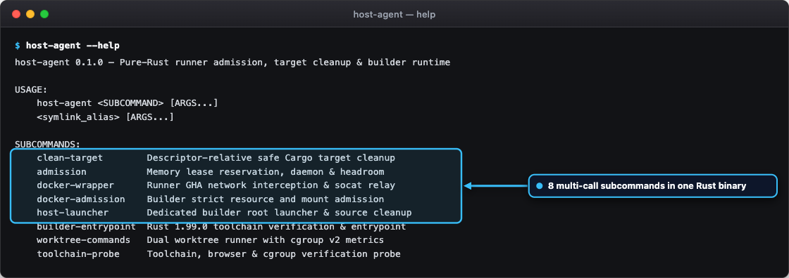
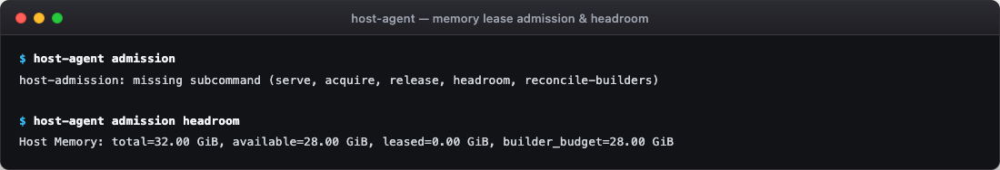
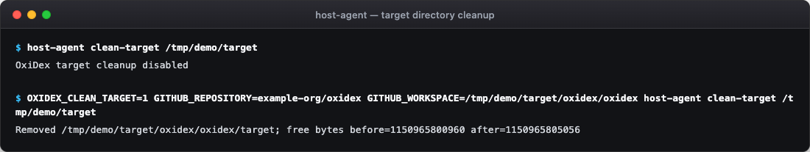
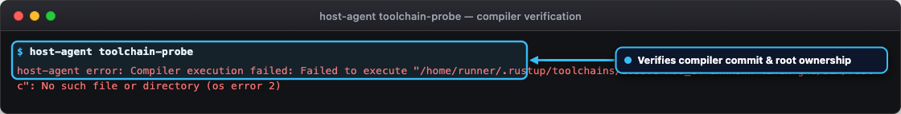
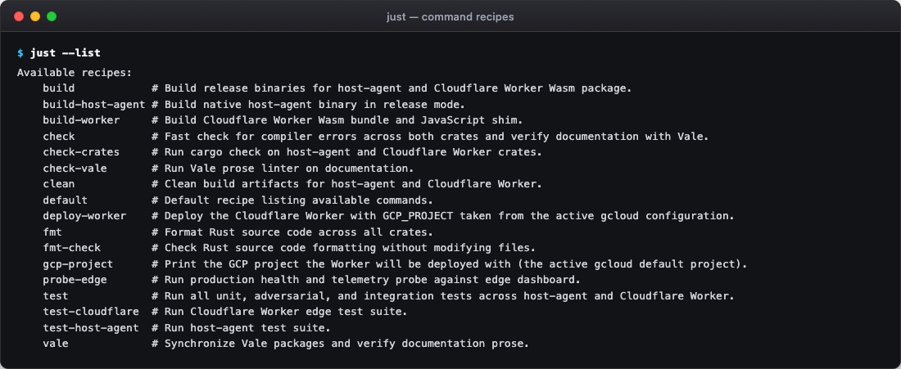
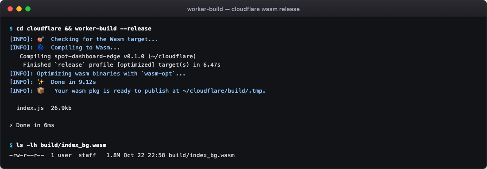
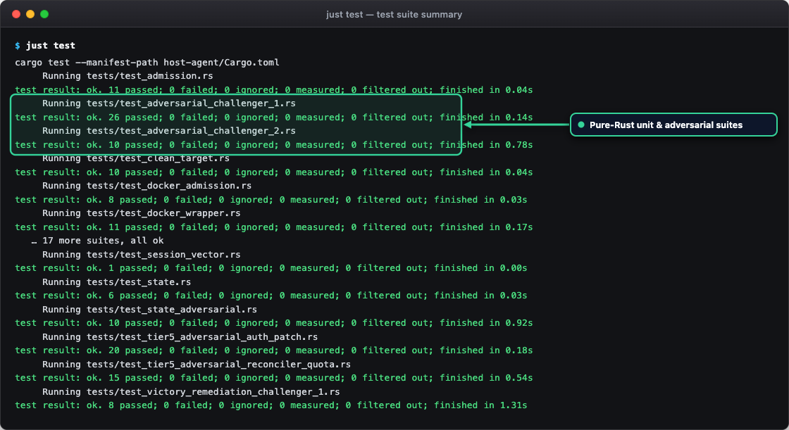
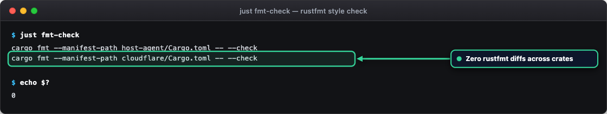

# Command reference

This page documents the command-line entry points across the pure-Rust architecture:
the host agent binary (`host-agent`), development automation recipes (`just`), edge deployment
tools (`wrangler`), and Rust build workflows (`cargo`).

## Subsystems and command summary

The repository features two primary execution environments:

| Environment | Binary or tool | Responsibility |
| --- | --- | --- |
| Runner hosts and dedicated builders | `host-agent` | Pure-Rust daemon handling memory admission, container wrappers, host launching, target cleanup, and toolchain probes. |
| Edge control plane and development | `just`, `cargo`, `wrangler` | Local compilation, test execution, style verification, secret management, and Worker deployment. |

## Host agent subcommands

<div class="carousel" markdown>
<div class="carousel-track" markdown>
<figure class="shot" markdown>

<figcaption markdown>Terminal output of `host-agent --help` showing all subcommands of the multi-call binary.</figcaption>
</figure>
<figure class="shot" markdown>

<figcaption markdown>Terminal output of `host-agent admission` for memory lease reservation and headroom queries.</figcaption>
</figure>
<figure class="shot" markdown>

<figcaption markdown>Terminal output of `host-agent clean-target` performing descriptor-safe directory cleanup without following symlinks.</figcaption>
</figure>
<figure class="shot" markdown>

<figcaption markdown>Terminal output of `host-agent toolchain-probe` checking toolchain binaries and cgroup resource caps.</figcaption>
</figure>
</div>
</div>
<!-- /shot -->

The `host-agent` binary runs on runner hosts and dedicated builder VMs. It provides nine subcommands
and supports execution either directly or through symlink aliases.

```bash
host-agent <subcommand> [arguments...]
```

### `clean-target`

Performs descriptor-relative safe removal of Cargo `target` directories on GitHub Actions runner hosts.
This prevents symlink attacks and directory escapes.

- **Alias**: `gha-runner-clean-target`
- **Usage**: `host-agent clean-target [work-root]`
- **Default root**: `/work`
- **Safety guarantees**:
  - Requires `GITHUB_REPOSITORY` to match `example-org/example-rust-project`.
  - Traverses directory hierarchy using descriptor-relative system calls (`openat`, `unlinkat` with `O_NOFOLLOW`).
  - Limits traversal to a maximum depth of 64 levels and 100,000 directory entries.
  - Refuses execution if target spans across foreign filesystem mount points.
  - Commits directory changes to storage using `fsync` on the parent workspace descriptor.

### `admission`

Manages host-level memory reservations, admission leases, peer heartbeat checks, and headroom queries.

- **Alias**: `gha-host-admission`
- **Usage**: `host-agent admission <action> [options...]`
- **Actions**:
  - `serve`: starts the admission daemon listening on a local UNIX domain socket.
    - `--socket-path <path>`: socket path (default: `/run/gha-admission/socket`).
    - `--config-path <path>`: configuration path (default: `/etc/gha-admission.json`).
    - `--ledger-path <path>`: active lease ledger path (default: `/var/lib/gha-admission/leases.json`).
  - `acquire`: requests a memory lease before starting a runner job or remote build.
    - `--builder`: acquires a dedicated builder lease instead of a runner lease.
    - `--socket-path <path>`: optional UNIX socket override.
    - **Exit codes**: `0` on lease granted, `75` on contention or hold, `1` on error.
  - `release`: releases an active memory lease upon job completion.
    - `--builder`: releases a dedicated builder lease.
    - `--socket-path <path>`: optional UNIX socket override.
  - `headroom`: calculates available allocatable memory headroom based on host hardware, reserved system memory, and active leases.
    - `--config-path <path>`: path to admission configuration.
    - `--ledger-path <path>`: path to lease ledger.
    - `--json`: outputs structured headroom metrics in JSON format.
  - `reconcile-builders`: evaluates running builder processes during host drain.
    - `--global-lock-held`: required flag confirming global drain lock is held by caller.

### `docker-wrapper`

Intercepts Docker container invocations on runner hosts to manage container networking and forward
ports through local `socat` relays.

- **Alias**: `docker` (when runner environment is detected)
- **Usage**: `host-agent docker-wrapper [docker-args...]`
- **Environment variables**:
  - `GHA_REAL_DOCKER`: path to underlying Docker binary (default: `/usr/bin/docker`).
  - `GHA_DOCKER_WRAPPER_STATE_DIR`: runtime directory for relay state (default: `/run/gha-docker-wrapper`).
  - `GHA_DOCKER_WRAPPER_HANDSHAKE_TIMEOUT`: socket connection timeout in seconds (default: `15.0`).
- **Behavior**: inspects Docker subcommands (`run`, `create`, `network create`, `stop`, `rm`), configures
  isolated container networks, and relays ports without exposing host ports.

### `docker-admission`

Enforces strict hardware resource bounds and security policies before launching Docker build containers
on dedicated builders.

- **Alias**: `docker` (when builder environment is detected)
- **Usage**: `host-agent docker-admission run [docker-args...]`
- **Enforced policies**:
  - Root privilege required unless `EXAMPLE_RUST_PROJECT_ALLOW_UNPRIVILEGED=1` is set for testing.
  - Project name must match alphanumeric naming rules (`^[a-zA-Z0-9][a-zA-Z0-9_-]{0,63}$`).
  - Fixed resource limits: exactly 16 vCPUs (`--cpus=16`), 28 GiB RAM (`--memory=28g`), and zero swap (`--memory-swap=28g`).
  - Unprivileged container execution: runs as UID 1001, GID 1001 (`--user 1001:1001`).
  - Forbids `--privileged`, `--cap-add`, host networking, and mounting the Docker daemon socket.
  - Restricts volume mounts to `/src`, `/target`, and `/cargo` under `/mnt/runner-data/remote-build`.

### `host-launcher`

Root launcher on dedicated builders that validates build commands, prepares isolated project directories,
executes builds, and securely cleans source files.

- **Alias**: `example-rust-project-remote-build`
- **Usage**:
  - `host-agent host-launcher <project> prepare`
  - `host-agent host-launcher <project> cleanup`
  - `host-agent host-launcher <project> <command> [args...]`
- **Allowed build commands**: `cargo`, `rustc`, `rustfmt`, `clippy-driver`, `just`, `uv`, `python3`, `cbindgen`.
- **Directory layout**: prepares `/mnt/runner-data/remote-build/sources/<project>` and target output
  directories with permissions `0710` owned by `root:1001`.
- **Cleanup**: recursively empties project source directories while keeping Cargo caches intact.

### `builder-entrypoint`

Executes inside dedicated builder containers to verify compiler toolchains and environment variables
before running compilation tasks.

- **Alias**: `example-rust-project-build-entrypoint`
- **Usage**: `host-agent builder-entrypoint [command...]`
- **Checks**: verifies Rust 1.99.0 toolchain installation, PATH settings, and user UID/GID 1001 before executing.

### `worktree-commands`

Coordinates concurrent dual worktree compilations on dedicated builders and collects cgroup v2 resource
metrics.

- **Alias**: `example-rust-project-worktree-commands`
- **Usage**: `host-agent worktree-commands <project> <worktree-id> <command...>`
- **Telemetry**: measures peak memory consumption, throttled CPU periods, and compilation durations.

### `toolchain-probe`

Validates that compiler toolchains, browser binaries, and cgroup v2 controllers meet specification.

- **Alias**: `example-rust-project-toolchain-probe`
- **Usage**: `host-agent toolchain-probe [options...]`
- **Verification scope**:
  - Rust 1.99.0 compiler, clippy, and rustfmt binaries.
  - Cross-compilation targets (Linux musl and macOS Darwin stubs).
  - Playwright Chromium browser binary at `/opt/playwright-browsers`.
  - cgroup v2 memory controller and swap limits.

### `telemetry`

Collects cgroup v2 working-set memory, CPU load, disk I/O, admission leases, and workflow-correlated container logs; serves an OpenMetrics and JSON HTTP endpoint for the [GCP Ops Agent](https://cloud.google.com/stackdriver/docs/solutions/agents/ops-agent); and dynamically scales GitHub Actions runner slots on underutilized hosts.

- **Aliases**: `gha-host-telemetry`, `host-telemetry`
- **Usage**: `host-agent telemetry <action> [options...]`
- **Actions**:
  - `collect`: samples `/proc`, `/sys/fs/cgroup`, `/var/lib/gha-admission/leases.json`, and active Docker runner containers once and prints structured JSON or OpenMetrics output.
    - `--instances-dir <path>`: path to runner instance directories (default: `/mnt/runner-data/instances`).
    - `--log-output <path>`: appends structured JSONL telemetry and correlated log entries to the specified file.
    - `--prometheus`: outputs OpenMetrics / Prometheus exposition text instead of JSON.
  - `serve`: runs the lightweight telemetry HTTP server (`GET /metrics`, `GET /status`) and appends structured JSONL log lines for `google-cloud-ops-agent`.
    - `--listen <host:port>`: bind address (default: `127.0.0.1:9464`).
    - `--instances-dir <path>`: path to runner instance directories (default: `/mnt/runner-data/instances`).
    - `--log-output <path>`: structured JSONL output path (default: `/var/log/gha-host-telemetry.jsonl`).
    - `--edge-url <url>`: optional edge ingestion endpoint (`POST /api/observability/ingest`).
    - `--bearer-token <token>`: bearer token for authenticated edge telemetry ingestion.
  - `scale-runners`: evaluates observed peak working-set RAM and CPU usage per runner and recommends or launches additional runner containers without interrupting active jobs.
    - `--target-runners <n>`: explicit target runner slot count override (defaults to the dynamic density recommendation).
    - `--registration-token <token>`: registration token for GitHub Actions used when starting new runner containers.
    - `--dry-run`: prints the recommended slot transition without starting new containers.

## Just recipes

<div class="carousel" markdown>
<div class="carousel-track" markdown>
<figure class="shot" markdown>

<figcaption markdown>Output of `just --list` showing every task runner recipe in the root `justfile`.</figcaption>
</figure>
<figure class="shot" markdown>

<figcaption markdown>Output of `just gcp-project` and `just deploy-worker` passing the active `gcloud` project to Wrangler.</figcaption>
</figure>
</div>
</div>
<!-- /shot -->

Development and verification tasks are managed through `just` recipes defined in `justfile`.

```bash
just <recipe> [arguments...]
```

| Recipe | Description |
| --- | --- |
| `just test` | Runs all unit, adversarial, and integration tests across `host-agent` and `cloudflare` workspaces. |
| `just build` | Compiles the `host-agent` binary in release mode and builds the Cloudflare Worker bundle. |
| `just check` | Runs `cargo check` on both crates and verifies documentation with Vale. |
| `just clean` | Removes build artifacts, cargo target directories, and temporary test outputs. |
| `just fmt` | Formats all Rust code across the repository using `cargo fmt`. |
| `just fmt-check` | Verifies code formatting across all workspaces without modifying files. |
| `just vale` | Runs the Vale prose linter against all Markdown documentation and agent rules. |
| `just probe-edge` | Probes the Cloudflare Worker edge dashboard health and overview endpoints. |

## Wrangler commands

<figure class="shot" markdown>

<figcaption markdown>Output of `cd cloudflare && worker-build --release` showing the compiled Wasm bundle size (`2.12 MiB`, well under the `3 MiB` limit).</figcaption>
</figure>
<!-- /shot -->

The Cloudflare Worker edge control plane is managed using the Wrangler command-line tool from the
`cloudflare/` directory.

### Local development

Starts a local edge development server with in-memory Workers KV emulation:

```bash
cd cloudflare
wrangler dev
```

### Edge deployment

Deploys the Worker and Cron Triggers (`*/5 * * * *`) to Cloudflare edge. The recipe reads the GCP project
from the active gcloud configuration and passes it as the `GCP_PROJECT` variable:

```bash
just gcp-project    # Shows the project that the deploy uses
just deploy-worker  # Runs wrangler deploy --var GCP_PROJECT:<project>
```

A plain `wrangler deploy` clears `GCP_PROJECT`, and the dashboard header then shows `not configured`.

### Secret management

Stores encrypted secrets securely in Cloudflare secret storage:

```bash
cd cloudflare
wrangler secret put GCP_SERVICE_ACCOUNT_KEY
wrangler secret put SESSION_SECRET
wrangler secret put GITHUB_OAUTH_CLIENT_SECRET
```

### Inspect edge state

Reads the fleet and autoscaler state JSON directly from Workers KV:

```bash
cd cloudflare
wrangler kv key get --binding=SPOT_KV "dashboard:state"
```

## Cargo verification commands

<div class="carousel" markdown>
<div class="carousel-track" markdown>
<figure class="shot" markdown>

<figcaption markdown>Condensed output of `just test` running all `host-agent` and `cloudflare` integration and adversarial test suites.</figcaption>
</figure>
<figure class="shot" markdown>

<figcaption markdown>Output of `just fmt-check` verifying zero `rustfmt` diffs across both Rust crates.</figcaption>
</figure>
</div>
</div>
<!-- /shot -->

Cargo provides direct access to test, lint, and build targets:

```bash
# Test host agent workspace
cargo test --manifest-path host-agent/Cargo.toml

# Test Cloudflare Worker workspace
cargo test --manifest-path cloudflare/Cargo.toml

# Run compiler checks
cargo check --manifest-path host-agent/Cargo.toml
cargo check --manifest-path cloudflare/Cargo.toml

# Run clippy checks
cargo clippy --manifest-path host-agent/Cargo.toml --all-targets -- -D warnings
cargo clippy --manifest-path cloudflare/Cargo.toml --all-targets -- -D warnings
```
