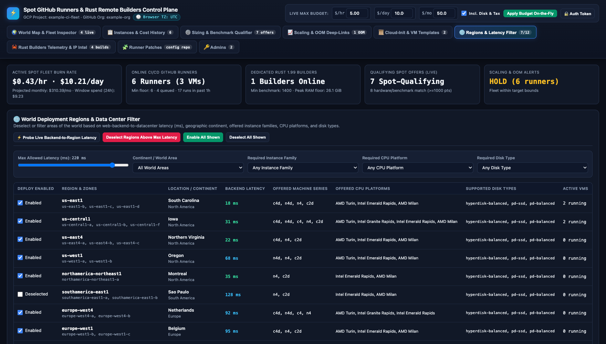
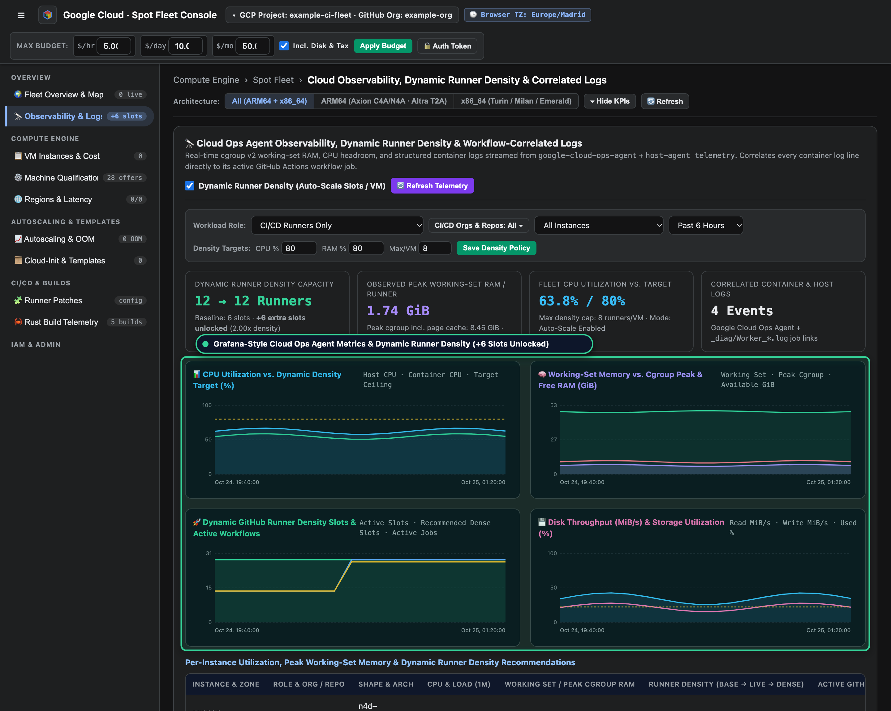
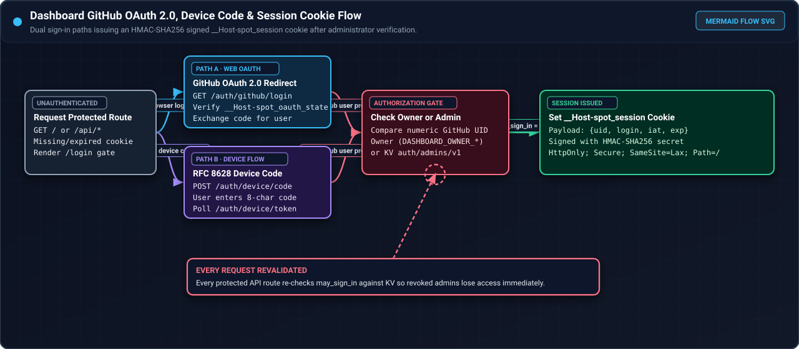
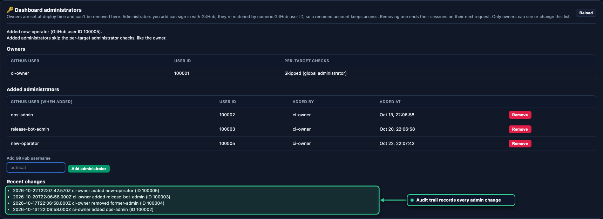
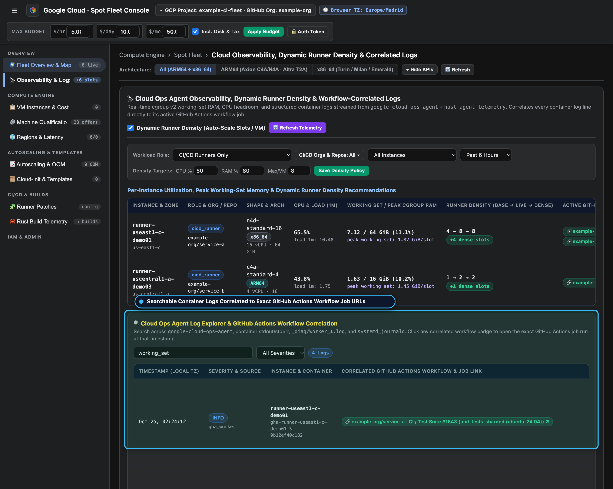
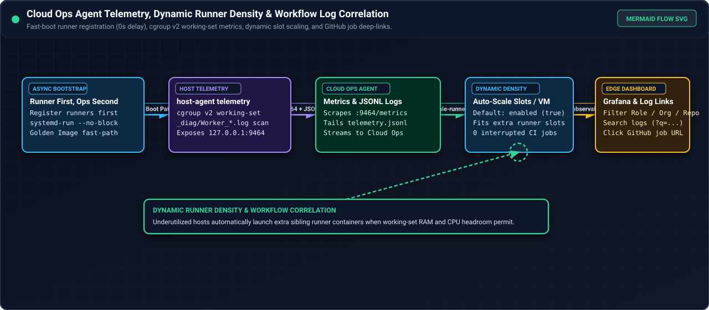
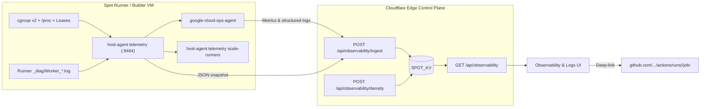

# Dashboard

The dashboard is a web user interface (UI) for the Spot runner fleet and dedicated Rust builders. It combines
fleet telemetry (cost, capacity, qualifying Spot offers, scaling signals, build records) with controls for
policy, templates, regions, administrators, and runner patches.

The dashboard runs as a pure-Rust app compiled to WebAssembly inside the Cloudflare Worker edge control
plane (`cloudflare/src/ui.rs`). It is served directly from edge memory on `https://spot.swacktech.com` with
sub-15 ms latency, backed by Cloudflare Workers KV (`SPOT_KV`). Zero control VMs are required.

!!! info "Screenshots use example data"
    Every screenshot and flowchart on this site uses made-up data (`example-ci-fleet`, `example-org`, example
    hosts, RFC 5737 IP addresses, and example templates), not a live deployment. Each figure includes a
    **Reference** footer explaining what it shows. Click any screenshot or SVG flowchart to open the full-screen
    viewer on the same page: left-click an area to zoom in, use the bottom slider or **Reset 100%** button to
    adjust zoom, and press the Left/Right arrow keys (or click the side arrows) to cycle through every image on
    the current page.

## Pages and tabs

<div class="carousel" markdown>
<div class="carousel-track" markdown>
<figure class="shot" markdown>

<figcaption markdown>Tab 1 (World Map and Fleet Inspector): global region pins, active VMs per region, all-in Spot rates, and SSH commands.</figcaption>
</figure>
<figure class="shot" markdown>

<figcaption markdown>Tab 2 (Instances and Cost History): sortable inventory of running and deleted Spot VMs with window spend and lifecycle triggers.</figcaption>
</figure>
<figure class="shot" markdown>

<figcaption markdown>Tab 3 (Sizing and Benchmark Qualifier): per-role vCPU, RAM, benchmark floors, disk profiles, and qualifying Spot offer tables.</figcaption>
</figure>
<figure class="shot" markdown>

<figcaption markdown>Tab 4 (Scaling and OOM Deep-Links): autoscaling policy thresholds, live scenario evaluator, and GitHub Actions OOM step/line deep-links.</figcaption>
</figure>
<figure class="shot" markdown>

<figcaption markdown>Tab 5 (`cloud-init` and VM Templates): interactive YAML editor, boot-stage visualizer, and saved VM shape templates.</figcaption>
</figure>
<figure class="shot" markdown>

<figcaption markdown>Tab 6 (Regions and Latency Filter): per-region enablement toggles filtered by backend latency, continent, machine series, and CPU platform.</figcaption>
</figure>
<figure class="shot" markdown>

<figcaption markdown>Tab 7 (Rust Builders Telemetry and IP Intel): remote build durations, crate cache hit rates, peak container RAM, CPU points, and network badges.</figcaption>
</figure>
<figure class="shot" markdown>

<figcaption markdown>Tab 8 (Runner Patches): `spot-runner-patch-v1` manifest editor, security validator, effective JSON view, and pull request creator.</figcaption>
</figure>
<figure class="shot" markdown>

<figcaption markdown>Tab 9 (Observability and Logs): displays GCP Ops Agent and `host-agent` Grafana-style metrics, multi-select organization and repository filters, and Dynamic Runner Density scaling.</figcaption>
</figure>
<figure class="shot" markdown>

<figcaption markdown>Tab 10 (Admins): owner-only dashboard administrator allowlist keyed by numeric GitHub user ID with an audit history table.</figcaption>
</figure>
</div>
</div>
<!-- /shot -->

The dashboard is a single-page app with multiple functional tabs. The **Admins** tab appears only for
a signed-in owner. The header features summary metrics (fleet burn rate, online runners, online builders,
qualifying offers, and scaling alerts) and a daily budget tracking bar.

| Tab | What it does |
| --- | --- |
| World Map and Fleet Inspector | Shows data center pins by region. You can inspect active runners and view candidate regional configurations. |
| Instances and Cost History | Lists active and deleted instances with sorting, search, time window filters, and total price columns. |
| Sizing and Benchmark Qualifier | Configures per-runner vCPU and RAM, minimum counts, CPU benchmark floors, disk types, and templates for runners and Rust builders. The qualification matrix displays candidate Spot offers (`/api/qualify` and `/api/profile/{role}` return static placeholders with hard-coded counts and empty lists). |
| Scaling and OOM Deep-Links | Configures autoscaling triggers and budget caps. Lists out-of-memory (OOM) events with links to relevant workflow runs. |
| `Cloud-Init` and VM templates | The `cloud-init` parse endpoint (`POST /api/cloud-init/parse`) is a stub that reports line count and format (`cloud-config` or shell script) with no real validation, and saves VM templates from active configurations. |
| Regions and Latency Filter | Configures regions by latency, continent, machine families, CPU platforms, and disk types. |
| Rust Builders Telemetry and IP Intel | Records and summarizes remote build runs: cache hits, peak RAM, CPU time, and builder statistics. |
| Runner Patches | Edits and validates patch manifests in the configuration repository. See [The patch console](#the-patch-console). |
| Observability and Logs | Displays Grafana-style time-series charts from the GCP Ops Agent and `host-agent telemetry`, configures Dynamic Runner Density scaling (`enable_dynamic_runner_density`), and provides a searchable log explorer with deep-links to GitHub Actions workflow jobs. See [Observability, dynamic runner density, and log explorer](#observability-dynamic-runner-density-and-log-explorer). |
| Admins | Owner only. Manages added administrators. See [Manage administrators](#manage-administrators). |

!!! note "The dashboard preserves safety gates"
    The dashboard operations for instance deletion and regional scaling operate as safety-gated execution plan
    previews. They update the dashboard telemetry state and return execution plans without mutating live cloud
    resources. Live fleet provisioning is orchestrated by the autonomous scheduled edge reconciler.

## Local development with wrangler

<div class="carousel" markdown>
<div class="carousel-track" markdown>
<figure class="shot" markdown>

<figcaption markdown>Top navigation header showing the configured GCP project, GitHub organization, browser time zone badge, and live budget controls.</figcaption>
</figure>
<figure class="shot" markdown>

<figcaption markdown>Five top-level KPI cards summarizing active Spot burn rate, online CI/CD runners, dedicated Rust builders, qualifying Spot offers, and scaling state.</figcaption>
</figure>
</div>
</div>
<!-- /shot -->

To run and test the dashboard locally, use the Cloudflare Workers development command-line tool in the `cloudflare/` directory:

```bash
cd cloudflare
wrangler dev
```

The local development server compiles the Rust Worker to WebAssembly and serves it locally at `http://localhost:8787`.
Environment variables and bindings are configured in `cloudflare/wrangler.toml`.

## Authentication and sign-in

<div class="carousel" markdown>
<div class="carousel-track" markdown>
<figure class="shot" markdown>

<figcaption markdown>Authentication flowchart comparing the GitHub Web OAuth 2.0 redirect path and RFC 8628 Device Code path before issuing the HMAC-SHA256 `__Host-spot_session` cookie.</figcaption>
</figure>
<figure class="shot" markdown>

<figcaption markdown>Sign-in page presented to unauthenticated visitors with buttons for GitHub Web OAuth 2.0 and GitHub Device Code authentication.</figcaption>
</figure>
<figure class="shot" markdown>

<figcaption markdown>Device Code prompt displaying a one-time user code and verification link while polling for authorization completion.</figcaption>
</figure>
</div>
</div>
<!-- /shot -->

When `GITHUB_OAUTH_CLIENT_ID` is set, the dashboard signs users in using GitHub OAuth 2.0:

- **Flows**: the web flow uses OAuth 2.0 authorization code flow with Proof Key for Code Exchange (PKCE, `S256`).
  The sign-in page also offers the device flow (RFC 8628).
- **Identity validation**: the owner is pinned by login and numeric ID fixed in code (for example, `example-owner:100001`). The owner
  can grant administrator privileges to other users on the Admins page.
- **Per-target permission checks**: non-global administrators must possess administrator rights on all controlled targets.
  Global administrators (`DASHBOARD_GLOBAL_ADMINS`) skip per-target checks.
- **Session cookie**: the session cookie `__Host-spot_session` is `HttpOnly`, `Secure`, and `SameSite=Lax`. It carries
  an HMAC-SHA256 signature (`spot-dashboard/session/v1`) using `SESSION_SECRET`. Sessions last 12 hours by default.
- **Bulk revocation**: setting `SESSION_NOT_BEFORE` to a Unix timestamp rejects all sessions issued prior to that cutoff.

## Manage administrators

<div class="carousel" markdown>
<div class="carousel-track" markdown>
<figure class="shot" markdown>

<figcaption markdown>Dashboard Administrators panel listing configured owners, added administrators by numeric GitHub UID, and the change history log.</figcaption>
</figure>
<figure class="shot" markdown>

<figcaption markdown>Dashboard Administrators panel immediately after adding `new-operator`; it shows the updated allowlist and the audit log entry.</figcaption>
</figure>
</div>
</div>
<!-- /shot -->

The **Admins** tab and `/api/admins` endpoints allow the owner to manage dashboard administrators:

| Route | Purpose |
| --- | --- |
| `GET /api/admins` | Lists the owners, added administrators, and recent administrative audit records. |
| `POST /api/admins/add` | Adds a new administrator by GitHub login (`{"login": "<username>", "confirm": true}`). |
| `POST /api/admins/remove` | Removes an administrator by numeric user ID (`{"uid": <id>, "confirm": true}`). |

- Owner accounts are hardcoded and cannot be added or removed.
- At most 50 administrators can be added.
- The dashboard verifies the GitHub user profile and records the numeric user ID upon addition.
- Administrative state is persisted atomically in `SPOT_KV` key `dashboard:state`.

## The patch console

<div class="carousel" markdown>
<div class="carousel-track" markdown>
<figure class="shot" markdown>

<figcaption markdown>Runner Patches console displaying the configuration repository branch, commit SHA, and manifest file list.</figcaption>
</figure>
<figure class="shot" markdown>

<figcaption markdown>Runner Patches console after saving an edit as a pull request on the configuration repository.</figcaption>
</figure>
</div>
</div>
<!-- /shot -->

The **Runner Patches** tab edits [runner patch](runner-patches.md) manifests in the configuration repository (`CONFIG_REPO`, for example `example-org/spot-runners-config`),
validates schemas, previews rollout classifications, and opens pull requests. Routes under `/api/patch-console/*`
are also available under the alias `/api/patches/*`:

| Route | Purpose |
| --- | --- |
| `GET /api/patch-console/bootstrap` | Lists `defaults.yaml` and repository manifests in the configuration repository. Aliased as `/api/patches`. |
| `GET /api/patch-console/manifest` | Returns manifest content, base Git SHA, blob SHA, and canonical patch digest. Aliased as `/api/patches/manifest`. |
| `POST /api/patch-console/validate` | Validates manifest YAML against hardware sizing and permitted machine types. Aliased as `/api/patches/validate`. |
| `POST /api/patch-console/preview` | Classifies runner hosts into `noop`, `hot_patch`, `recreate_containers`, or `replace_vm`. Aliased as `/api/patches/preview`. |
| `POST /api/patch-console/save` | Opens a pull request on branch `spot-dashboard/<slug>-<digest>`. Aliased as `/api/patches/save`. |

Direct live hot-patching (`POST /api/patches/hot-patch`) is deprecated. The bootstrap endpoint reports `executor.available=false` with the reason that the serverless edge reconciler rolls out manifest updates automatically on the next 5-minute cron tick. Saving a patch creates an idempotent branch and opens a pull request against the configuration repository (`CONFIG_REPO`, for example `example-org/spot-runners-config`).
The console enforces hardware sizing constraints (minimum 16 vCPUs, 32 GiB RAM, 2 runner containers, and queue threshold >= 20).

## Observability, dynamic runner density, and log explorer

<div class="carousel" markdown>
<div class="carousel-track" markdown>
<figure class="shot" markdown>

<figcaption markdown>Observability and Logs tab displaying the Workload Role selector, conditional multi-select Organization and Repository dropdown, Dynamic Runner Density opt-out toggle, and four Grafana-style SVG time-series charts.</figcaption>
</figure>
<figure class="shot" markdown>

<figcaption markdown>Searchable Log Explorer correlating container and host log lines with the active GitHub Actions workflow run and job URL executing on that runner slot at that timestamp.</figcaption>
</figure>
<figure class="shot" markdown>

<figcaption markdown>Architecture flowchart showing how `google-cloud-ops-agent` and `host-agent telemetry` stream cgroup v2 metrics and workflow-correlated logs to the edge control plane to unlock extra runner slots on underutilized Spot VMs.</figcaption>
</figure>
</div>
</div>
<!-- /shot -->

The **Observability & Logs** tab (`/?tab=observability`) exposes real-time host, cgroup v2 container, and admission lease telemetry collected by `host-agent telemetry` (`127.0.0.1:9464`) alongside the [GCP Ops Agent](https://cloud.google.com/stackdriver/docs/solutions/agents/ops-agent).



### Role and multi-select organization and repository filters

The filter bar at the top of the **Observability & Logs** tab narrows both the Grafana-style time-series charts and the log explorer:

- **Workload Role**: filters telemetry to **All Roles (CI/CD + Rust Builders)** (`all`), **CI/CD Runners Only** (`cicd_runner`), or **Rust Builders Only** (`rust_builder`).
- **Organizations & Repositories (Multi-Select)**: when **All Roles** or **CI/CD Runners Only** is selected, the multi-select dropdown activates so you can select any combination of GitHub organizations (`example-org`) and repositories (`example-org/service-a`, `example-org/service-b`). Selecting **Rust Builders Only** hides the organization and repository selector and scopes charts to dedicated `builder-*` instances.
- **Instance, Log Source, Severity, and Window**: filters down to a single VM (`runner-useast1-c-demo01`), log subsystem (`gha_worker`, `ops_agent`, `admission`, `kernel`), minimum severity (`INFO`, `WARN`, `ERROR`), and time window (`1h` to `24h`).

### Grafana-style time-series panels and dynamic runner density

The dashboard renders four synchronized SVG time-series panels from the ingested Ops Agent and `host-agent` metrics:

1. **CPU Utilization vs Target Headroom (%)**: plots host CPU utilization, container cgroup CPU usage, and the target ceiling (`target_cpu_percent`, default `80%`).
2. **Memory Working Set vs Cgroup Peak (GiB)**: compares actual non-reclaimable working-set memory (`memory.current - inactive_file`) against total cgroup peak memory and available host RAM.
3. **Runner Slot Density (`Baseline -> Active -> Recommended`)**: tracks baseline provisioned runner containers against dynamically scaled runner slots and active GitHub Actions workflows.
4. **Disk I/O Throughput (`MiB/s`) & Space Utilization (%)**: plots read and write throughput alongside `/mnt/runner-data` capacity.

The **Dynamic Runner Density** banner (`enable_dynamic_runner_density: true` by default) allows operators to adjust target CPU utilization, target memory utilization, and the maximum runner slots per VM—or opt out at any time using the checkbox toggle (`POST /api/observability/density`).

### Workflow-correlated log explorer

Every log entry ingested from runner containers (`_diag/Worker_*.log`), `host-agent admission`, `google-cloud-ops-agent`, and the kernel journal is enriched with the active container's workflow metadata (`organization`, `repository`, `workflow_name`, `job_name`, `run_id`, and `job_id`).

- Enter a free-text query (`q=`) in the **Search Logs** input to filter by job name, container ID, runner slot, cgroup metric, or error text.
- Each correlated log row renders a clickable badge linking directly to `https://github.com/<owner>/<repo>/actions/runs/<run_id>/job/<job_id>` for the workflow job that was executing on that runner slot at that exact timestamp.

| Route | Purpose |
| --- | --- |
| `GET /api/observability` | Queries filtered time-series metrics, per-instance density recommendations, and workflow-correlated logs (`role`, `orgs`, `repos`, `instance`, `source`, `severity`, `q`, `window_hours`). |
| `POST /api/observability/ingest` | Ingests a host telemetry snapshot and correlated log batch from `host-agent telemetry`. |
| `POST /api/observability/density` | Updates Dynamic Runner Density policy (`enable_dynamic_runner_density`, `target_cpu_percent`, `target_memory_percent`, `max_runners_per_instance`). |

For upstream agent configuration details, see the [GCP Ops Agent overview](https://cloud.google.com/stackdriver/docs/solutions/agents/ops-agent), [Ops Agent configuration reference](https://cloud.google.com/stackdriver/docs/solutions/agents/ops-agent/configuration), and [Ops Agent Prometheus receiver documentation](https://cloud.google.com/stackdriver/docs/solutions/agents/ops-agent/third-party/prometheus).

## Edge state and quota conservation

The dashboard uses an in-isolate memory cache to conserve Cloudflare KV quota:

- **Consolidated document**: all state is stored under a single key `dashboard:state` in `SPOT_KV`.
- **In-isolate memory cache**: read endpoints (`/api/overview`, `/api/health`, `/api/scaling`) read from a thread-local
  in-memory cache with a `60s` TTL. Steady-state reads perform 0 KV writes and at most 1 KV read per minute per isolate.
- **GCP token cache**: service account OAuth 2.0 tokens are cached in memory for `55m` with zero KV operations.
- **Diff-gated reconciliation**: the 5-minute scheduled reconciler skips KV writes on unchanged ticks (<50 writes/day).
