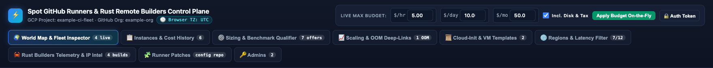
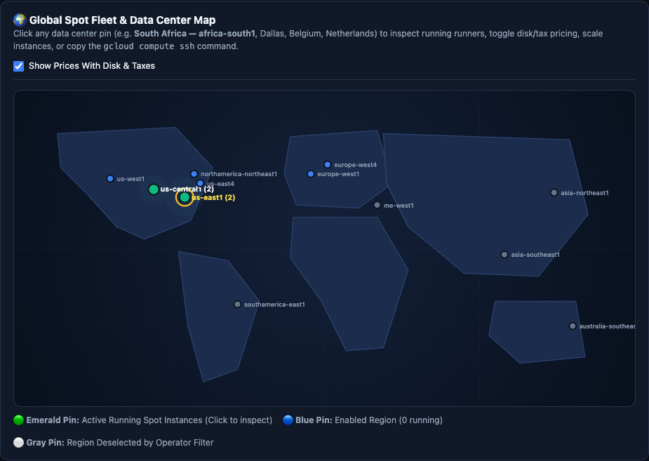
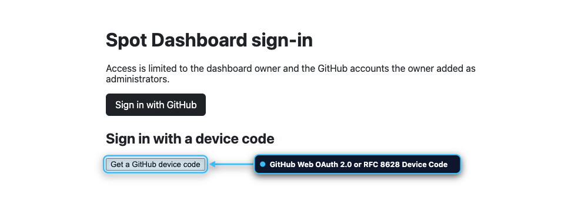
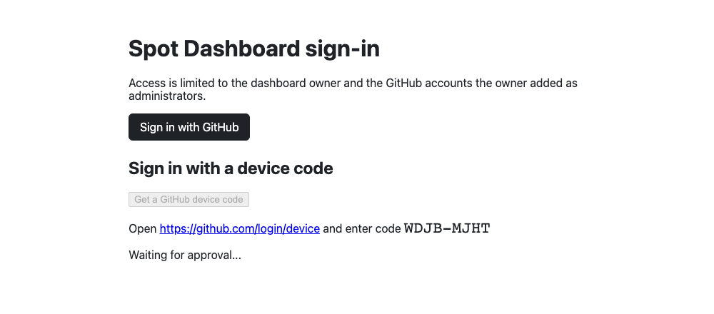
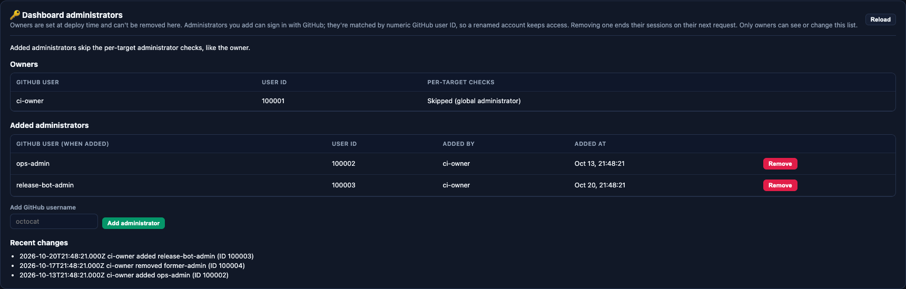
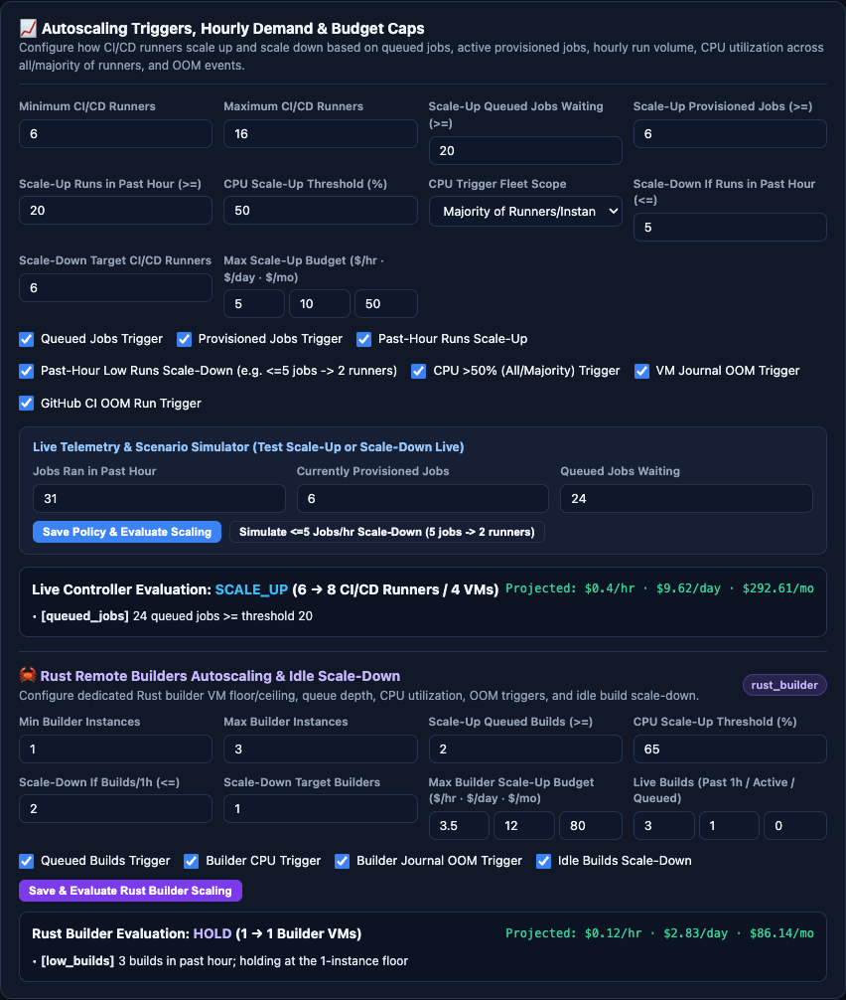
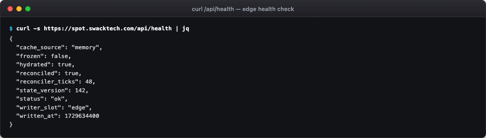
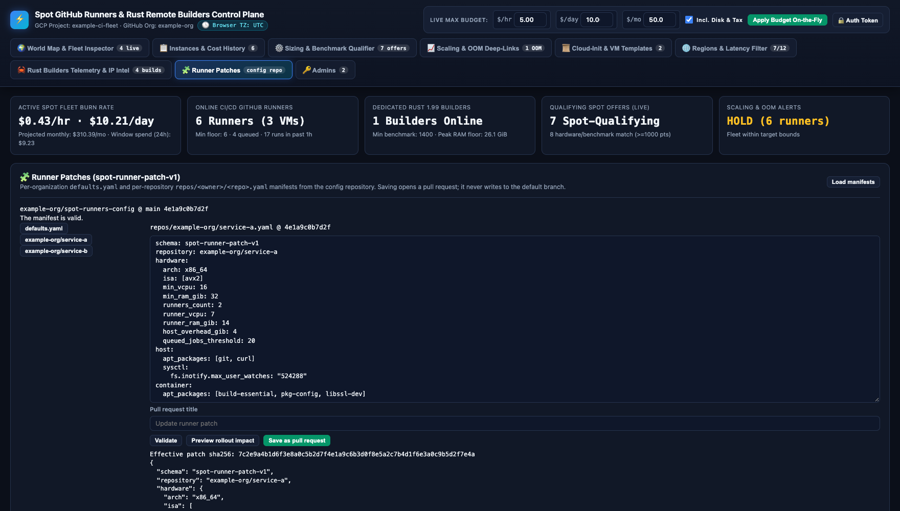
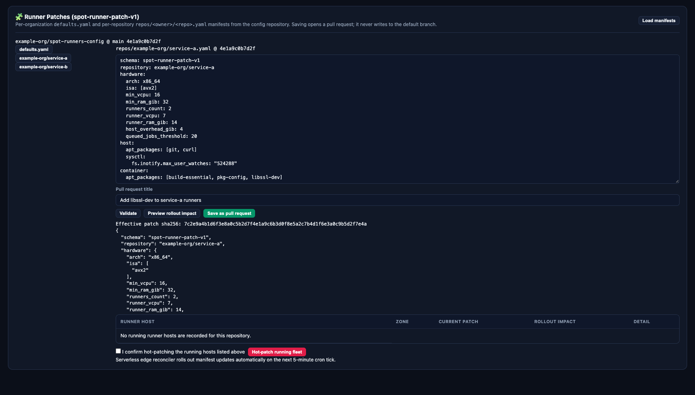
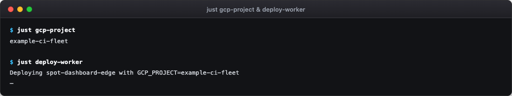

# Serverless edge dashboard

The web dashboard and runner fleet controller run as a serverless Worker on Cloudflare's edge at
`https://spot.swacktech.com`. Compiled to `wasm32-unknown-unknown` from Rust by using `workers-rs`, the
Worker serves the dashboard web interface directly from memory in under 15 milliseconds, authenticates
operators through GitHub OAuth 2.0, manages runner configuration patches, and reconciles the GCP (Google's
cloud platform) Spot runner fleet by using scheduled cron triggers.

The architecture operates within Cloudflare's Free Tier with zero origin virtual machines (VMs), zero
Cloudflare Tunnels, and zero external background worker processes.

## Architecture

| Component | Location | Role |
| --- | --- | --- |
| Serverless Worker | `cloudflare/` (`wasm32-unknown-unknown`) | Serves the web user interface and REST endpoints, handles session authentication, validates runner patch manifests, and executes scheduled fleet reconciliation. |
| Workers KV | Binding `SPOT_KV` | Stores the single consolidated document `dashboard:state` (`spot-dashboard-snapshot-v1`), holding the precomputed overview, fleet telemetry, administrators, and scaling configuration. |
| In-isolate cache | Worker isolate memory (`thread_local!`) | Caches the parsed state document with a 60-second time to live (TTL) and the GCP OAuth 2.0 access token with a 55-minute TTL, eliminating repetitive KV operations. |
| GitHub OAuth 2.0 | `https://github.com/login/oauth/` | Provides authentication through authorization-code flow with PKCE for browsers and Device Authorization flow for command-line workstations. |
| GCP Compute Engine | Compute Engine REST API | Provisions, monitors, and cleans up Spot runner hosts across configured regions. |
| Configuration repository | `CONFIG_REPO` (for example `example-org/spot-runners-config`) | Stores runner patch manifests (`defaults.yaml` and repository overrides under `repos/<owner>/<repo>.yaml`). |

The serverless Worker eliminates the legacy control plane components:

<!-- vale Google.WordList = NO -->
- Decommissions Python control VMs, eliminating always-on compute costs and VM maintenance.
- Removes `cloudflared` tunnels, Cloudflare Access service tokens, and origin health polling loops.
- Replaces Cloud Run watchdog jobs and Cloud Storage state locks with native Worker cron triggers and diff-gated KV synchronization.
- Replaces the JavaScript proxy worker (`cloudflare/worker.js`) with compiled WebAssembly.
<!-- vale Google.WordList = YES -->

## Edge user interface serving

<div class="carousel" markdown>
<div class="carousel-track" markdown>
<figure class="shot" markdown>

<figcaption markdown>The Worker renders the GCP project from the `GCP_PROJECT` variable into the header.</figcaption>
</figure>
<figure class="shot" markdown>

<figcaption markdown>The world map is drawn in the browser from the overview data.</figcaption>
</figure>
</div>
</div>
<!-- /shot -->

The dashboard single-page web app is embedded directly into Worker memory at compile time in `cloudflare/src/ui.rs`.

- **Sub-15 ms response latency**: requests for `GET /` and `GET /index.html` respond directly from Worker memory in under 15 milliseconds, requiring zero origin round trips, or network fetches.
- **Login gate**: unauthenticated visitors receive a responsive sign-in gate that offers both browser OAuth 2.0 login and command-line device code verification.
- **Request payload caps**: the Worker enforces a 16 KiB limit on authentication endpoints under `/auth/` and `/api/auth/`, and a 256 KiB limit on standard dashboard endpoints. Requests exceeding these caps receive HTTP 413 (`payload_too_large`).
- **Path normalization**: the request router normalizes percent-encoded paths, resolves dot segments, and collapses slashes before evaluation. Any request targeting `/api/control*` receives HTTP 404.

## Sign-in

<div class="carousel" markdown>
<div class="carousel-track" markdown>
<figure class="shot" markdown>

<figcaption markdown>Unauthenticated requests get the sign-in page.</figcaption>
</figure>
<figure class="shot" markdown>

<figcaption markdown>The device flow for terminals and shared machines.</figcaption>
</figure>
<figure class="shot" markdown>

<figcaption markdown>Owners manage added administrators.</figcaption>
</figure>
</div>
</div>
<!-- /shot -->

The dashboard provides authentication through GitHub OAuth 2.0. Sign-in succeeds only when the user meets these criteria:

- The user is the owner, pinned by immutable administrator login and numeric user ID fixed in code (such as `example-owner:100001`), or an administrator added by the owner. Added administrators are tracked by immutable numeric user ID.
- The user is a global administrator or holds administrator permissions on every controlled repository target.
- The Worker can read the configuration repository. If repository listing fails, sign-in fails closed with HTTP 403.

### Session tokens and security

The session cookie `__Host-spot_session` uses purpose-separated HMAC-SHA256 signatures:

- The signature uses the purpose label `spot-dashboard/session/v1` to prevent cross-context token reuse.
- The `__Host-` prefix requires browsers to enforce `Secure`, `Path=/`, and host-only domain isolation.
- The sign-in state cookie `__Host-spot_oauth_state` secures the authorization code flow against cross-site request forgery.
- Setting `SESSION_NOT_BEFORE` in the Worker environment rejects any session issued prior to that Unix timestamp, providing instant global session revocation.

### Supported authentication flows

The Worker supports two authentication workflows:

1. **Browser web flow with PKCE**:
   - `/auth/github/login` generates an encrypted state parameter with a PKCE code verifier and redirects to GitHub.
   - `/auth/github/callback` validates the state and code verifier, exchanges the code for an access token, confirms administrator authorization, and issues the signed session cookie.
2. **Device authorization flow**:
   - `/auth/device/code` issues a user verification code and URI for headless terminal workstations.
   - `/auth/device/token` and `/auth/device/poll` poll for completion with rate limiting and exponential backoff (`slow_down`).

### Dashboard administrators

The owner manages administrators on the **Admins** tab and through `/api/admins`:

| Route | Purpose |
| --- | --- |
| `GET /api/admins` | Lists owners, added administrators, and recent authorization audit events. |
| `POST /api/admins/add` | Adds an administrator by GitHub username. Requires `{"login": "<username>", "confirm": true}`. |
| `POST /api/admins/remove` | Removes an administrator by numeric ID. Requires `{"uid": <id>, "confirm": true}`. |

The owner account is immutable and cannot be removed. At most 50 administrators can be added. Every administrator modification updates the consolidated state document in KV.

## Edge state and quota conservation

To operate within Cloudflare Free Tier quotas (1,000 KV writes per day and 100,000 KV reads per day), the Worker implements three conservation mechanisms:

### Single consolidated state document

All configuration, budgets, scaling policies, administrator lists, and precomputed overview snapshots reside in a single KV key:

- Key: `dashboard:state`
- Schema: `spot-dashboard-snapshot-v1`
- Envelope: contains `schema`, `state_version`, `writer_slot: "edge"`, `written_at`, `state_fingerprint` (SHA-256 digest of canonical state JSON), and `state`.

Consolidating data into a single document prevents scattered reads and ensures that a complete state load or write requires at most one KV operation.

### In-isolate memory caching

The Worker maintains an in-isolate memory cache fronting KV access:

- **State cache**: parsed dashboard state is cached in Wasm isolate memory (`thread_local!`) with a 60-second TTL. Common endpoints (`/`, `/api/health`, `/api/overview`, `/api/scaling`, `/api/admins`, `/api/auth/status`) read from memory in under 0.1 milliseconds.
- **Immediate write consistency**: state mutations update isolate memory immediately, ensuring consecutive requests within the same isolate read current state.
- **GCP token cache**: the 55-minute GCP service account OAuth 2.0 access token is stored in isolate memory (`thread_local!`). Minting uses RS256 JWT signing and consumes zero KV operations.

### Diff-gated and rate-limited writes

The Worker writes to KV only under these conditions:

1. An explicit mutation occurs (`POST /api/admins/*`, `POST /api/scaling`, or patch console save).
2. The scheduled fleet reconciler detects a state transition in Compute Engine or GitHub Actions.
3. A coarse heartbeat interval of 30 to 60 minutes has elapsed since the last write.

Unchanged cron ticks perform zero KV writes. In steady state, the Worker performs fewer than 50 KV writes per day.

## Scheduled fleet reconciliation

<div class="carousel" markdown>
<div class="carousel-track" markdown>
<figure class="shot" markdown>

<figcaption markdown>The scaling evaluation when queued jobs reach the 20-job scale-up threshold.</figcaption>
</figure>
<figure class="shot" markdown>

<figcaption markdown>Example `/api/health` response.</figcaption>
</figure>
</div>
</div>
<!-- /shot -->

The Worker executes scheduled reconciliation every 5 minutes by using Cloudflare Cron Triggers (`#[event(scheduled)]`):

```rust
#[event(scheduled)]
pub async fn scheduled(event: ScheduledEvent, env: Env, _ctx: ScheduleContext) {
    // Reconciles runner hosts and synchronizes state
}
```

The reconciliation loop performs these tasks:

1. **Concurrency protection**: acquires a 240-second lease to prevent concurrent overlapping reconciliation cycles.
2. **Floor target maintenance**: ensures that each target in `CONTROLLED_TARGETS` maintains at least one active Spot runner host meeting the sizing floor.
3. **Queue backlog scale-up**: checks queued GitHub Actions jobs and triggers scale-up of additional Spot hosts only when queued jobs reach or exceed 20 (`queued_jobs_threshold >= 20`).
4. **Preempted VM cleanup**: queries Compute Engine for instances in `TERMINATED` status and deletes them with `deleteDisk=ALL`.
5. **Stale runner cleanup**: queries GitHub Actions for offline, idle runners that have no corresponding Compute Engine VM, and removes their registrations.
6. **State snapshot publication**: compares the fleet fingerprint against the cached state. If differences exist or the heartbeat has elapsed, writes the precomputed `OverviewPayload` snapshot to `dashboard:state`.

## Fast-boot golden images and templates

The reconciler and patch console support fast-boot runner deployment:

- **Golden images**: supports optional `source_image` or `golden_image_family` properties. Provisioning from a pre-baked image reduces VM boot time to approximately 30 seconds.
- **Instance templates**: supports optional `sourceInstanceTemplate` query parameters on `instances.insert`.
- **Per-launch overrides**: launch requests override machine type, zone, labels, and `startup-script` metadata while inheriting disk and OS configurations from the template.
- **Base fallback**: when these settings are omitted, provisioning defaults to public Debian 12 images.
- **Serialization parity**: golden image and template fields use `skip_serializing_if = "Option::is_none"`, preserving exact canonical `patch_sha256` hashing parity.

## Ephemeral runner configuration with JIT config

The fleet reconciler supports GitHub Actions Just-In-Time (JIT) runner configuration:

- **2-slot configuration**: for each 16 vCPU host, the reconciler calls GitHub's `generate-jitconfig` API (`POST /orgs/{org}/actions/runners/generate-jitconfig` or repository endpoint) to generate two distinct single-use runner credentials for the two 7 vCPU runner containers.
- **Metadata injection**: the reconciler injects JIT configuration blocks into the instance startup metadata alongside the patch script.
- **Preemption safety**: ephemeral runners avoid registration token leaks and eliminate stale runner registrations when Spot instances are preempted.
- **Registration token fallback**: if JIT configuration generation is unavailable, the reconciler automatically falls back to generating standard runner registration tokens.

## Runner patches

<div class="carousel" markdown>
<div class="carousel-track" markdown>
<figure class="shot" markdown>

<figcaption markdown>The patch console validates manifests at the edge.</figcaption>
</figure>
<figure class="shot" markdown>

<figcaption markdown>The rollout preview with live hot-patching off.</figcaption>
</figure>
</div>
</div>
<!-- /shot -->

The **Runner Patches** tab and `/api/patches` routes (aliased under `/api/patch-console/*`) edit, validate, preview, and save runner configurations:

| Route | Purpose |
| --- | --- |
| `GET /api/patches` | Lists patch manifests from the default branch of the configuration repository. Aliased as `/api/patch-console/bootstrap`. |
| `GET /api/patches/manifest?path=...` | Retrieves a manifest and calculates its effective patch and canonical SHA-256 digest. Aliased as `/api/patch-console/manifest`. |
| `POST /api/patches/validate` | Validates manifest syntax and checks hardware sizing floor rules against merged defaults. Aliased as `/api/patch-console/validate`. |
| `POST /api/patches/preview` | Evaluates running hosts and classifies required actions (`noop`, `hot_patch`, `recreate_containers`, `replace_vm`). Aliased as `/api/patch-console/preview`. |
| `POST /api/patches/save` | Opens a pull request on the configuration repository with the updated manifest. Aliased as `/api/patch-console/save`. |

Direct live hot-patching via `POST /api/patches/hot-patch` is deprecated. The patch console bootstrap endpoint indicates `executor.available=false`, explaining that the serverless edge reconciler rolls out manifest updates automatically on the next 5-minute cron tick.

### Hardware sizing floor validation

The patch console strictly enforces hardware minimums:

- Minimum 16 vCPUs and 32 GiB host RAM.
- Permitted machine types: `c4d-highcpu-16`, `n4d-highcpu-16`, `n4-highcpu-16`, and `c2d-highcpu-16`.
- Runner allocation: exactly 2 runners per host at 7 vCPUs and 14 GiB RAM each, leaving 4 GiB reserved for host operating system overhead.
- Queue backlog threshold: `queued_jobs_threshold >= 20`.

### Canonical hashing parity

Patch manifests use schema `spot-runner-patch-v1`. Canonical SHA-256 digests generated by the Rust Worker match canonical test fixtures (`tests/fixtures/patch_vector.json`) and the pure-Rust implementation in `cloudflare/src/patch.rs`:

- Manifest keys are sorted alphabetically across all nesting levels.
- Compact separators `(',', ':')` eliminate extraneous whitespace.
- Strings use UTF-8 encoding with ASCII escape sequences matching JSON `ensure_ascii=True` canonicalization rules.

### Pull request workflow

Saving a patch opens a pull request on the configuration repository (`CONFIG_REPO`, for example `example-org/spot-runners-config`):

- The Worker creates a dedicated branch named `spot-dashboard/<slug>-<digest-prefix>` (first 12 hex characters of the digest) from the default branch head.
- The Worker commits the canonical JSON representation of the manifest to the manifest path (`defaults.yaml` or `repos/<owner>/<repo>.yaml`).
- The Worker opens a pull request targeting `main` with the manifest digest and description. Manifest saves never commit directly to the default branch.

## State durability

- State persists in Cloudflare Workers KV under key `dashboard:state`.
- Each mutation increments `state_version` and updates `written_at` and `state_fingerprint`.
- Reconciler cycles and user modifications update the in-isolate memory cache immediately.
- If KV is unavailable, cached in-memory state continues serving read requests.

## Outages and recovery

When external services experience outages:

- **Compute Engine API errors**: the reconciler logs upstream failures and leaves existing runner hosts unchanged until the next cycle.
- **GitHub API rate limits**: reconciler calls back off and avoid deregistering active runners.
- **KV read errors**: if the state document cannot be retrieved on worker cold start, the Worker creates a valid default state bundle (`default_dashboard_bundle`) and logs an alert.

## Configuration

<figure class="shot" markdown>

<figcaption markdown>`just deploy-worker` passes the default gcloud project as `GCP_PROJECT`.</figcaption>
</figure>
<!-- /shot -->

Set these variables in `cloudflare/wrangler.toml` or as Cloudflare Worker secrets:

| Variable | Type | Purpose |
| --- | --- | --- |
| `SESSION_SECRET` | Secret | Secret key for signing and validating HMAC-SHA256 session cookies. |
| `SESSION_NOT_BEFORE` | Variable | Optional Unix timestamp cut-off for invalidating earlier sessions. |
| `SPOT_KV` | Binding | Cloudflare Workers KV namespace binding for consolidated state storage. |
| `GCP_PROJECT` | Variable | GCP project shown in the dashboard header. `just deploy-worker` sets it from the active gcloud project. |
| `GCP_SERVICE_ACCOUNT_KEY` | Secret | JSON service account key with Compute Engine administration permissions. |
| `GITHUB_ORG` | Variable | Primary GitHub organization (default `swack-tools`). |
| `GITHUB_OAUTH_CLIENT_ID` | Variable | GitHub OAuth 2.0 app client ID. |
| `GITHUB_OAUTH_CLIENT_SECRET` | Secret | GitHub OAuth 2.0 app client secret. |
| `SPOT_CONFIG_GH_TOKEN` | Secret | GitHub personal access token with repository and runner administration permissions. |

## Commands

Run unit tests for the Rust Cloudflare Worker:

```bash
cd cloudflare
cargo test
```

Build the release WebAssembly bundle and verify bundle size:

```bash
cd cloudflare
worker-build --release
```

Run the native host-agent test suite:

```bash
cargo test --manifest-path host-agent/Cargo.toml
```

Check documentation style with Vale:

```bash
vale sync
vale docs/edge-dashboard.md
```

Build MkDocs documentation in strict mode:

```bash
mkdocs build --strict
```
