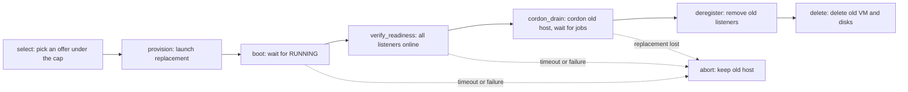

# Fleet and autoscaler

The fleet controller keeps a set of GCP Spot virtual machines (VMs)
registered as GitHub Actions runners. It reads provider and
GitHub state, chooses a host topology, and changes one host at a time. This page
explains how the controller decides, how it retires a host without losing work,
and which guards protect running jobs.

!!! warning "Live operations"
    Only `src/runner_fleet.py` and a tiered `--dry-run` without
    `--install-launch-agent` leave provider resources and controller state
    unchanged. Every other controller run can create, drain, or delete VMs and
    runner registrations. Read [Dry run, once, and the state lock](#dry-run-once-and-the-state-lock)
    before you run the controller.

## What the controller does

Three entry points manage runner hosts. Run each from the repository root.

| Entry point | Purpose | Changes resources? |
| --- | --- | --- |
| `src/runner_fleet.py` | Prints GitHub runner registrations, GCP VM counts, and the scale-out plan that restores a runner floor. | No |
| `src/spot_runner_manager.py` | Previews or provisions one runner host, or a strict heavy-runner pool. | With `--apply`, and with `--patch-live`, which changes a running VM and its runner containers at once without `--apply` |
| `src/spot_runner_autoscaler.py` | Runs the control loop that launches, drains, rotates, and deletes hosts. | Yes (see the warning at the top of this page) |

The autoscaler runs the same loop in every mode. Each check does the following:

1. List the GitHub runners and the `oxidex-runners-*` VMs that belong to the
   controller's target.
2. Poll tracked repositories for jobs, so a lost host can be traced to its jobs.
3. Record observed VMs and write the state file.
4. Finish any pending host operation, such as a launch, drain, or delete,
   before it starts new work.
5. Clean up after lost hosts.
6. Apply the scaling mode: observe demand, then launch, replace, or retire at
   most one host.

The autoscaler launches new hosts by calling `src/spot_runner_manager.py
--apply` as a child process. It names each host
`oxidex-runners-<region>-<zone letter>-<target tag>-<time and random suffix>`
and gives its runners names of the form `gha-<host name>-<slot>`.

### Registered listeners and concurrent capacity

A runner host registers several GitHub listeners, but the listener count is not
the number of jobs that can run at once. Registered listeners only decide how
many jobs GitHub can assign to the host. On a tiered host, the job-started hook
asks the host admission service to reserve memory before the job runs. The
reservation, not the listener count, limits concurrent work. See
[Admission and memory leases](#admission-and-memory-leases).

## Choose a scaling mode

Select the mode with `--scaling-mode`. The command-line default is `resource`.
Pass `--scaling-mode tiered` explicitly for production use.

| Mode | Evidence | Behavior |
| --- | --- | --- |
| `tiered` | Per-host CPU and memory windows, input/output (IO) pressure, queue delay, job timings, and out-of-memory (OOM) events | Chooses host shapes and listener density from the tier ladder. Missing or incomplete evidence holds the current fleet. |
| `resource` | Per-host CPU and memory only | Adds or removes uniform hosts after two five-minute checks. Launches use one fixed shape class (32 vCPU and at least 110 GiB of RAM, with 8 listeners). This mode is the default. |
| `legacy` | Runner occupancy (online and busy listener counts) | Adds a host while more than half the listeners are busy and the online runner count is at or below `--minimum-runners`, and removes one after two low checks. |

Use tiered mode. Resource and legacy modes can delete an overpriced host even
while jobs are active, unless you enable
[make-before-break rotation](#price-rotation-and-make-before-break). Tiered mode
replaces hosts only after the replacement is registered and healthy, and drains
the old host first.

### Polling and host-count rules

- `resource` and `tiered` modes require `--interval-seconds 300` (the default).
  The controller raises an error for any other value. `legacy` mode accepts
  any positive interval.
- `--maximum-hosts` defaults to 5 and must be positive. In `tiered` mode it
  cannot exceed 5.
- Resource-mode growth and shrinkage need two consecutive five-minute checks.
  A check that has no metrics breaks the streak.
- In `tiered` mode the controller sleeps for the interval minus the time the
  check spent after sampling, so successive samples stay about five minutes
  apart.
- CPU and memory metrics come from GCP monitoring. Runner provisioning in
  `resource` and `tiered` modes installs the metrics-only Ops Agent. Without
  complete metrics, tiered mode holds, and resource mode waits.

### Tiered mode

A tier is an allowed host shape with a listener range and a strict total daily
cost cap. The cap covers compute plus boot and data storage.

| Tier | vCPU | RAM, GiB | Initial / maximum listeners | Daily cap, USD | Concurrent jobs at the 15 GiB default reservation |
| --- | ---: | ---: | ---: | ---: | --- |
| `small` | 4 | 16 | 4 / 8 | 0.60 | Does not fit |
| `starting` | 8 | 16 | 8 / 8 | 1.25 | Does not fit |
| `expanded` | 8 | 32 | 8 / 16 | 1.25 | 1 |
| `large` | 16 | 64 | 20 / 20 | 3.00 | 3 |
| `bulky` | 32 | 128 | 16 / 20 | 4.50 | 8 |

The last column comes from the controller's own planning check, which assumes
2 GiB of host overhead and the initial listener count. The tier table does not
quote current offers. A tier also needs an affordable offer with SSD-backed data
storage (`pd-balanced`, `pd-ssd`, or `hyperdisk-balanced`). When the job
reservation does not fit a tier, the controller skips that tier and moves up the
ladder. Pass `--tier-job-memory-gib` to match your workload.

**Topology limits.** A tiered fleet has at most five hosts, 80 vCPU, and 100
listener slots in total, including any replacement that overlaps a source. Only
the last host can be a `small`, `starting`, or `expanded` tail host; every host
before it is `large` or `bulky`. An unaffordable, unavailable, or incompatible
target holds the operation instead of selecting an arbitrary fallback.

**Growth and shrinkage.** The planner reads absolute demand, not fleet averages:

- One host over 75 percent CPU or memory, or a compatible queue delay or
  job-duration regression, grows the fleet when the signal holds in two
  distinct windows. Only a host OOM grows it after a single observation.
- Six low windows, no pending compatible jobs, healthy IO, and projected peaks
  that fit the smaller topology shrink the fleet. The projection keeps CPU peaks
  below 60 percent and RAM peaks (plus 25 percent and 2 GiB per host) within
  the target RAM.
- A completed tier migration starts a 900-second cooldown. A host OOM bypasses the cooldown.
- A queue delay with CPU and memory headroom first raises listener density by
  four slots, up to the tier maximum, before it adds a host.
- Incomplete job inventory, missing metrics, or unhealthy IO pressure holds
  optimization.

A tier change runs as a migration. The controller launches the replacement,
waits for two healthy complete windows, and drains the source only when fresh
demand fits the target. Pass `--migrate-oversized` to let the controller
gradually replace existing hosts whose shape is not a tier.

## Set the runner floor

`--minimum-runners` sets a lower bound that scale-down must preserve for the
controller's target. It does not make the controller launch hosts to reach the
floor. It defaults to 1 in both
`src/spot_runner_autoscaler.py` and `src/runner_fleet.py`, and the autoscaler
rejects values below 1. Earlier versions defaulted to a larger floor, so pass
the flag explicitly if you relied on the old default.

How each mode uses the floor:

- **`resource` and `legacy`:** the controller records the floor and derives the
  fewest hosts whose expected listener slots reach it. A scale-down removes a
  host only if the remaining hosts still hold at least that many listener slots
  and the host count stays over the derived minimum. In `legacy` mode the
  floor also bounds growth: the controller adds a host only while the online
  runner count is at or below the floor and more than half the listeners are
  busy.
- **`tiered`:** the controller accepts and validates the flag, and the LaunchAgent
  stores it, but the tiered planner does not read it. A tiered fleet never
  shrinks below one host, and an empty fleet launches a first host. In `resource` and `legacy` modes, an empty or all-offline fleet doesn't trigger a launch by itself: only lost-host restoration relaunches hosts.

The floor is per controller, and each controller serves one target. A target is
either an organization (for example `swack-tools`) or a repository
(`owner/repo`):

- `--target` selects the target. Without it, the controller uses `--org`
  (default `swack-tools`).
- Launched hosts carry a `spot-target` label. A controller counts, scales, and
  rotates only the hosts that carry its own target label. Unlabeled hosts from
  earlier versions belong to the organization target named by `--org`.
- The controller binds its state file to one target and refuses a state file
  that another target created. Use a separate `--state-file` for each target.
- Organization targets register runners in runner group 10, the default that
  `spot_runner_manager.py` uses. The manager requires the group to be
  repository-scoped and enabled for `<org>/oxidex`. Repository targets have no
  runner groups.

The [dashboard](dashboard.md) has its own scaling profile with a separate
minimum-runner setting. Changing it does not change `--minimum-runners`.

To preview the floor against live registrations without changing anything, run
`src/runner_fleet.py` with the same `--minimum-runners` and `--runners-per-vm`
values. It prints the online and registered runner counts and the scale-out
plan.

## Price rotation and make-before-break

The controller checks each running Spot host against the daily cap. A host is
overpriced when its current compute plus storage cost reaches `--max-daily-usd`
(default 10 dollars). If the controller cannot verify a price, it keeps the
VM and retries on the next check.

What happens next depends on the mode:

| Situation | Behavior |
| --- | --- |
| `tiered` mode | The tier cap, not `--max-daily-usd`, defines overpriced. The controller starts a "tier price replacement" migration when its evidence is complete. It never uses delete-first eviction, and `--make-before-break` has no effect on runner hosts. |
| `resource` or `legacy`, `--make-before-break` | The controller rotates the host with the sequence below. Passing `--target` also selects rotation. |
| `resource` or `legacy`, default (`--no-make-before-break`) | The controller deletes the overpriced VM and its disks immediately, including any active jobs, and then launches a replacement. |

`--make-before-break` and `--no-make-before-break` are mutually exclusive. The
default is off. The `--manage-control-vm` option rotates the dashboard control
VM with its own sequence, which the
[edge hosting reference](edge-dashboard.md) describes.

A host that runs a [runner patch](runner-patches.md) stays in service over the
cap unless this controller has a matching `--patch-repo`, because a replacement
without the patch would pass readiness while missing packages, mounts, and
labels. The controller logs the hold on both the rotation and the delete-first
path.

### Rotation sequence

The outgoing host keeps running jobs until the replacement registers every
listener.

1. **Select.** The controller picks an offer that meets the cap. With no
   offer, it keeps the old host and tries again on the next check. The
   rotation starts at the provision step, and it returns to selection only
   after failures.
2. **Provision.** It launches the replacement. Three failed attempts return the
   rotation to selection with a different offer. A launch that misses its
   deadline (600 seconds, or 2400 for a tiered host with remote builders) is
   abandoned: the controller deletes the VM, its disks, and the runner records.
3. **Boot.** It waits up to 600 seconds for the replacement to reach `RUNNING`.
4. **Verify readiness.** It waits up to 900 seconds until every expected
   listener of the replacement is online. The expected count comes from the
   launch sizing.
5. **Cordon and drain.** It cordons the old host (see the next section) and
   waits for busy runners and tracked jobs to finish. After 3600 seconds, the
   controller advances to deregistration. It still refuses to deregister while
   any runner is busy or a tracked job is active, and it returns to draining
   with a fresh 3600-second timer. The host cordon and remote build quiesce
   checks never time out.
6. **Deregister.** It re-reads each old runner and deletes the registration only
   if the runner is freshly idle. Any work sends the rotation back to the drain
   step.
7. **Delete.** It records the intentional deletion and deletes the old VM and
   its disks. Then it removes the temporary drain group.

During a rotation the maximum host count allows one extra host for the overlap.

### Rollback

The controller re-checks the replacement on every retirement step. If the
replacement is absent, replaced under the same name, not running, or has fewer
online listeners than expected (for example after a preemption), the controller
stops retiring the old host and restores it:

1. It restores each cordoned runner's labels and runner group, and deletes the
   temporary drain group.
2. It releases the host job-start cordon marker that the rotation placed, and
   any builder drain marker it placed. It removes only its own marker.
3. It aborts the rotation. It deletes the replacement only if the replacement
   is idle and offline; otherwise it schedules a drain and then a delete for
   the surplus host.

If the old host has already lost listeners to deregistration, the controller
cannot restore it. The rotation stays pending, keeps the old host cordoned, and
waits for the replacement to come back or provisions a new replacement.

## Drain and the host job-start cordon

A drain quarantines a host's runners, waits for CI work to finish, and then
removes the host. GitHub keeps the read-only `self-hosted`, `linux`, and `X64`
labels on every runner, so removing custom labels never stops a job that selects
only those labels. The controller isolates a host in one of two ways, depending
on the target.

### Repository targets

Personal repositories have no runner groups, so the controller cordons the host:

1. Over `gcloud compute ssh`, a lock-guarded root program first checks the VM's
   provider instance ID against the instance metadata.
2. The program checks every runner container. Each one must mount
   `/run/gha-runner-cordon` read-only, run the cordon-aware job-started hook,
   and not override the hook in its runner state.
3. The program writes the marker file `/run/gha-runner-cordon/draining` (a
   root-owned file) that holds the owner token.
4. The job-started hook (`runner/job-started.sh`) refuses every new job while
   the marker exists. It runs before admission and before any job step.

The controller deregisters runners only after a later observation finds the
marker in place and no `Runner.Worker` process on the host. The first
observation that places the marker never deregisters.

An idle listener can still accept an assignment during the drain. That job
fails before its first step with the annotation **Runner host is being
retired**. GitHub reports the failure and does not reassign the job, so re-run
it to schedule it on another runner.

A host whose containers lack the read-only mount or the cordon-aware hook (the
hook text carries the `GHA_RUNNER_CORDON_V1` capability string) cannot refuse
jobs. The controller holds its retirement and logs `Retirement held`. The host
keeps its labels and registrations until a cordon-capable host replaces it.
Rollback releases a marker only if its content matches the owner token that the
operation recorded.

### Organization targets

An organization drain moves the host's runners into a temporary runner group
named `spot-drain-<host name>-<instance ID>`. The group has `selected`
visibility, no repositories, and no public repository access. The controller
rejects a group that does not meet those conditions, strips the custom labels,
and deletes the group after the host disappears.

The fallback paths are:

- A rotation that cannot create or verify the isolated group cordons the host
  the same way as for a repository target, and holds the rotation if the host
  cannot refuse jobs.
- A drain that starts in `label_only` mode, as `legacy` scale-down does, also
  cordons the host first. If the host cannot refuse jobs, the drain switches to
  an isolated runner group. In `resource` and `tiered` modes, an organization
  `label_only` drain converts to an isolated group.

### Finishing a drain

A drain completes only when all of these conditions hold. The controller
re-checks them before it deletes anything.

- Every drained runner is online and idle, and the recorded runner identities
  match.
- The tracked CI jobs on the host are completed.
- Remote builds on the host are quiesced.
- A fresh read of each runner shows it idle, and the delete requests for the
  runners succeed.
- A fresh inventory shows the runner registrations absent.

The controller then deletes the VM and its disks and waits for provider
confirmation that both are gone. Stopping the controller does not drain a VM or
stop a job.

For operator procedures such as finding a stuck drain, see
[Operations and troubleshooting](operations.md).

## Admission and memory leases

Tiered runner hosts run a root-owned admission service (`host_admission.py`).
A runner container asks it for memory before a job starts, and Unix peer
credentials decide which lease belongs to which caller. A client cannot supply
its own budget or release another container's lease.

- **Budget.** The service reserves `max(2, host overhead) + 0.25 × listeners`
  GiB for the host, and the rest of the RAM is work memory. Concurrent jobs are
  the smaller of the listener count and the work memory divided by the job
  reservation.
- **Reservation size.** `--tier-job-memory-gib` sets the per-job cap and
  reservation. The default is 15 GiB. The help text calls it a verified
  compatible workload cap, not a measured peak. Use job measurements and OOM
  evidence to choose a value.
- **Runner hooks.** On a tiered host the job-started hook waits and retries
  every five seconds until the service grants the lease. The job-completed hook
  releases the lease, retrying until the service acknowledges, and then cleans
  the job target. If the Worker has already ended, the completed hook skips
  cleanup and exits with status 75.
- **Builder admission.** A remote build that the service refuses exits with
  status 75. The `reconcile-builders` command also exits with 75 while builders
  run.
- **Ledger.** The lease ledger is `/var/lib/gha-admission/leases.json` on the
  host. It is for reference only. Never edit or delete it to bypass a hold or a
  drain.

### Heavy-runner pools

`spot_runner_manager.py --heavy-runner-pool 2` or `3` provisions a strict
CI-only pool. Each runner gets 8 vCPU and 32 GiB with no extra swap, the pool
uses the `spot-heavy32` label, and the admission work budget equals 32 GiB per
runner. The service checks the actual container memory, swap, and CPU limits
before it grants a lease. The runner group must allow public repositories and
select only the organization's `oxidex` repository. A label alone does not
enforce these limits.

The controller protects a host that has any `spot-heavy32` runner. While a
heavy route has no verified replacement, tier changes, price replacement, and
automatic launches hold, and a retirement logs `Retirement held: heavy route
has no verified replacement`.

### Out-of-memory handling

The controller reads kernel and cgroup events from each host and keeps
separate OOM obligations for the host, runner, builder, and unknown cases. Exit
status 137 alone proves neither a host nor a container OOM. The planner reacts
as follows:

| Evidence | Reaction |
| --- | --- |
| Host OOM | Grow the fleet after one observation and reset listener density. |
| Container OOM with host headroom | Raise the reservation and container caps, but only on an idle host. If the new cap exceeds the host envelope, migrate to a larger tier. |
| Container OOM with host memory over 75 percent | Treat it as host pressure. |
| Unattributed OOM | Hold until identity evidence arrives. |

`oom_disposition.py` is a maintainer-only helper. The controller never runs it.

## Recover lost hosts and failed jobs

A managed host that disappears without an intentional deletion is a loss. The
controller records it and then cleans up before it restores capacity:

- It verifies the recorded VM and disk identities, deletes the stopped VM and
  its detached disks, and checks that the disks are gone. A foreign, recreated,
  attached, or unrecognized disk keeps recovery pending. Incomplete inventory is
  never proof of absence.
- It removes stale offline, idle runner registrations of the lost host.
- Then it restores capacity. In `resource` and `legacy` modes, it launches
  replacements up to the saved restoration target. In `tiered` mode, the tier
  migration restores the previous committed topology, using allowed tiers.

The controller tracks jobs so it can rerun work that a host loss killed.
`--job-repository OWNER/REPO` selects the repositories to track and can repeat.
The default is the repository target itself, or `<org>/oxidex` for an
organization target. The controller reruns a job only when the job failed on a
lost VM and GitHub reports a runner-loss error, such as a lost connection, or a
runner that stopped responding. Successful jobs, cancellations, and ordinary
code failures never qualify. The controller records each request before it sends
it, and it checks an uncertain response for a newer attempt before it submits
again. A loss that stays unconfirmed for a day expires without a rerun.

## State, locks, and logs

### State and lock files

- `--state-file` defaults to `~/Library/Application Support/Spot Runner
  Autoscaler/state.json`. The controller writes it atomically.
- The controller holds an exclusive lock on `<state file>.lock`. A second
  controller on the same state file stops with `Another controller owns state`
  and the path.
- State survives restarts and holds host operations, rotations, migrations,
  recovery obligations, job tracking, and OOM obligations. A registration,
  drain, cleanup, or uncertain prior operation blocks another host change.
- If the controller can't read the state file, it logs `Ignoring unreadable
  autoscaler state` and starts from empty state, which drops pending host
  operations, loss obligations, and job tracking on the next write. Keep a
  backup before you restart a controller after a disk problem.
- Never delete or hand-edit the state file, the lease ledger, or a runtime
  update journal to bypass a hold or a drain.

### Logs

- `--log-file` defaults to `~/spot-ghrunner.log`. The controller appends to it.
- The log records a spend rate and project cost summary about once an hour. Pass
  `--billing-export-table` or set `GCP_BILLING_EXPORT_TABLE` to include billing
  export totals.
- The LaunchAgent writes standard output and standard error to
  `~/Library/Logs/spot-runner-autoscaler.log`.

The controller loads `.env` from the repository root. See
[Configuration](configuration.md) for the variables, and
[Commands](commands.md) for the complete option list.

### Dry run, once, and the state lock

- `--dry-run` prints a read-only tier decision as JSON: the decision, resource
  evidence, workload signals, candidate offers, and any pending migration. It
  reads provider, GitHub job, and metrics data, and it reads kernel and
  cgroup events from each runner host over `gcloud compute ssh`, which can add
  SSH keys to your project or OS Login settings on first use. It runs the tier
  planner whatever `--scaling-mode` says. It never launches, drains, or
  deletes, never runs job recovery, and never writes controller state. It still
  opens the state lock and the log file. With `--manage-control-vm`, it also
  prints that VM's plan.
- `--once` runs one check and exits. Without `--dry-run`, that check can
  provision or retire resources.
- `--install-launch-agent` is not a dry-run. The controller writes and
  bootstraps the LaunchAgent before it reaches the dry-run branch.

### Install the launch agent { #run-as-a-macos-launchagent }

`--install-launch-agent` writes
`~/Library/LaunchAgents/com.swacktools.spot-runner-autoscaler.plist` and runs
`launchctl bootstrap` for the current user. It then exits without running a
check. The agent starts at login and restarts with `KeepAlive`.

!!! warning
    Installing the agent starts the live controller loop. The plist records the
    options you pass at install time, such as the mode, project, target, floor,
    tier memory, builder selection, tracked repositories, and
    `--make-before-break`. It omits `--dry-run` and `--once`, so a dry-run
    preview that includes `--install-launch-agent` still installs a live agent.
    The installer ignores the `launchctl` exit status, so confirm the service
    state yourself.

The plist points to this checkout and the Python interpreter that installed it.
Editing the source or changing a command-line default does not update an
installed plist. Linux has no installer; run the foreground controller under
your service manager. For stop, restart, and replacement steps, see
[Operations and troubleshooting](operations.md).

## Related pages

- [Runner patches](runner-patches.md): packages, mounts, and labels that every
  launched host receives.
- [Dashboard](dashboard.md) and [Edge hosting](edge-dashboard.md): the web view
  of the fleet and the control VM that hosts it.
- [Commands](commands.md): option reference for every entry point.
- [Configuration](configuration.md): environment variables and `.env` files.
- [Security model](security.md): admission, cordon, and access boundaries.
- [Operations and troubleshooting](operations.md): runbooks for drains,
  rotations, and recovery.
