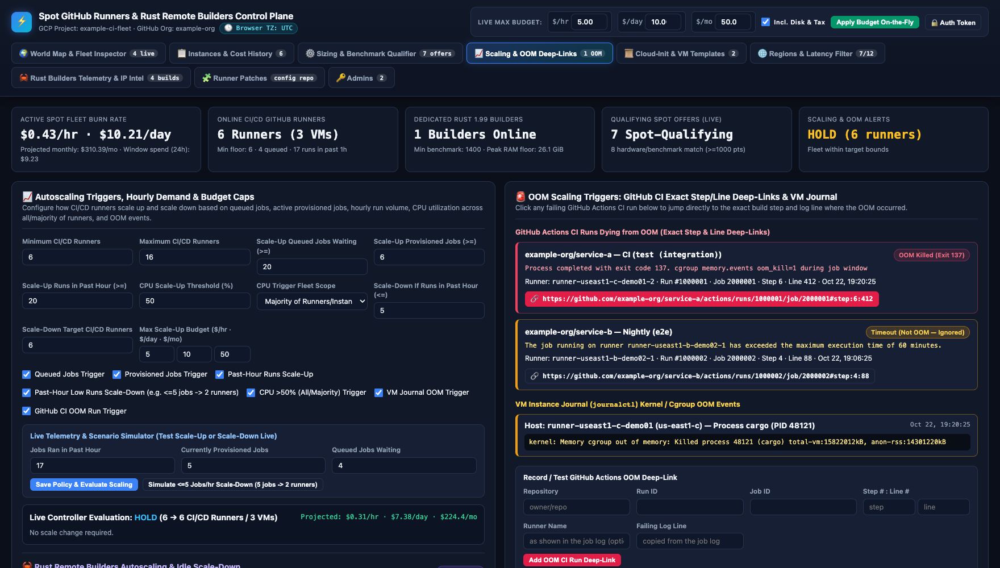

# Fleet and edge reconciler

The fleet controller runs as an autonomous serverless reconciler inside the Cloudflare Worker edge control plane
(`cloudflare/src/reconciler.rs`). On a 5-minute scheduled cron cadence (`#[event(scheduled)]`), the reconciler queries
the Compute Engine and GitHub Actions APIs, evaluates fleet capacity, manages Spot VM lifecycles, and persists
the consolidated fleet snapshot to Cloudflare Workers KV (`SPOT_KV`).

Runner hosts run the native pure-Rust `host-agent` binary to manage memory leases, container isolation,
and workspace cleanup.

## What the edge reconciler does

The edge reconciler executes an autonomous control loop on every 5-minute cron trigger:

1. **Inventory discovery**: queries Compute Engine (`instances.aggregatedList`, `disks.aggregatedList`) and GitHub Actions
   runner registrations for the configured organization.
2. **Backlog detection**: queries GitHub Actions workflow runs and jobs to detect queued job backlog.
3. **Floor target maintenance**: ensures at least one 16-vCPU Spot runner host per configured controlled target (`controlled_targets`).
4. **Demand-driven scale-up**: launches additional 16-vCPU Spot runner hosts when queued backlog reaches or exceeds 20 jobs (`queued_jobs >= 20`).
5. **JIT configuration minting**: requests 2-slot Just-in-Time (JIT) configurations from GitHub Actions API (`generate-jitconfig`)
   with registration token fallback.
6. **Preempted VM cleanup**: detects instances in `TERMINATED` status and cleans up orphaned VMs and auto-deleting disks.
7. **Stale runner cleanup**: deletes offline, idle GitHub runner registrations belonging to terminated or missing VMs.
8. **Diff-gated KV synchronization**: computes a SHA-256 state fingerprint and skips `SPOT_KV.put` on unchanged ticks
   unless a coarse heartbeat interval (>=30 minutes) has elapsed, conserving KV write quota (<50 writes/day).

## Registered listeners and concurrent capacity

A runner host registers two GitHub runner listeners, but the listener count is not the limit of concurrent work.
On each host, the `gha-admission` service (`host-agent host-admission`) reserves memory before a job starts. The memory
reservation, not the listener count, enforces concurrency limits.

### Sizing and resource allocation

Runner hosts provision 16-vCPU shapes with at least 32 GiB RAM:

```text
runner_count = 2
runner_cpu = 7 vCPUs each
runner_memory = 14 GiB each
host_overhead = 4 GiB (reserved for OS and Docker services)
```

This configuration ensures each runner container has dedicated vCPU and memory allocations while leaving adequate headroom
for the host kernel, systemd services, and the Docker engine.

## Runner floor maintenance

The reconciler maintains a runner floor for each target in `controlled_targets`. Each entry defines:

- Organization or repository target (for example `example-org` or `example-org/example-repo`).
- Runner group (organization-scoped or repository-scoped).
- Target machine shapes (such as `c4d-highcpu-16`, `n4d-highcpu-16`, `n4-highcpu-16`, `c2d-highcpu-16`).
- Maximum daily cost budget per host (default $1.50 per day for compute and SSD storage).

If no active runner host exists for a target, the reconciler immediately provisions a replacement.

## Scale-up and backlog management



*The Scaling and OOM Deep-Links tab sets scale-up and scale-down triggers and budget caps, and shows the current controller decision.*

When GitHub Actions reports a queued job backlog of 20 or more jobs (`queued_jobs >= 20`), the reconciler triggers
scale-up:

- It evaluates candidate Spot offers across configured regions (`us-central1`, `us-east1`, `us-west1`).
- It provisions an additional 16-vCPU Spot runner host up to the configured fleet capacity cap.
- It attaches a 40 GiB boot disk and a 100 GiB data disk formatted with ext4.
- When the queued backlog clears and runners become idle, the reconciler drains and terminates surplus hosts.

## Admission and memory leases

Runner hosts execute a root-owned host admission daemon managed by systemd (`systemctl status gha-admission`).
The daemon listens on Unix domain socket `/run/gha-admission/socket` and manages the lease ledger:

- **Ledger file**: `/var/lib/gha-admission/leases.json`, guarded by `/var/lib/gha-admission/leases.json.lock`.
- **Peer verification**: the daemon verifies caller process credentials (`SO_PEERCRED`) on Linux to ensure a client
  cannot supply its own budget or release another container's lease.
- **Job acquisition**: `runner/job-started.sh` calls `host-agent host-admission acquire`, blocking if total memory leases
  exceed available headroom.
- **Job release**: `runner/job-completed.sh` calls `host-agent host-admission release` upon job termination.
- **Headroom calculation**: `host-agent host-admission headroom` reports available memory for new jobs.

Never edit or delete `/var/lib/gha-admission/leases.json` or its lock file to bypass an admission hold.

## Descriptor-relative target cleanup

After a job completes, `runner/job-completed.sh` executes `host-agent clean-target <workspace_path>`. The tool:

- Opens the workspace path with `O_RDONLY | O_DIRECTORY | O_NOFOLLOW`.
- Cleans the Cargo `target/` directory using descriptor-relative `unlinkat` with `AT_SYMLINK_NOFOLLOW`.
- Refuses to follow symlinks to avoid directory traversal attacks.

## Edge state and quota conservation

The edge reconciler persists state to Cloudflare Workers KV under key `dashboard:state`:

- **Single consolidated document**: replaces fragmented keys with a single JSON document containing overview telemetry,
  active VMs, runner allocations, and pricing catalog.
- **In-isolate memory caching**: a 60-second TTL in-isolate memory cache ensures read requests perform 0 KV writes
  and at most 1 KV read per 60 seconds per isolate.
- **Diff-gated reconciliation**: unchanged ticks perform 0 KV writes, keeping write operations well below Cloudflare's
  free tier limit of 1,000 writes per day.

## Related pages

- [Runner patches](runner-patches.md): configuration manifests and pull request workflow.
- [Dashboard](dashboard.md): edge Web UI overview and administration.
- [Edge hosting](edge-dashboard.md): edge control plane and KV storage on Cloudflare Workers.
- [Commands](commands.md): command-line options and subcommands.
- [Security model](security.md): host admission, Docker wrapper, and container isolation.
- [Operations and troubleshooting](operations.md): monitoring and operational runbooks.
