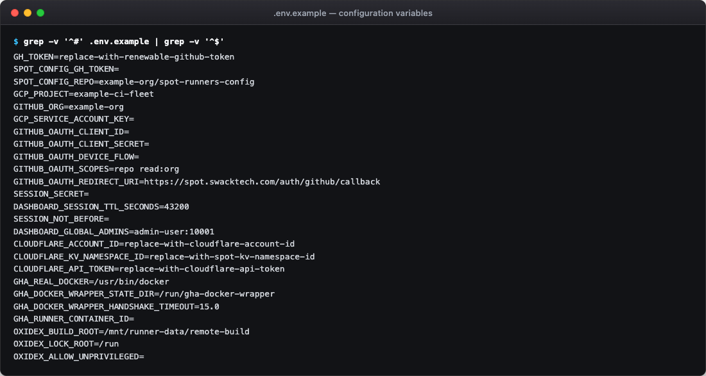

# Getting started

This page takes you from a fresh checkout to your first read-only fleet inspection and test verification.
Run the read-only commands first. Nothing on this page creates, changes, or deletes a VM, disk, or GitHub resource
until the edge reconciler cron triggers or you invoke an explicit live mutation endpoint.

## Prerequisites

On the operator machine, install:

- Rust 1.80 or later with Cargo.
- Cloudflare `wrangler` command-line tool and `worker-build` for edge deployment.
- Git, the GCP command-line tool (`gcloud`), and the GitHub command-line tool (`gh`).
- Standard POSIX utilities (`jq`, `curl`, `sha256sum`).
- Vale if you plan to change the documentation. See [Development](development.md).

Your accounts need these permissions:

- **GCP**: access to Compute Engine, regional quotas, persistent disks, instance metadata, and
  the selected network. Enable the Compute Engine API in your project.
- **GitHub**: organization runner-management access to deploy runners (`repo`, `admin:org`).
- **Cloudflare**: read/write access to Workers KV to deploy the Worker and manage `SPOT_KV`.

Dedicated builder rendering needs no GitHub runner token. It needs an approved public SSH identity mapping for
the uploader account. See [Set up a builder](dedicated-builders.md).

## Clone and sign in

<div class="carousel" markdown>
<div class="carousel-track" markdown>
<figure class="shot" markdown>

<figcaption markdown>The sign-in page offers GitHub web sign-in and a GitHub device code.</figcaption>
</figure>
<figure class="shot" markdown>

<figcaption markdown>Device sign-in shows a one-time code to enter at the GitHub device page.</figcaption>
</figure>
</div>
</div>
<!-- /shot -->

```bash
git clone https://github.com/swack-tools/spot-github-runners.git
cd spot-github-runners

gcloud auth login
gcloud config set project example-project

gh auth login
gh auth status
```

## Create the environment file

<figure class="shot" markdown>

<figcaption markdown>`.env.example` lists every variable with placeholder values only.</figcaption>
</figure>
<!-- /shot -->

For local testing and configuration, copy `.env.example` to `.env`:

```bash
cp .env.example .env
chmod 600 .env
```

Edit `.env` and set a renewable `GH_TOKEN` with the permissions from the previous section. Git ignores the file.
Do not use a short-lived runner registration token as the renewable credential: the edge reconciler obtains
ephemeral JIT configurations or registration tokens automatically during deployment.

For the Cloudflare Worker, configure secrets using `wrangler secret put`:

```bash
wrangler secret put SESSION_SECRET
wrangler secret put GCP_SERVICE_ACCOUNT_KEY
wrangler secret put GITHUB_OAUTH_CLIENT_ID
wrangler secret put GITHUB_OAUTH_CLIENT_SECRET
```

The [configuration reference](configuration.md) lists every variable.

Keep real secrets out of Git. Do not commit `.env`, SSH private keys, service account JSON files, rendered launch
directories, or operational state. Store deployment output under a directory outside the checkout, such as
`$HOME/oxidex-ops`.

## Run the read-only commands

<div class="carousel" markdown>
<div class="carousel-track" markdown>
<figure class="shot" markdown>

<figcaption markdown>`host-agent --help` lists the subcommands of the multi-call binary.</figcaption>
</figure>
<figure class="shot" markdown>

<figcaption markdown>`just --list` shows the build, test, lint, and deploy recipes.</figcaption>
</figure>
<figure class="shot" markdown>

<figcaption markdown>`just test` runs the host agent and Worker test suites.</figcaption>
</figure>
</div>
</div>
<!-- /shot -->

Run these commands from the repository root. Each one reads state and prints a result. None of them
creates, changes, or deletes a VM, disk, or runner registration.

Inspect `host-agent` subcommands and options:

```bash
cargo run --manifest-path host-agent/Cargo.toml -- --help
```

Inspect host memory headroom:

```bash
cargo run --manifest-path host-agent/Cargo.toml -- admission headroom
```

Run the unit and adversarial test suites:

```bash
# Test the native host agent
cargo test --manifest-path host-agent/Cargo.toml

# Test the Cloudflare Worker edge control plane
cargo test --manifest-path cloudflare/Cargo.toml
```

Verify release WebAssembly compilation:

```bash
cd cloudflare && worker-build --release
```

Probe edge dashboard health:

```bash
curl -sS https://spot.swacktech.com/api/health | jq .
```

The health response reports the reconciliation status and fleet inventory.

## Next steps

- Read [Fleet and autoscaler](fleet-and-autoscaler.md) for how edge reconciliation works.
- Read [Operations and troubleshooting](operations.md) for the safety rules that apply to a live fleet.
- To build Rust on a dedicated VM, follow [Set up a builder](dedicated-builders.md).
- To host the dashboard, read the [edge hosting guide](edge-dashboard.md).
