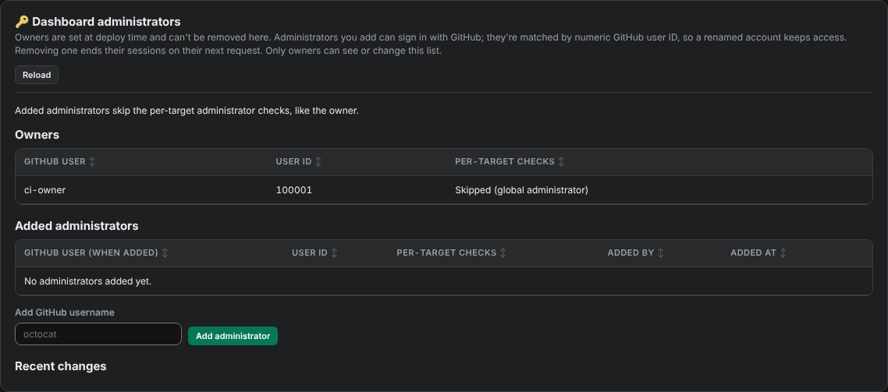
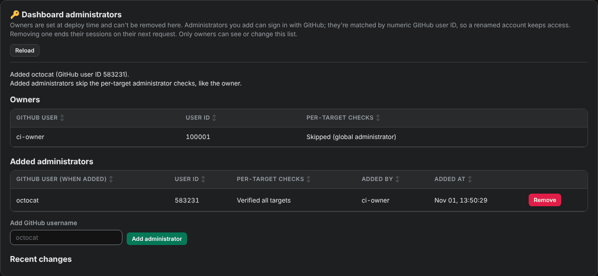

# Add an administrator

Administrators can sign in to the dashboard and change the fleet: launch and remove runner pools, edit templates, and change scaling. Only an owner can add or remove administrators. Owners are set when the dashboard is deployed.

<figure class="shot walkthrough" markdown>

<figcaption>Adding the GitHub user <code>octocat</code> as an administrator.</figcaption>
</figure>

## Before you begin

[Sign in](sign-in.md) as an owner.

## Add an administrator

1. Open **Administrators** in the left menu. It lists the owners, the administrators already added, and recent changes.

    

1. In **Add GitHub username**, type the person's GitHub username.
1. Click **Add administrator**, then confirm.
1. The dashboard looks the user up on GitHub and adds them by their numeric GitHub user ID, so they keep access if they rename their account.

    

They can [sign in](sign-in.md) right away with their own GitHub account.

## Remove an administrator

Click **Remove** on their row and confirm. Their sessions end on their next request.
