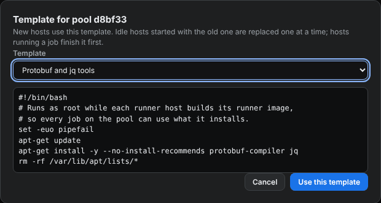
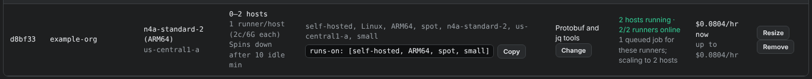

# Roll a template onto a running pool

You can switch a running pool to another [runner setup template](make-a-runner-template.md). The pool replaces its hosts one at a time, and busy hosts finish their jobs first.

<figure class="shot walkthrough" markdown>

<figcaption>Switching a running pool for <code>example-org</code> to the template <code>Protobuf and jq tools</code>.</figcaption>
</figure>

## Before you begin

- [Make the template](make-a-runner-template.md).
- [Sign in](sign-in.md) to the dashboard.

## Change the template

1. Open **Machine Qualification** and scroll to **Runner pools**.
1. Click **Change** in the pool's **Template** column.
1. Pick the template, or **Built-in runner setup only** to remove the pool's template.

    

1. Click **Use this template**. The pool's row shows the new template.

    

## What happens next

On each reconciler run, every 5 minutes, the pool replaces one idle host that started before the change with a new host that uses the new template. It does this only when the pool has all its hosts and none is starting or stopping, so the pool is never more than one host short. A host running a job stays until the job ends. A pool with no hosts uses the new template for its next host.

The pool keeps its own copy of the template. Editing the template later doesn't change the pool: click **Change** and pick the template again to roll out the edited version.
