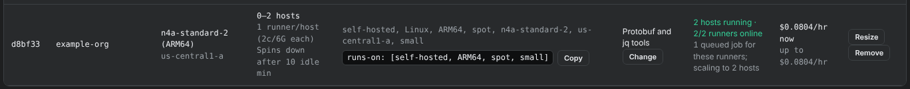
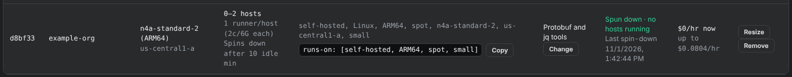
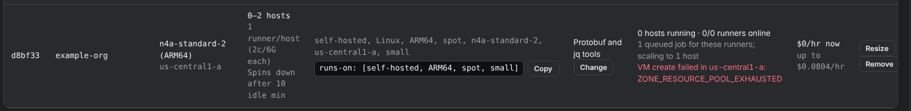

# Check on a pool

The **Runner pools** panel shows what each pool is doing: hosts running, runners online, queued jobs, spin-downs, launch errors, and cost.

<figure class="shot walkthrough" markdown>

<figcaption>A pool with two hosts running jobs, and the same pool after its hosts sat idle and were deleted.</figcaption>
</figure>

## Open the panel

1. [Sign in](sign-in.md) and open **Machine Qualification**.
1. Scroll to **Runner pools**. Hide the left menu with **☰** to see every column.
1. Click **Refresh** to reload the panel. It also refreshes every minute while the page is open.

The panel can lag by up to one reconciler run, about 5 minutes.

## Read a pool's status

**While jobs run**, **Status** shows the hosts running and runners online. For a pool that spins down, it also shows the queued jobs for the pool's labels and the host count the pool is moving to. **Cost** shows what the running hosts cost now, and the most the pool can cost.

**After the jobs finish**, each host that sits idle for the pool's idle minutes is deleted, newest first. When the last one goes, **Status** shows **Spun down · no hosts running** and the time of the last spin-down, and the pool costs `$0/hr now`. The next queued job starts a host again.

**When a launch fails**, a red line shows why. For example, `ZONE_RESOURCE_POOL_EXHAUSTED` means the zone has no Spot capacity for that machine right now.

The reconciler keeps trying every 5 minutes, and the line clears when a host starts. If it stays, [remove the pool](resize-or-remove-a-pool.md) and launch it in another zone.

Other errors you may see:

| Message | What to do |
| --- | --- |
| `runner registration token unavailable` | The Worker's GitHub token can't register runners for this organization or repository. Give it write access to the organization's self-hosted runners, or to the repository's administration settings. |
| `VM create failed` | GCP refused the VM. The message includes GCP's reason, for example a missing permission. |
| `Couldn't read GitHub's job queue; keeping the hosts it has.` | The Worker's GitHub token can't read Actions for the target's repositories. The pool keeps the hosts it has and starts none for queued jobs. |

## How long things take

From a live test with a 2 vCPU pool that had no hosts:

| Step | Time |
| --- | --- |
| Job pushed to the queue | 0 minutes |
| The pool sees it and starts a host | about 5 minutes |
| The host's runner takes the job | about 10 minutes |
| The host is deleted after the job | idle minutes plus up to 10 minutes |

Set **Fewest hosts** to `1` with [Resize](resize-or-remove-a-pool.md) when jobs can't wait for a host to start. That host runs, and costs money, all the time.
