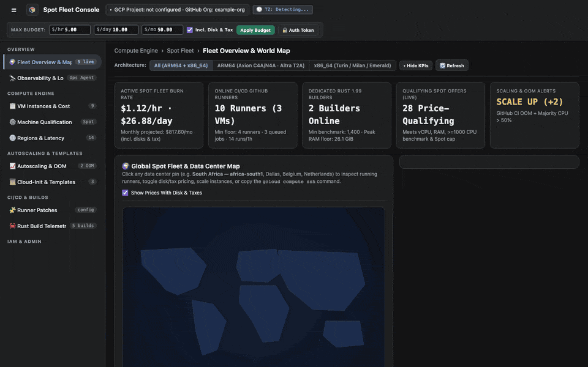
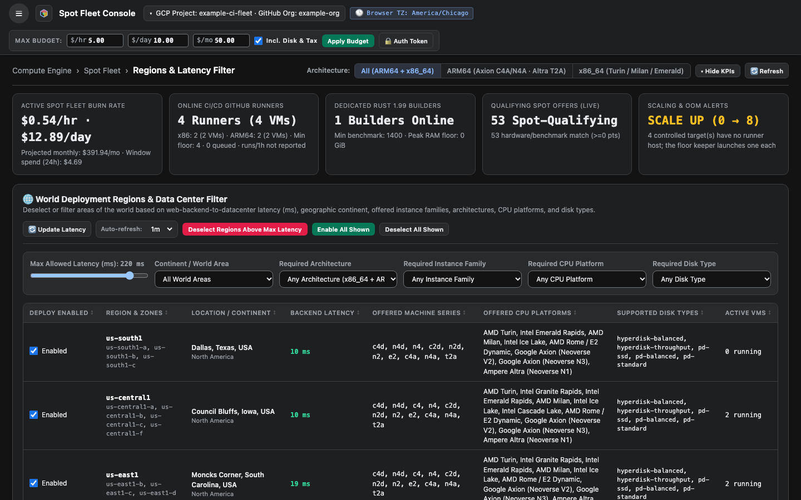
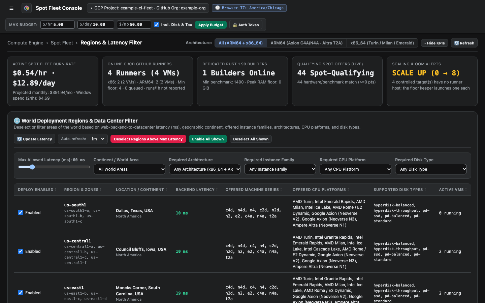

# Choose regions

**Regions & Latency** controls where the fleet may run. The matrix stops offering a region you turn off.

<figure class="shot walkthrough" markdown>

<figcaption>Filtering by world area and machine family, turning off regions above a latency limit, and turning them back on.</figcaption>
</figure>

## Before you begin

[Sign in](sign-in.md) to the dashboard.

## Filter the list

1. Open **Regions & Latency**. The table shows each region's latency, machine families, CPU platforms, and disk types.

    

1. Narrow the table with **Continent / World Area**, **Required Architecture**, **Required Instance Family**, **Required CPU Platform**, or **Required Disk Type**.

## Turn regions off and on

- To turn off slow regions, drag **Max Allowed Latency** to the highest latency you accept, then click **Deselect Regions Above Max Latency**.

    

- To change every region the filters show, click **Enable All Shown** or **Deselect All Shown**.
- To change one region, use the checkbox on its row.

Click **Update Latency** to measure latency again.
