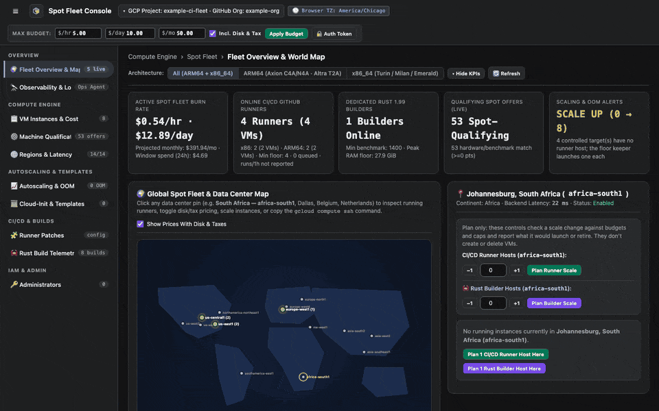
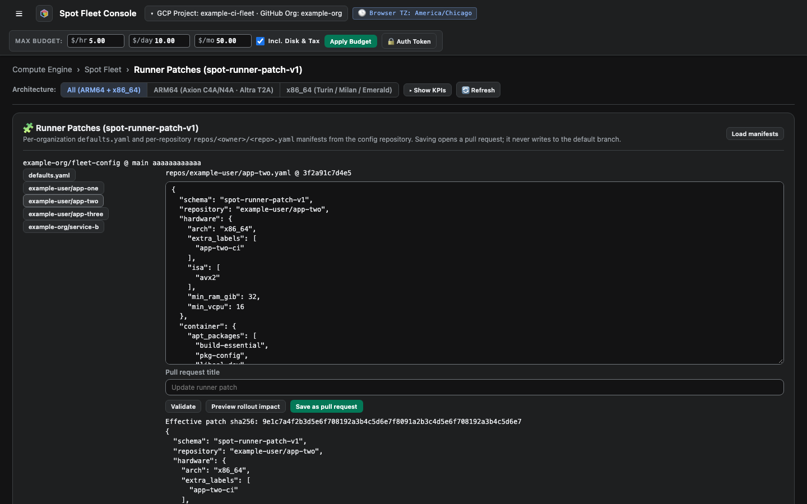
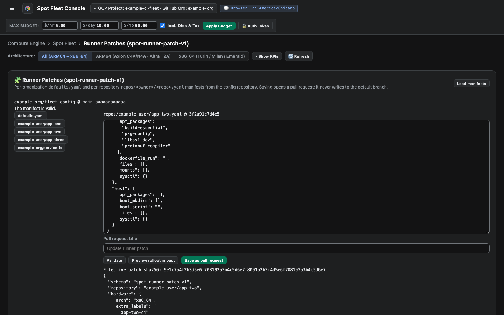
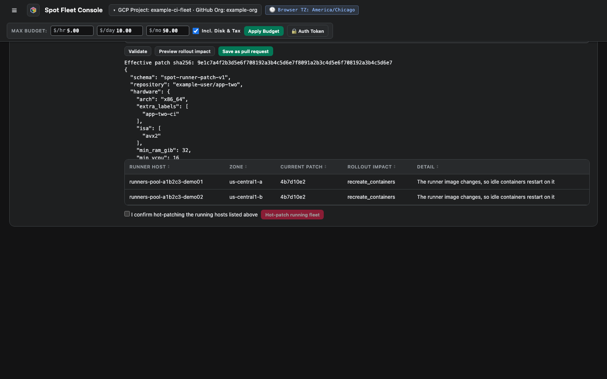
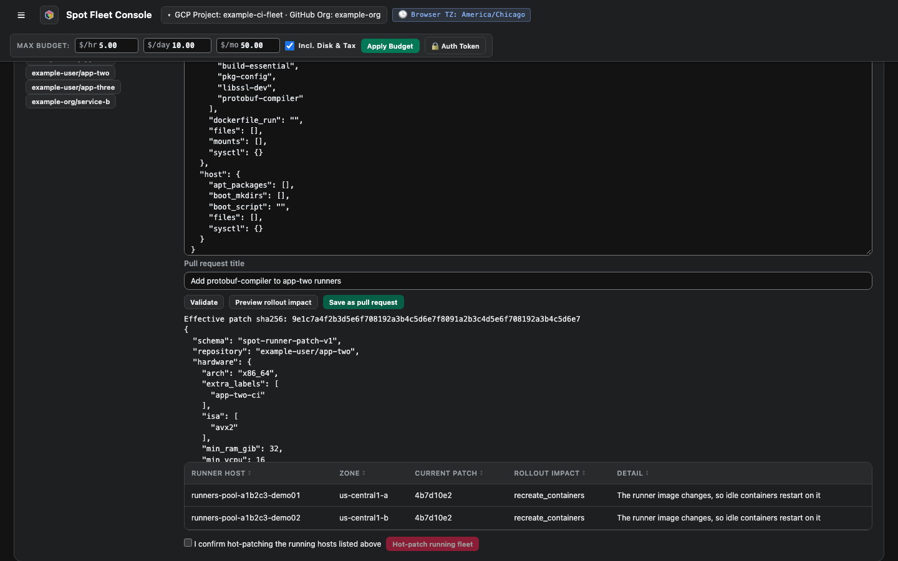

# Edit a runner patch

A runner patch changes what runner hosts install. You edit it on the dashboard, and the dashboard opens a pull request on the configuration repository. Nothing changes until you merge it.

<figure class="shot walkthrough" markdown>

<figcaption>Adding a package to one repository's runner image and opening a pull request.</figcaption>
</figure>

## Before you begin

[Sign in](sign-in.md) to the dashboard.

## Change a manifest

1. Open **Runner Patches**, and click **Load manifests**.
1. Click `defaults.yaml` for organization defaults, or click a repository.

    

1. Edit the manifest.
1. Click **Validate**. It checks the schema and the host size.

    

1. For a repository manifest, click **Preview rollout impact** to see what each host would do.

    

1. Enter a **Pull request title**, then click **Save as pull request**.

    

1. Review and merge the pull request on GitHub. The reconciler rolls out the change on a later run.

For the manifest format, see [Runner patches](../runner-patches.md).
