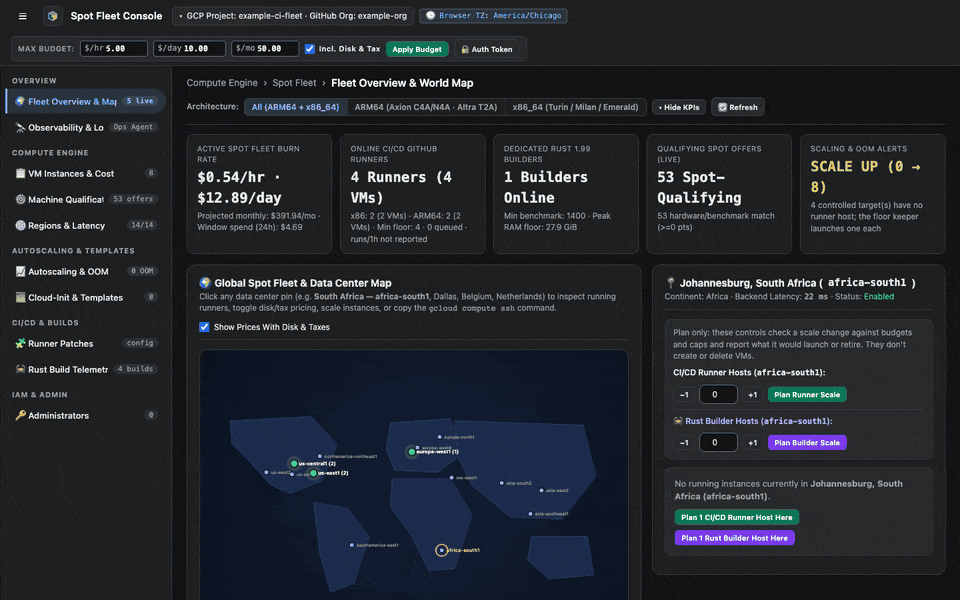
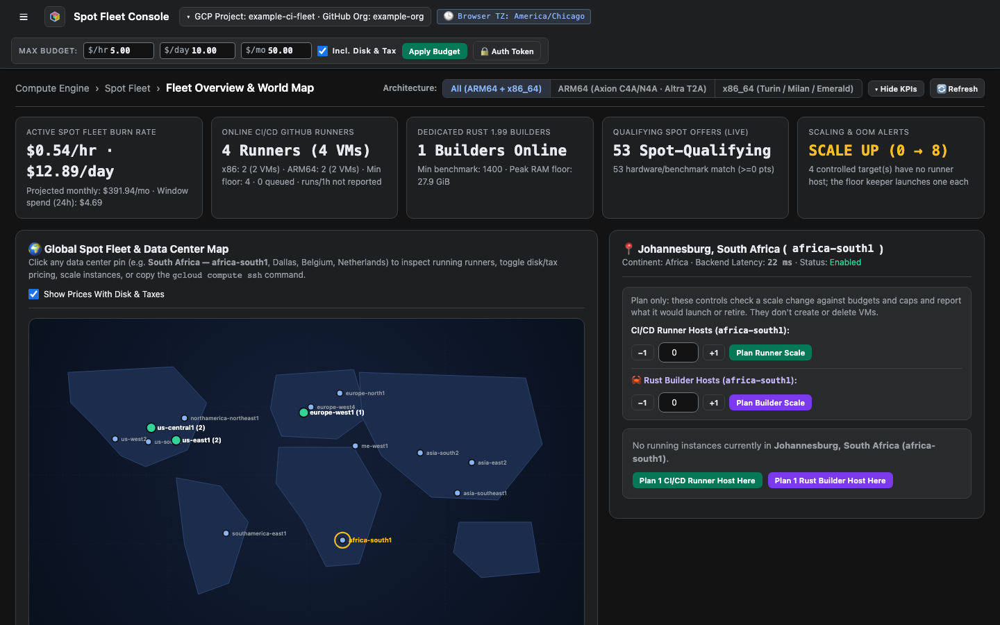
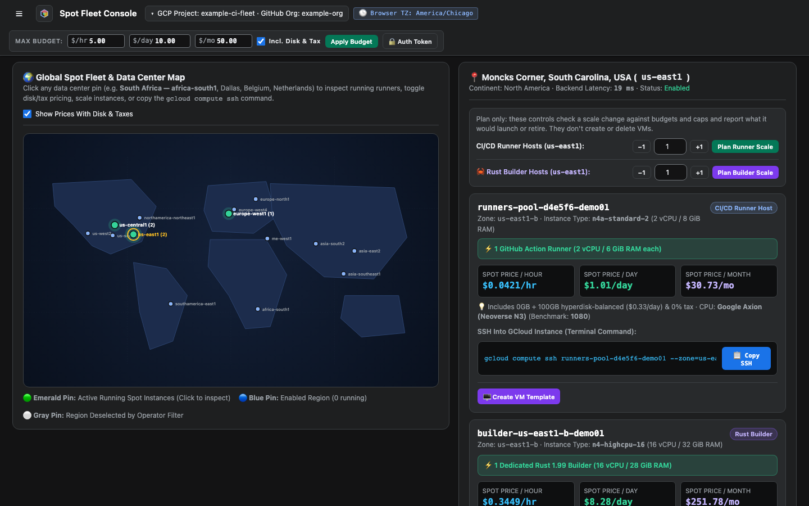
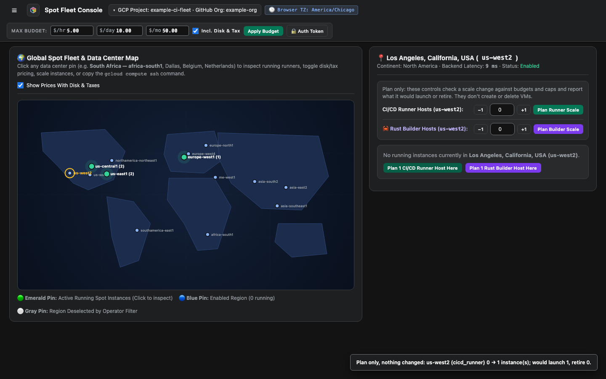

# Explore the fleet map

The map shows every region the fleet can use. Use it to see where hosts run, what they cost, and how to connect to them.

<figure class="shot walkthrough" markdown>

<figcaption>Clicking a region with hosts, a region without hosts, and a plan button.</figcaption>
</figure>

## Before you begin

[Sign in](sign-in.md) to the dashboard.

## Read the map

**Fleet Overview & Map** opens first. A green pin is a region with running hosts, and its label shows how many. A blue pin is an enabled region with no hosts, and a gray pin is a region you've turned off.

## Inspect a region

1. Click a pin. The inspector lists the region's hosts with their cost and the `gcloud compute ssh` command for each one.

    

1. To copy a host's command, click **Copy SSH**.

## Check a scaling change

The plan buttons check a change against budgets and caps, and report what would launch or retire. They don't create or delete VMs.

1. Click **Plan 1 CI/CD Runner Host Here**, or set a count and click **Plan Runner Scale**.
1. Read the message at the bottom of the page.

    
