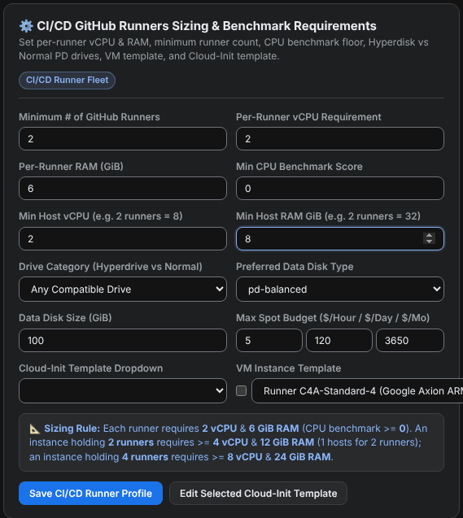
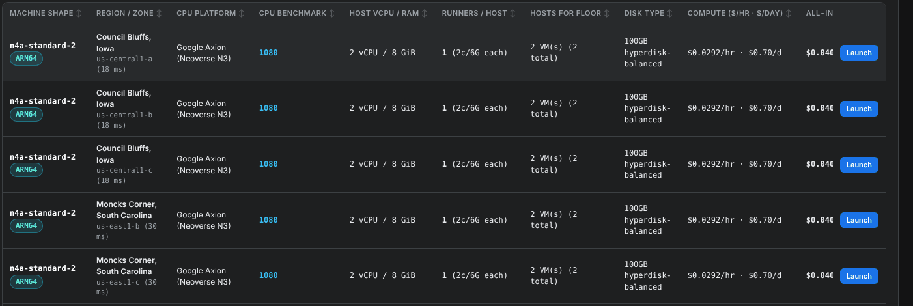
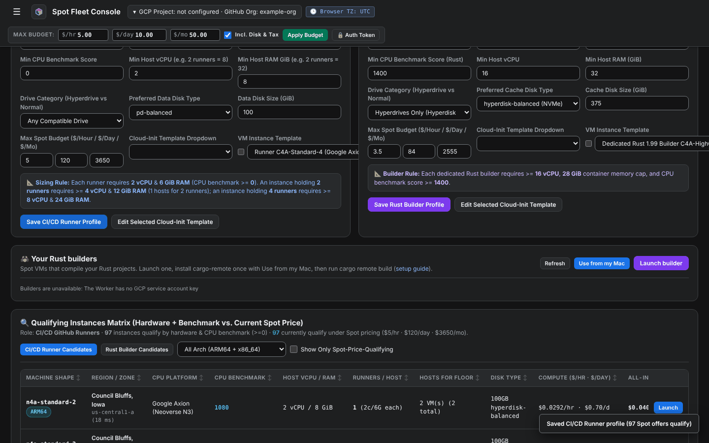

# Find the cheapest hosts for your runners

The **Qualifying Instances Matrix** lists every Spot machine that fits the runners you describe, with its price, cheapest first. Use it to pick the host for a [runner pool](launch-a-pool.md).

<figure class="shot walkthrough" markdown>

<figcaption>Describing a 2 vCPU, 6 GiB runner on a host of at least 2 vCPU and 8 GiB, then reading the matrix.</figcaption>
</figure>

## Before you begin

[Sign in](sign-in.md) to the dashboard.

## Describe your runners

1. Open **Machine Qualification** in the left menu.
1. Describe one runner and the smallest host you accept in the **CI/CD GitHub Runners Sizing** form. For small 2 vCPU runners:

    | Field | Value |
    | --- | --- |
    | **Per-Runner vCPU Requirement** | `2` |
    | **Per-Runner RAM (GiB)** | `6` |
    | **Min Host vCPU** | `2` |
    | **Min Host RAM GiB** | `8` |
    | **Min CPU Benchmark Score** | `0`, or a score your jobs need |
    | **Drive Category** | **Any Compatible Drive** lists the most hosts |

    

    Each host keeps 2 GiB of RAM for itself, so an 8 GiB host holds one runner with 6 GiB.

## Read the matrix

1. Scroll down to the **Qualifying Instances Matrix**. It updates as you type.
1. To see more columns, hide the left menu with **☰** at the top left.
1. Read each row:

    

    | Column | What it tells you |
    | --- | --- |
    | **Machine Shape** | The machine type and its architecture, `ARM64` or `x86_64`. Your jobs' tools must run on that architecture. |
    | **Region / Zone** | Where the host runs, and the latency from you. |
    | **CPU Benchmark** | A relative CPU speed score. Higher is faster. |
    | **Runners / Host** | How many of your runners fit on one host. |
    | **Compute** and **All-In w/ Disk** | The Spot price per hour and per day. **All-In** adds the data disk. |
    | **Launch** | Starts a [runner pool](launch-a-pool.md) on this row's machine and zone. It stays visible at the right edge while you scroll the table sideways. |

    The prices are GCP's Spot list prices for `us-central1`. Other regions differ by a few percent, and GCP can change Spot prices at any time, so treat them as estimates.

1. Optional: click a column header to sort by it, or choose **ARM64 Only** or **x86_64 Only** to filter by architecture.

## Save the sizing

Click **Save CI/CD Runner Profile** under the form. The matrix opens with this sizing next time, and the toast tells you how many Spot offers qualify.

Next: [launch a runner pool](launch-a-pool.md) on the row you picked.
