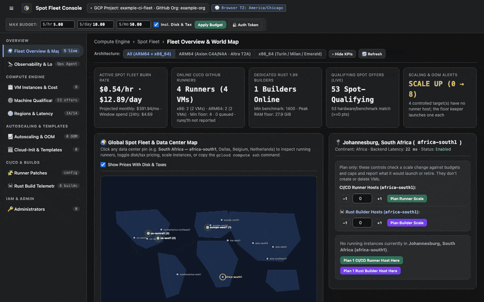
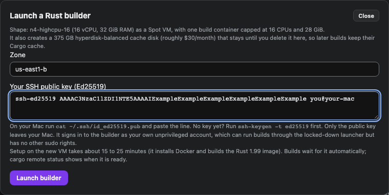
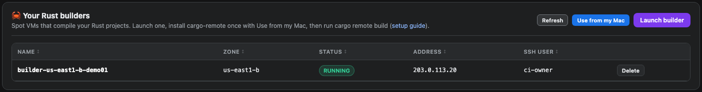
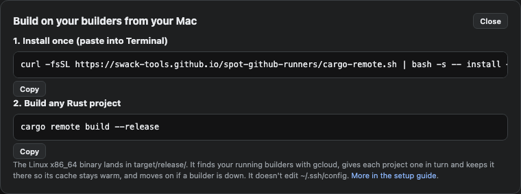
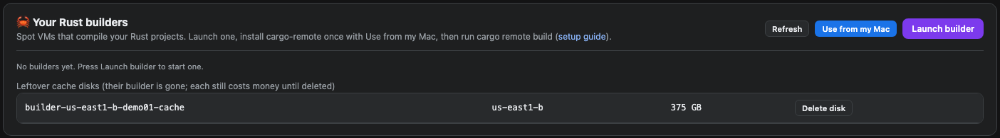

# Launch a Rust builder

A Rust builder is a Spot VM that compiles your Rust projects, so your laptop doesn't have to. You start one from the dashboard, install `cargo-remote` once on your Mac, and run `cargo remote build` in any Cargo project.

<figure class="shot walkthrough" markdown>

<figcaption>Launching a builder in <code>us-east1-b</code>, getting the install line, and deleting the builder and its cache disk.</figcaption>
</figure>

## Before you begin

- [Sign in](sign-in.md) as the dashboard owner. Added administrators can see builders but can't launch or delete them.
- Have an Ed25519 key on your Mac. If `~/.ssh/id_ed25519.pub` doesn't exist, run `ssh-keygen -t ed25519`.
- Pick a region with room for 415 GB of `hyperdisk-balanced` storage: a 375 GB cache disk and a 40 GB boot disk. GCP's quota for this storage is often 500 GB per region.

## Launch the builder

1. Open **Machine Qualification**. In **Your Rust builders**, click **Launch builder**.
1. In **Zone**, enter the zone, such as `us-east1-b`. Every builder uses the same `n4-highcpu-16` shape.
1. In **Your SSH public key (Ed25519)**, paste the line from `~/.ssh/id_ed25519.pub`.

    

1. Click **Launch builder**. Setup takes 15 to 25 minutes while the VM installs Docker and builds the Rust image.
1. Click **Refresh** to check on it. When it runs, the panel shows its address and your SSH user.

    

## Build from your Mac

1. Click **Use from my Mac**, and run the install line in Terminal. You only do this once.

    

1. In a Cargo project, run `cargo remote build --release`. The Linux x86_64 binary lands in `target/release/`.
1. To see whether your builders are ready, run `cargo remote status`.

## Delete the builder

A builder costs money while it runs, and its cache disk costs about $30 a month until you delete it.

1. Click **Delete** on the builder's row, then confirm. The VM goes away and the cache disk stays.

    

1. Under **Leftover cache disks**, click **Delete disk**, then confirm. The Cargo cache on it is gone for good.

For more about how builders work, see [Set up a builder](../dedicated-builders.md) and [Client workstation setup](../client-workstation-setup.md).
