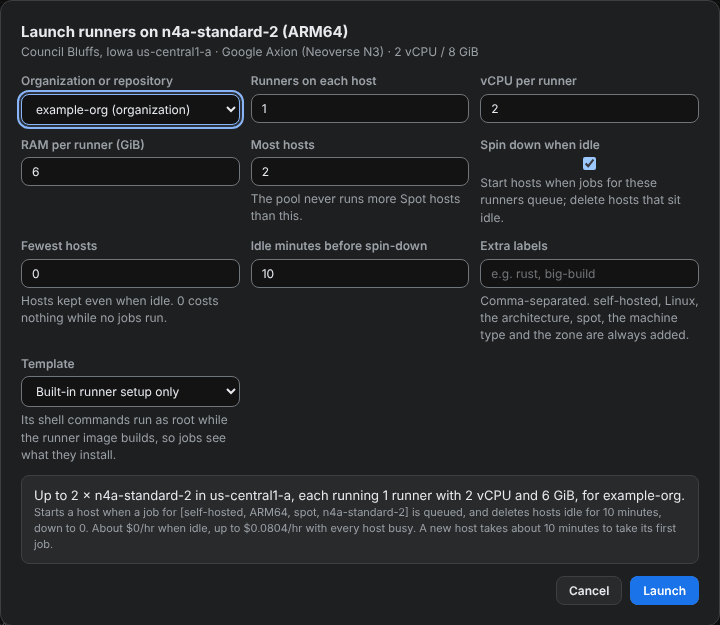
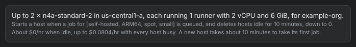
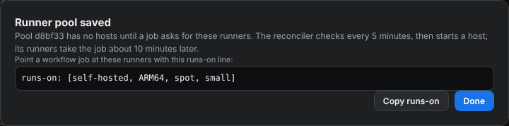
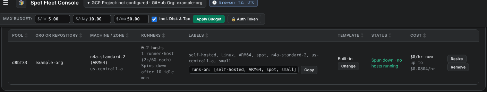

# Launch a runner pool

A runner pool is a set of Spot hosts whose GitHub Actions runners take your jobs. By default a pool spins down: it runs no hosts until a job asks for its runners, and it deletes hosts that sit idle, so an idle pool costs nothing.

<figure class="shot walkthrough" markdown>

<figcaption>Launching a spin-down pool on <code>n4a-standard-2</code> for <code>example-org</code> with the extra label <code>small</code>.</figcaption>
</figure>

## Before you begin

- [Sign in](sign-in.md) to the dashboard.
- [Find a host](find-cheap-hosts.md) in the **Qualifying Instances Matrix**.

## Launch the pool

1. In the matrix, click **Launch** on the row you want. The **Launch runners** dialog opens with that row's machine, zone, and runner size.

    

1. In **Organization or repository**, pick where the runners register: your organization, so any of its repositories can use them, or a single repository.
1. Leave **Spin down when idle** on. Check the fields that go with it:
    - **Most hosts**: the most hosts the pool runs at once.
    - **Fewest hosts**: hosts the pool keeps even when no jobs run. `0` costs nothing while the pool is idle, and the first job then waits about 10 minutes for a host.
    - **Idle minutes before spin-down**: how long a host sits without a job before it's deleted.
1. In **Extra labels**, add a label, such as `small`. Jobs ask for runners by label, so your own label keeps other self-hosted jobs off this pool.
1. Optional: in **Template**, pick a [runner setup template](make-a-runner-template.md) that installs extra tools.
1. Read the summary at the bottom. It shows the cost when the pool is idle and when every host is busy.

    

1. Click **Launch**. The dialog shows the `runs-on` line for your workflows.

    

1. Click **Copy runs-on**, then **Done**.

The pool appears in the **Runner pools** panel under the matrix. A spin-down pool shows **Spun down · no hosts running** until a job is queued for it.

Next: [point a workflow at the pool](use-a-pool-in-a-workflow.md).
