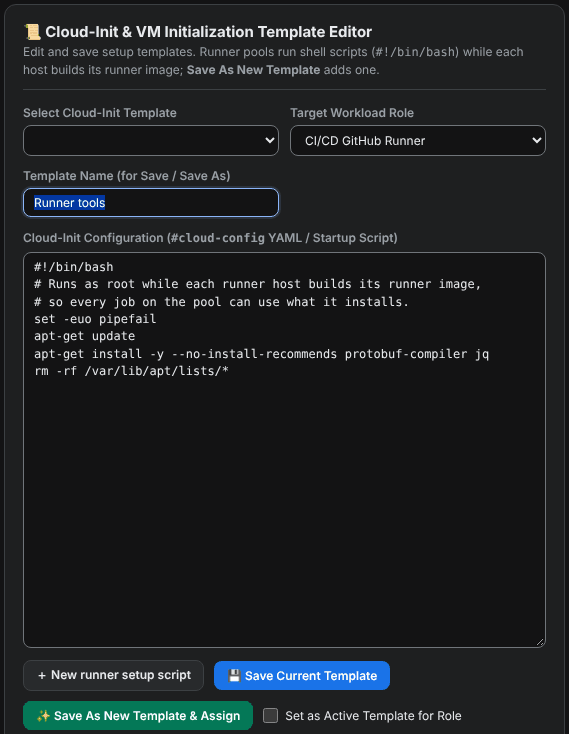
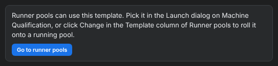

# Make a runner setup template

A runner setup template is a shell script that runs as `root` while a pool host builds its runner image. Anything it installs is there for every job on that pool's runners.

<figure class="shot walkthrough" markdown>

<figcaption>Creating the template <code>Protobuf and jq tools</code> from the starter script.</figcaption>
</figure>

## Before you begin

[Sign in](sign-in.md) to the dashboard.

## Create the template

<!-- vale Google.WordList = NO -->
<!-- The dashboard's page is named Cloud-Init & Templates. -->

1. Open **Cloud-Init & Templates** in the left menu.
1. Click **＋ New runner setup script**. The editor opens a starter script that installs two packages:

    ```bash
    #!/bin/bash
    # Runs as root while each runner host builds its runner image,
    # so every job on the pool can use what it installs.
    set -euo pipefail
    apt-get update
    apt-get install -y --no-install-recommends protobuf-compiler jq
    rm -rf /var/lib/apt/lists/*
    ```

    

1. Change the commands to install what your jobs need.
1. Give the template a name, then click **Save As New Template & Assign**.
1. The page confirms the save and offers **Go to runner pools**.

    

<!-- vale Google.WordList = YES -->

## Use the template

- For a new pool, pick the template in **Template** when you [launch the pool](launch-a-pool.md).
- For a running pool, [roll the template onto it](change-a-pool-template.md).

## Tips

- Keep `set -euo pipefail` at the top. A command that fails then stops the image build instead of leaving a half-set-up host. A host whose build fails never registers its runners.
- Try a new template on a pool with one host first.
- The template adds to the built-in setup. Docker, the data disk, runner registration, and memory admission always come from the built-in setup.
- `#cloud-config` YAML templates are listed on the page but can't be used for pools, because pool hosts don't run cloud-init.
