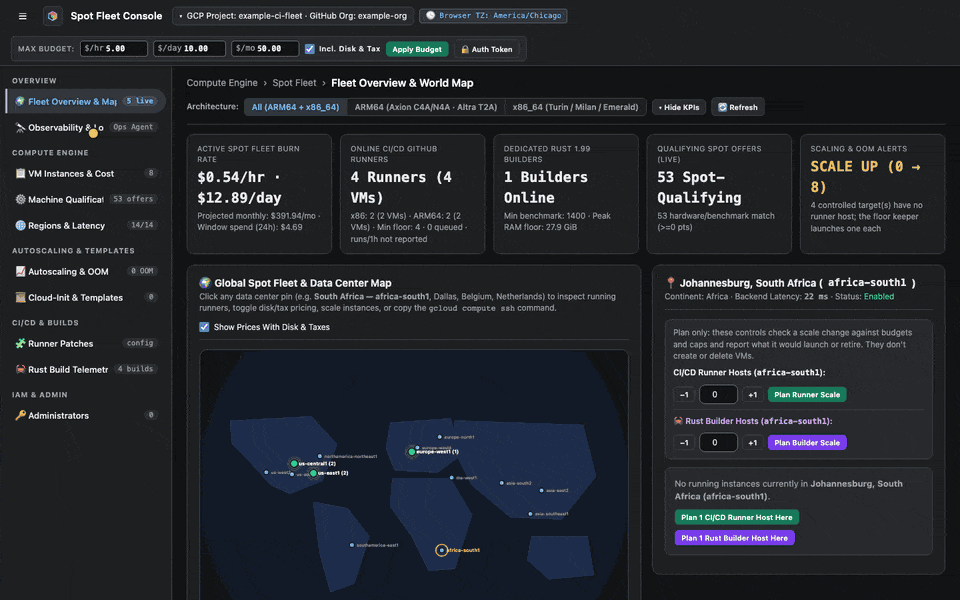
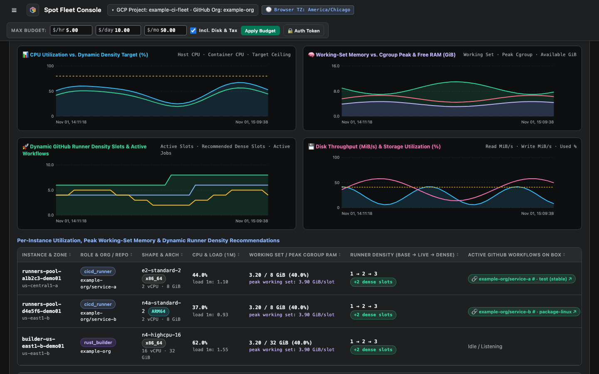
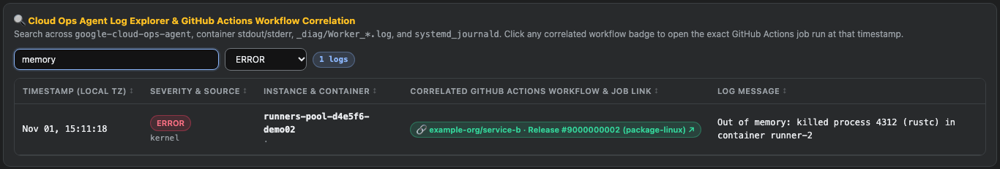

# Read observability and logs

**Observability & Logs** charts what each host is doing, and ties log lines to the GitHub Actions job that wrote them. Charts appear once hosts send telemetry.

<figure class="shot walkthrough" markdown>

<figcaption>Filtering by role and repository, changing the density target, and searching for a memory error. The telemetry is example data.</figcaption>
</figure>

## Before you begin

[Sign in](sign-in.md) to the dashboard.

## Read the charts

1. Open **Observability & Logs**.
1. Pick a **Workload Role**, organizations and repositories, a host, and a time window.

    

## Set runner density

Dynamic Runner Density adds runner slots on hosts with room to spare.

1. Set the **CPU %** and **RAM %** targets, and **Max/VM**.
1. Click **Save Density Policy**. To turn the feature off, clear the checkbox at the top of the panel.

## Search the logs

1. In **Log Explorer**, type a search term, such as `memory`.
1. To see only serious lines, pick a severity.

    

1. Click a green badge to open the workflow job on GitHub.
