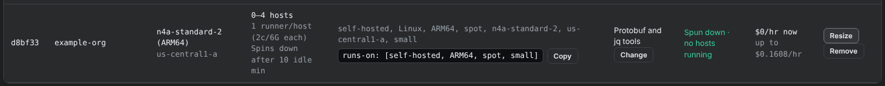
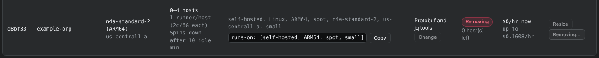

# Resize or remove a pool

Resize changes how many hosts a pool may run. Remove deletes the pool, its hosts, and their runner registrations. Remove the pool and [launch a new one](launch-a-pool.md) to change its machine, runner size, or labels.

<figure class="shot walkthrough" markdown>

<figcaption>Resizing a spin-down pool to 0 to 4 hosts, then removing it.</figcaption>
</figure>

## Before you begin

[Sign in](sign-in.md), open **Machine Qualification**, and scroll to **Runner pools**.

## Resize a pool

1. Click **Resize** on the pool's row.
1. Enter the most hosts, from 1 to 10, and click **OK**.
1. If the pool spins down, it also asks for the fewest hosts. Enter the number and click **OK**. `0` lets the pool spin down to nothing. Entering the same number as the most hosts turns spin-down off, so the pool always runs that many hosts.
1. The row shows the new range.

    

On its next runs, every 5 minutes, the reconciler matches the pool to the new numbers. It adds one host per run. It removes the newest idle hosts first, and a host running a job stays until the job ends.

Growing a pool must keep all pools, at their most hosts, under the dashboard's **Max Budget** hourly limit. Shrinking always works.

## Remove a pool

1. Click **Remove** on the pool's row and confirm.
1. The row shows **Removing…** while the reconciler deletes the pool's hosts and their runner registrations.

    

1. When no hosts or runners are left, the pool disappears from the panel, usually within 10 minutes.

Removing a pool stops any jobs running on its hosts. Jobs still queued for its labels stay queued until a runner with those labels comes online.
