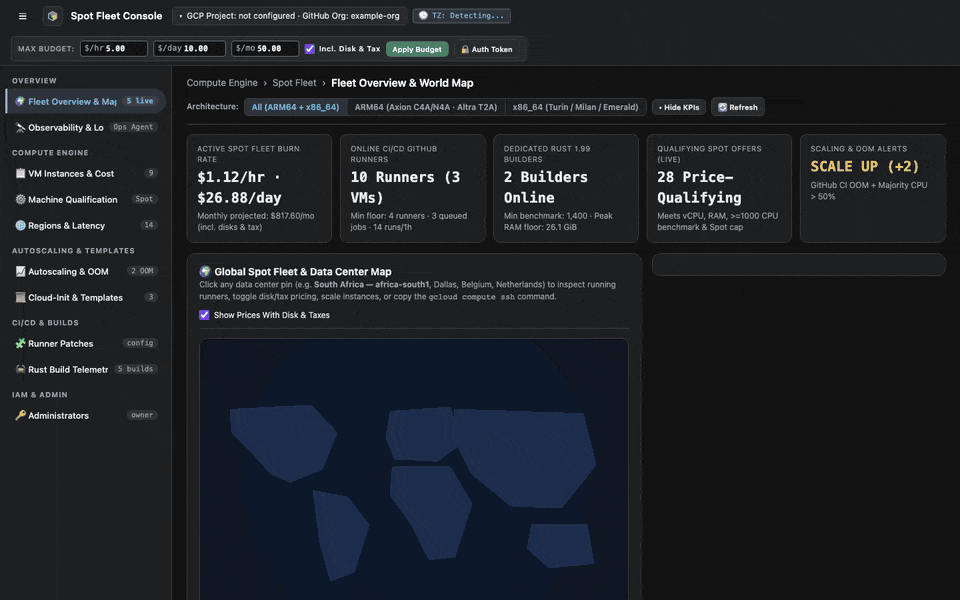
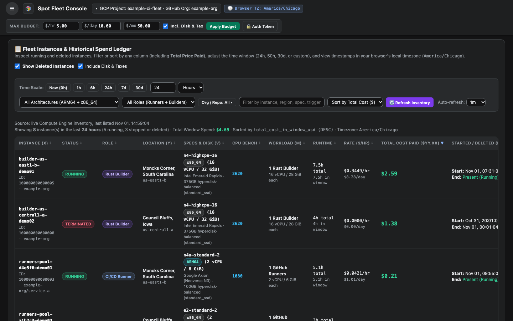
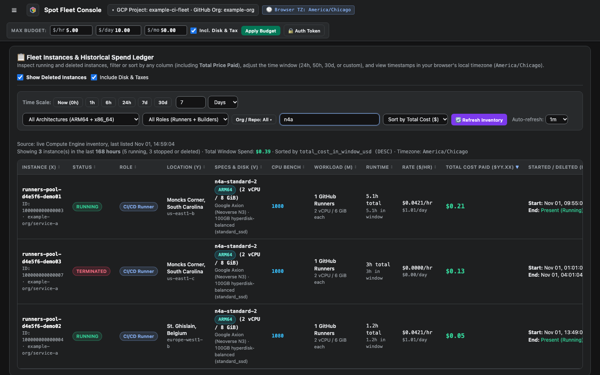
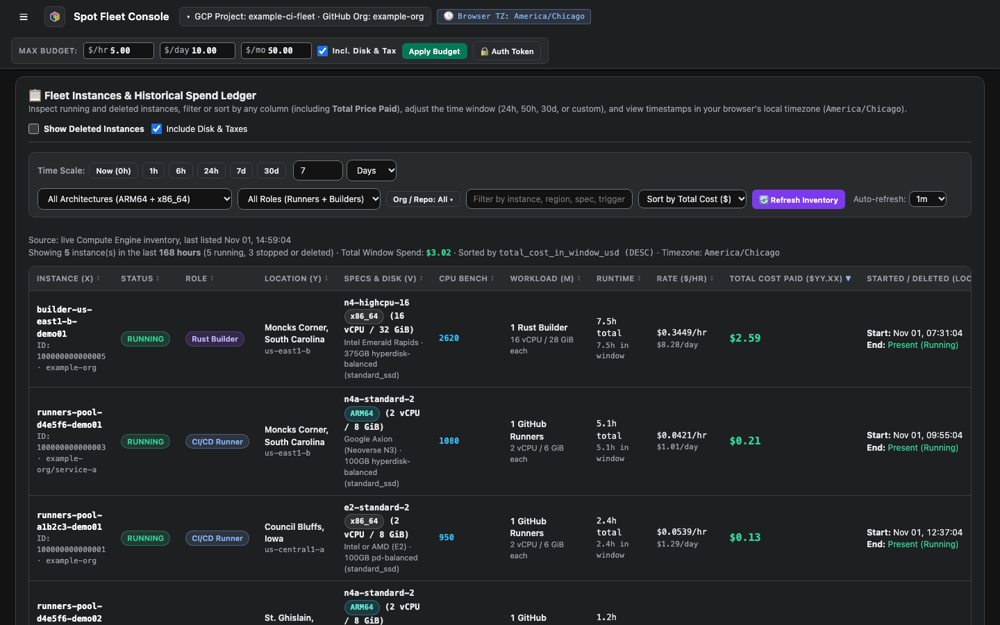

# Review instances and cost

**VM Instances & Cost** lists every host the fleet ran, including deleted ones, with what each one cost.

<figure class="shot walkthrough" markdown>

<figcaption>Changing the time window, filtering by role, searching, sorting, and hiding deleted hosts.</figcaption>
</figure>

## Before you begin

[Sign in](sign-in.md) to the dashboard.

## Find what you need

1. Open **VM Instances & Cost**.

    

1. To change the period that costs cover, click a **Time Scale** button.
1. To narrow the list, pick a role or architecture, or type in the search box. Search matches the host name, region, machine type, and more.

    

1. To sort, click a column header. Click it again to reverse the order.
1. To see only what runs now, clear **Show Deleted Instances**.

    

The list refreshes when you click **Refresh Inventory**, and on the schedule you pick in **Auto-refresh**.
