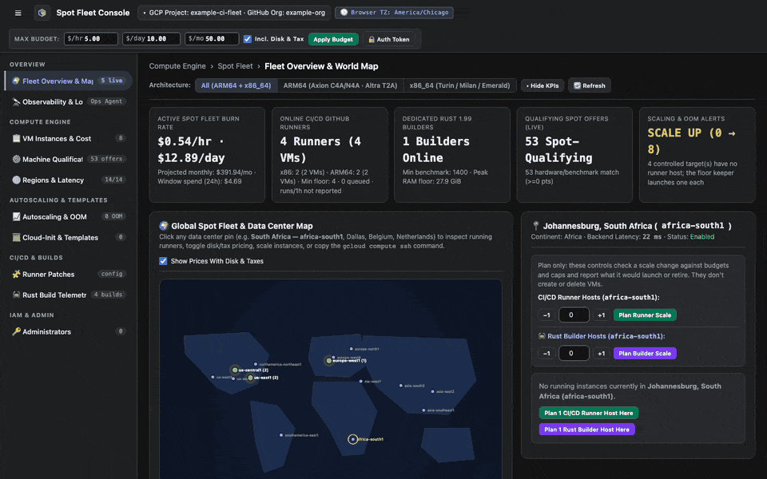
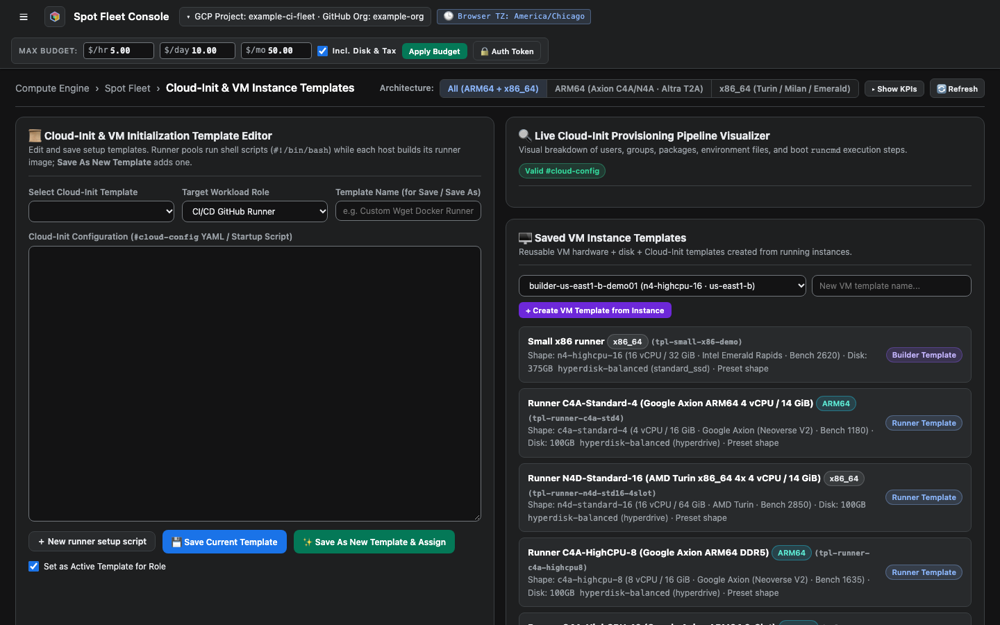

# Save a VM template

A VM template records a host's shape: its machine type, CPU, and disks. Save one from a host that works well, and a sizing profile can use it later.

<figure class="shot walkthrough" markdown>

<figcaption>Picking a host, naming the template, and creating it.</figcaption>
</figure>

## Before you begin

[Sign in](sign-in.md) to the dashboard.

## Save the template

1. Open **Cloud-Init & Templates**.
1. Under **Saved VM Instance Templates**, pick a host from the list.
1. Enter a name for the template.
1. Click **+ Create VM Template from Instance**. The new template joins the list.

    

To use it, pick it in a sizing form on **Machine Qualification**. To write a setup script instead, see [Make a runner setup template](make-a-runner-template.md).
