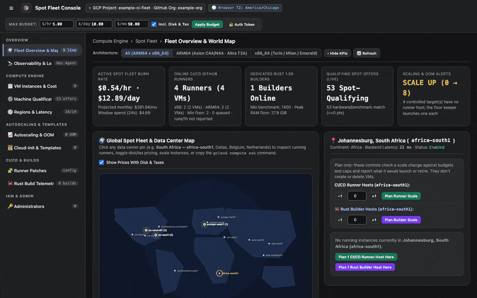
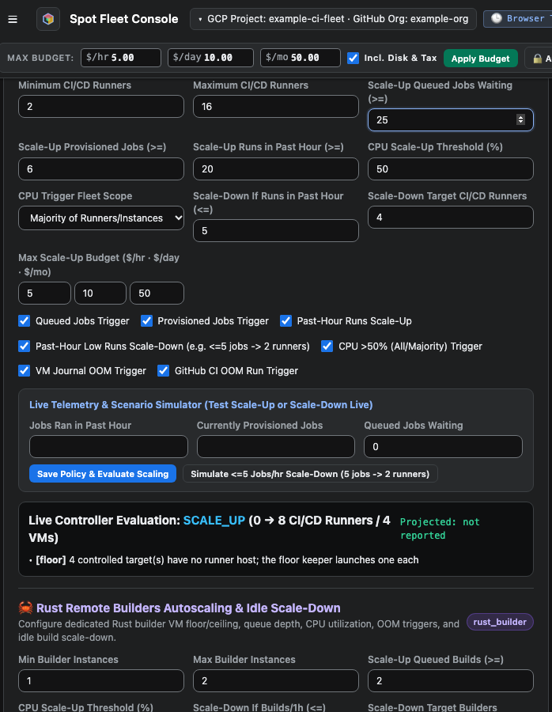
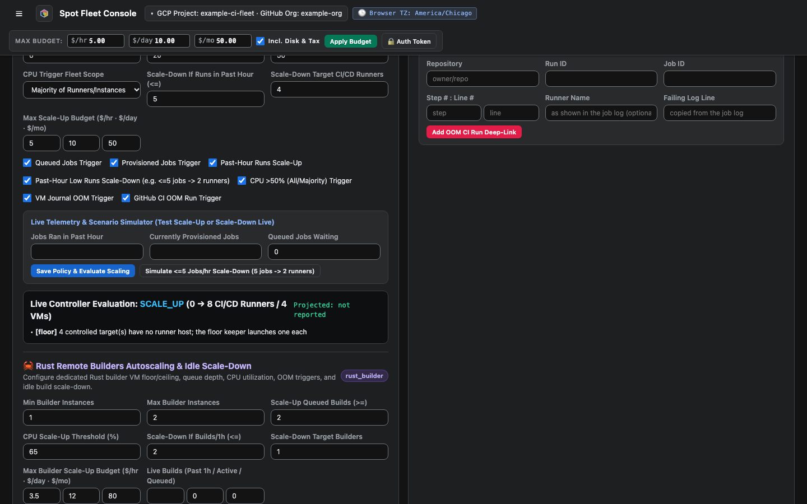

# Set autoscaling and budgets

The budget bar caps what the whole fleet may spend, and **Autoscaling & OOM** sets when the fleet grows and shrinks.

<figure class="shot walkthrough" markdown>

<figcaption>Applying the budget, changing the runner range and queue threshold, and evaluating the policy.</figcaption>
</figure>

## Before you begin

[Sign in](sign-in.md) to the dashboard.

## Set the budget

In the header, enter the most the fleet may spend per hour, day, and month, then click **Apply Budget**. Select **Incl. Disk & Tax** to count those costs too.

## Set the runner policy

1. Open **Autoscaling & OOM**.
1. Set **Minimum CI/CD Runners** and **Maximum CI/CD Runners**.
1. Set the triggers. Each checkbox turns one on or off. **Scale-Up Queued Jobs Waiting** must be at least 20.

    

1. Click **Save Policy & Evaluate Scaling**. **Live Controller Evaluation** shows what the fleet would do, and why.

    

If the policy breaks a rule, the message at the bottom of the page says which one, and nothing changes.

## Set the Rust builder policy

Under **Rust Remote Builders Autoscaling & Idle Scale-Down**, set the same kinds of limits, then click **Save & Evaluate Rust Builder Scaling**.

These policies apply to the fleet floor. [Runner pools](../runner-pools.md) have their own host limits.
