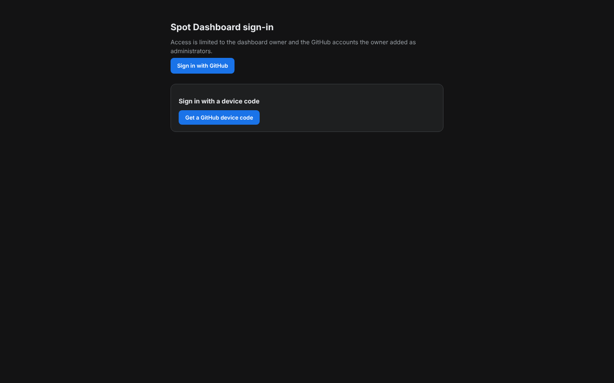
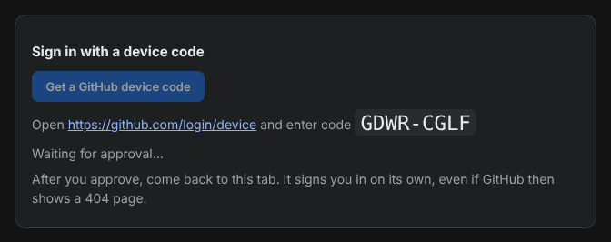
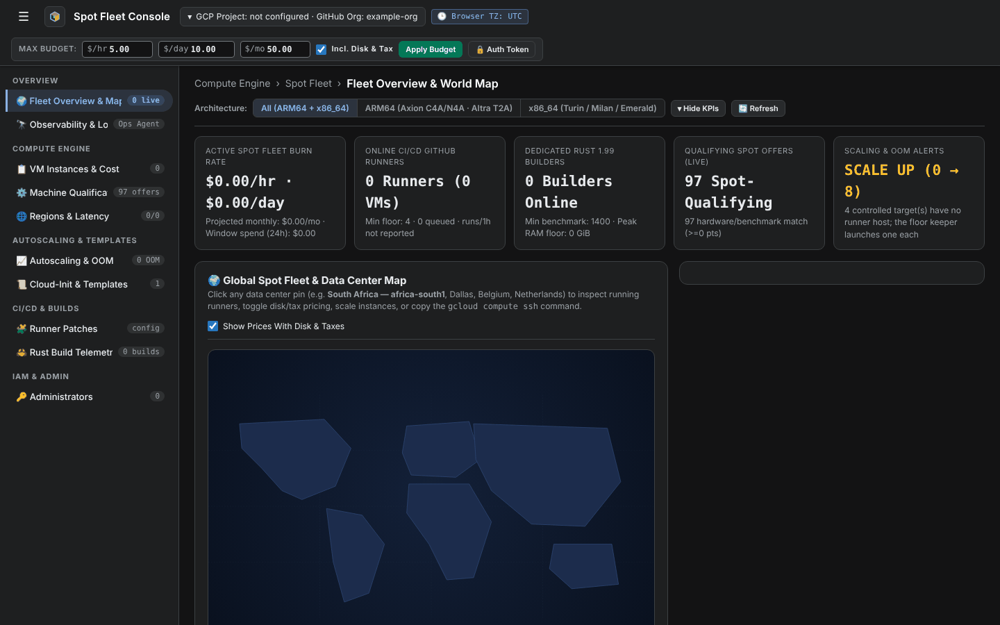

# Sign in to the dashboard

The dashboard signs you in with your GitHub account. You can sign in when you're the dashboard's owner or an [administrator](add-an-administrator.md) the owner added.

<figure class="shot walkthrough" markdown>

<figcaption>Getting a device code, approving it on GitHub, and landing on the dashboard.</figcaption>
</figure>

## Sign in with a device code

1. Open the dashboard. While you're signed out, it shows only the sign-in page.

    

1. Click **Get a GitHub device code**. The page shows a one-time code and the GitHub address to enter it at.

    

1. Open `https://github.com/login/device`, sign in to GitHub if it asks, enter the code, and click **Authorize**.
1. Go back to the dashboard tab. It notices the approval within a few seconds and opens the dashboard.

    

The code expires after 15 minutes. If it expires, click **Get a GitHub device code** again.

After you approve the code, GitHub sometimes shows its own 404 page. The sign-in still worked: go back to the dashboard tab.

## Troubleshooting

- **The page says GitHub signed you in as an account that isn't an authorized administrator**: you approved the code with a GitHub account the owner hasn't added. If you have more than one GitHub account, switch to the right one on GitHub and get a new code. Otherwise, ask the owner to [add you](add-an-administrator.md).
- **The page keeps waiting after you approved**: check that you entered the code shown in this tab. Codes from other tabs or earlier tries don't sign this tab in.

A session lasts 12 hours. Signing out, or an owner removing you as an administrator, ends it sooner.
