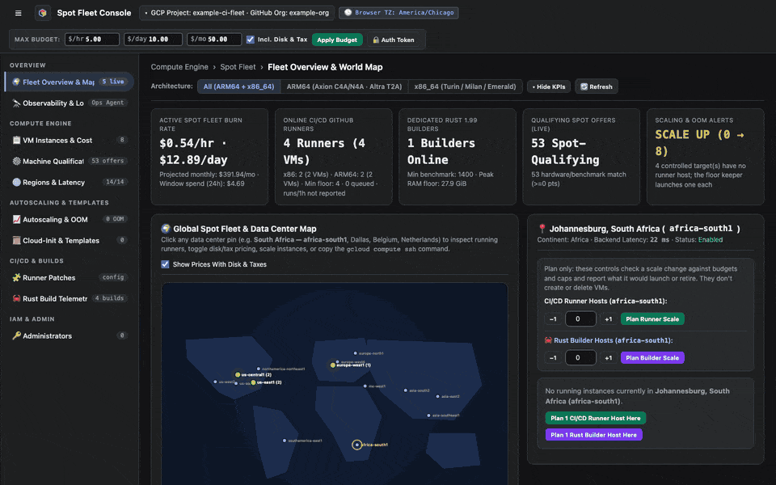

# Tour the dashboard

The dashboard has one page for each part of the fleet. This tour shows what each page is for, so you know where to look.

<figure class="shot walkthrough" markdown>

<figcaption>Each page of the dashboard, with example data.</figcaption>
</figure>

## The pages

Every page shares the header. It shows the budget bar and cards for the burn rate, online runners and builders, qualifying offers, and scaling state. Click **Hide KPIs** to make room.

| Page | What you do there | Guide |
| --- | --- | --- |
| **Fleet Overview & Map** | See where hosts run and inspect a region. | [Explore the fleet map](explore-the-fleet-map.md) |
| **Observability & Logs** | Read host charts and search logs. | [Read observability and logs](read-observability-and-logs.md) |
| **VM Instances & Cost** | See every host and what it cost. | [Review instances and cost](review-instances-and-cost.md) |
| **Machine Qualification** | Size runners, find hosts, and launch pools and builders. | [Find the cheapest hosts](find-cheap-hosts.md), [Launch a runner pool](launch-a-pool.md), [Launch a Rust builder](launch-a-builder.md) |
| **Regions & Latency** | Choose the regions the fleet may use. | [Choose regions](choose-regions.md) |
| **Autoscaling & OOM** | Set scaling triggers and budget caps. | [Set autoscaling and budgets](set-autoscaling.md) |
| **Cloud-Init & Templates** | Write setup scripts and save VM shapes. | [Make a runner setup template](make-a-runner-template.md), [Save a VM template](save-a-vm-template.md) |
| **Runner Patches** | Change per-repository runner manifests through pull requests. | [Edit a runner patch](edit-a-runner-patch.md) |
| **Rust Build Telemetry** | See remote build times and cache hits. | [Track Rust builds](track-rust-builds.md) |
| **Administrators** | Choose who else may sign in. Only the owner sees this page. | [Add an administrator](add-an-administrator.md) |
