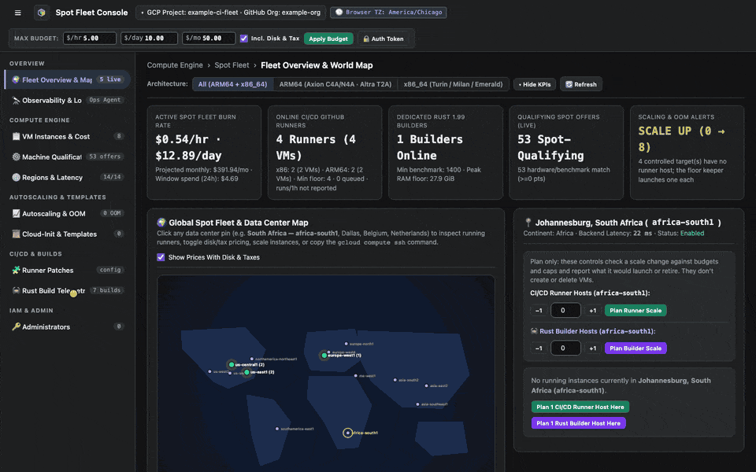
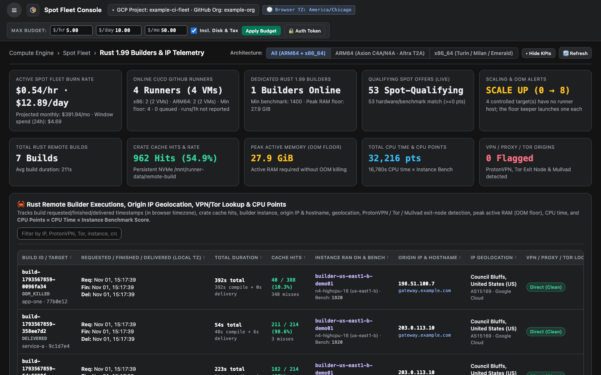
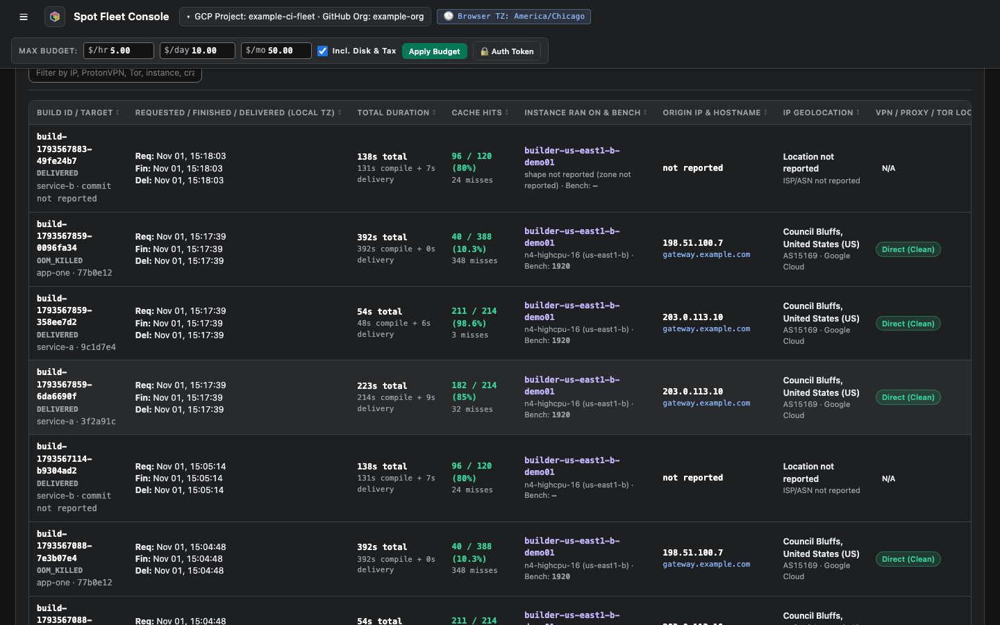

# Track Rust builds

**Rust Build Telemetry** records remote builds: how long they took, their cache hits, peak memory, and where they came from.

<figure class="shot walkthrough" markdown>

<figcaption>Searching for one project and recording a build by hand. The builds are example data.</figcaption>
</figure>

## Before you begin

[Sign in](sign-in.md) to the dashboard.

## Read the builds

1. Open **Rust Build Telemetry**. The cards show totals, and the table shows each build.

    

1. To narrow the table, type in the search box. It matches the project, status, address, and network.

## Record a build by hand

Builds report themselves. Use this form only for a build that didn't.

1. Under **Record a Rust Remote Build**, pick the **Status**.
1. Fill in what you know. A delivered build needs its compile and delivery seconds.
1. Click **+ Record Rust Build**.

    
