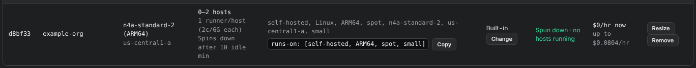
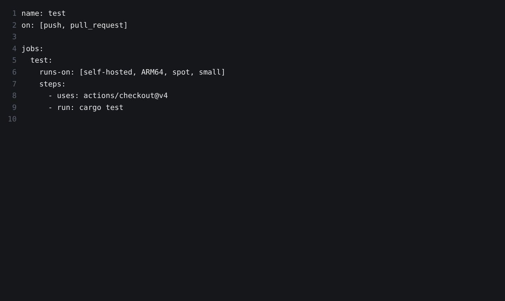

# Point a workflow at a pool

A job runs on a pool's runners when its `runs-on` lists labels that the pool's runners all have. Each pool shows the `runs-on` line to use.

<figure class="shot walkthrough" markdown>

<figcaption>Copying the pool's <code>runs-on</code> line and pasting it into the <code>test</code> job of a workflow in <code>example-org/service-a</code>.</figcaption>
</figure>

## Before you begin

[Launch a runner pool](launch-a-pool.md) for the organization or repository the workflow belongs to.

## Change the workflow

1. In **Machine Qualification**, scroll to **Runner pools** and find the pool's `runs-on` line.

    

1. Click **Copy**.
1. In your repository, open the workflow file under `.github/workflows/` and find the job's `runs-on`.
1. Replace its value with the pool's labels:

    ```yaml
    jobs:
      test:
        runs-on: [self-hosted, ARM64, spot, small]
        steps:
          - uses: actions/checkout@v4
          - run: cargo test
    ```

    

1. Commit and push.

## What happens next

The job waits in the queue. Within 5 minutes the dashboard's reconciler sees it and starts a host, and the host's runner takes the job about 10 minutes after it was queued. Later jobs start right away while a host is up.

For a pool on ARM64 hosts, the job's tools must run on ARM64. Most Linux tools and the Rust toolchain do. If they don't, pick an `x86_64` row in the matrix for the pool.

To watch the pool start a host and spin down again, see [Check on a pool](check-a-pool.md).
