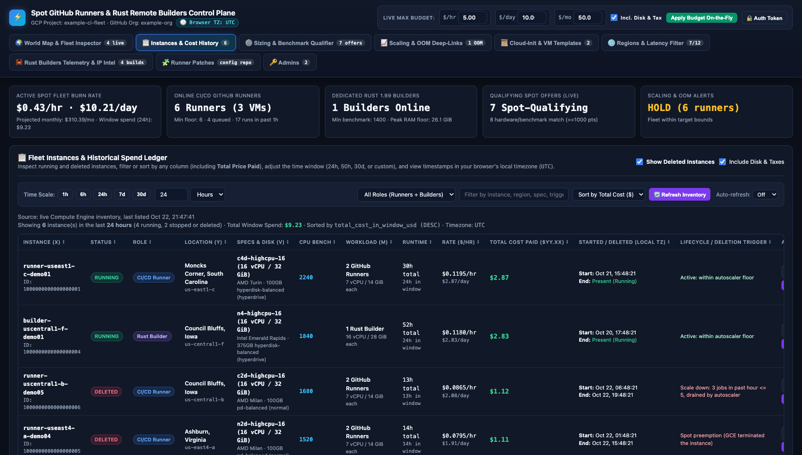
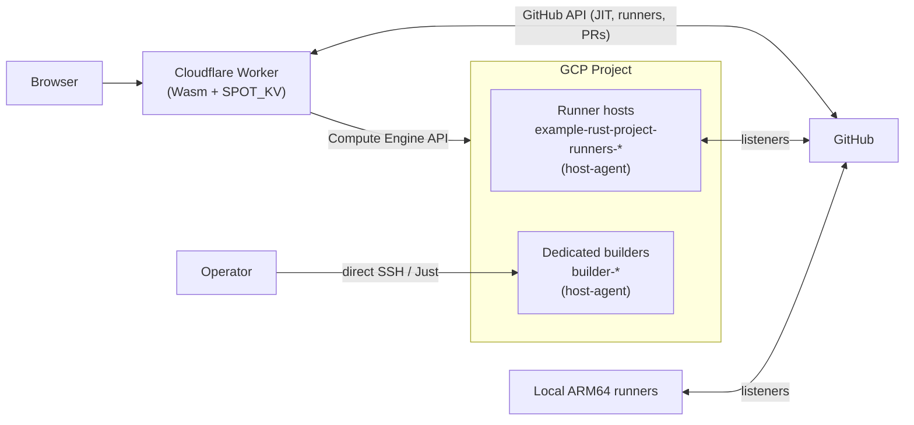

# Spot runner fleet and dedicated builders

This repository provisions and operates persistent GitHub Actions runners and dedicated Rust build VMs on GCP (Google's cloud platform) Spot instances. It mainly serves `example-org/example-rust-project`. It also includes a web dashboard hosted at the edge and a set of persistent local ARM64 Docker runners.

This site describes the source on `main`. Merging source does not update a running controller, container, or VM.
Inspect the deployed configuration and the actual tool versions before you route work to a host.

!!! info "Screenshots use example data"
    Every screenshot and flowchart on this site uses made-up data (`example-ci-fleet`, `example-org`, example
    hosts, RFC 5737 IP addresses, and example templates), not a live deployment. Each figure includes a
    **Reference** footer explaining what it shows. Click any screenshot or SVG flowchart to open the full-screen
    viewer on the same page: left-click an area to zoom in, use the bottom slider or **Reset 100%** button to
    adjust zoom, and press the Left/Right arrow keys (or click the side arrows) to cycle through every image on
    the current page.

## What the repository contains

<figure class="shot" markdown>

<figcaption markdown>End-to-end architecture flowchart showing the two-tier pure-Rust design: the Cloudflare Worker edge control plane backed by Workers KV (`SPOT_KV`) and the native `host-agent` multi-call binary on Spot runner and dedicated builder VMs.</figcaption>
</figure>
<figure class="shot" markdown>

<figcaption markdown>The edge dashboard world map view showing active fleet burn rate, online runners and builders, qualifying Spot offers, the scaling decision, and the region inspector for Iowa.</figcaption>
</figure>
<figure class="shot" markdown>

<figcaption markdown>The Instances and Cost History table listing running and deleted Spot VMs with runtime hours, hourly and daily Spot rates, window spend, lifecycle trigger, and copyable SSH command.</figcaption>
</figure>
<figure class="shot" markdown>

<figcaption markdown>The scaling evaluation panel showing a `SCALE_UP` decision (`6` to `8` runners across `4` VMs) triggered when queued jobs reach the `20`-job threshold, with projected hourly, daily, and monthly spend.</figcaption>
</figure>
<figure class="shot" markdown>

<figcaption markdown>The Rust Builders Telemetry table recording compile and delivery duration, crate cache hit rate, peak active container RAM, and CPU points for each remote build.</figcaption>
</figure>
<figure class="shot" markdown>

<figcaption markdown>The Runner Patches console after validating a repository manifest and saving the change as a GitHub pull request on the configuration repository.</figcaption>
</figure>
<figure class="shot" markdown>

<figcaption markdown>Terminal output of `host-agent --help` showing the eight subcommands compiled into the single native binary deployed on runner hosts and dedicated builders.</figcaption>
</figure>

<!-- /shot -->

| Component | What it does |
| --- | --- |
| Runner fleet | Spot VMs named `example-rust-project-runners-*` run Docker containers that register as GitHub Actions listeners. The edge reconciler provisions, replaces, and drains them. |
| Edge reconciler | A Cloudflare Worker cron trigger running every 5 minutes that maintains a runner floor, scales up on queued backlog (>=20 jobs), cleans terminated VMs, and syncs KV state. |
| Dedicated builders | `builder-*` VMs that register no GitHub runner. They run Rust builds in one resource-limited, unprivileged container with persistent caches. |
| Dashboard | A web UI for fleet telemetry, runner patches, and administrators. It runs as a compiled WebAssembly Worker at Cloudflare's edge backed by Workers KV. |
| Local runners | Two persistent ARM64 Docker runners that run on a local host, outside the GCP fleet. |
| Host agent | A native pure-Rust multi-call binary managing memory lease admission, descriptor-safe cleanup, and Docker security boundaries. |

## Architecture

The scheduled edge reconciler is the autonomous component that manages runner hosts. It queries GitHub Actions and Compute Engine APIs, maintains fleet state in `SPOT_KV`, and enforces rate-limited diff-gating to conserve KV write quotas (<50 writes/day). On runner hosts, the native `host-agent` manages memory leases and descriptor-safe cleanup. Dedicated builders run Rust builds in isolated containers managed by `host-agent docker-admission`. See the [security model](security.md).

## Where to start

- **New to the repository?** Start with [Getting started](getting-started.md), then run the read-only commands.
- **Operating the fleet?** Read [Fleet and autoscaler](fleet-and-autoscaler.md) and
  [Operations and troubleshooting](operations.md).
- **Changing runner hosts?** Read [Runner patches](runner-patches.md).
- **Running the dashboard?** Read [Dashboard](dashboard.md) and the
  [edge hosting guide](edge-dashboard.md).
- **Building Rust remotely?** Read [Set up a builder](dedicated-builders.md),
  [Remote builds and clients](remote-builds.md), and
  [Client workstation setup](client-workstation-setup.md).
- **Updating the documentation or screenshots?** Read
  [Documentation maintenance](maintenance/README.md) and
  [Recreate pictures, callouts, and flowcharts](maintenance/RECREATE_PICTURES.md).

## Choose a workflow

| Goal | Entry point | Creates or changes resources? |
| --- | --- | --- |
| Test host agent crate | `cargo test --manifest-path host-agent/Cargo.toml` | No |
| Test Cloudflare Worker edge crate | `cargo test --manifest-path cloudflare/Cargo.toml` | No |
| Build release Wasm Worker bundle | `cd cloudflare && worker-build --release` | Writes local build artifacts |
| Run all repository tests | `just test` | No |
| Check formatting, crates, and Vale | `just check` | No |
| Probe edge dashboard health | `just probe-edge` | No |
| Clean workspace targets and target directories | `host-agent clean-target <path>` | Cleans local build target directory |
| Manage host memory leases | `host-agent host-admission <subcommand>` | Updates `/var/lib/gha-admission/leases.json` |
| Save runner patch manifest | `POST /api/patch-console/save` | Creates Git branch and pull request |

See the [command reference](commands.md) for every flag.

## Registered listeners are not capacity

<figure class="shot" markdown>

<figcaption markdown>Top-level summary cards separating registered runner slots and running VM counts from per-job memory lease admission headroom.</figcaption>
</figure>
<!-- /shot -->

Twenty registered runners do not mean that twenty jobs can each use 32 GiB at once. Admission reserves memory
before a job starts. The physical host also needs space for its operating system, services, and idle listeners.
Keep the distinction between registered listeners and active jobs in mind whenever you read a runner count.
