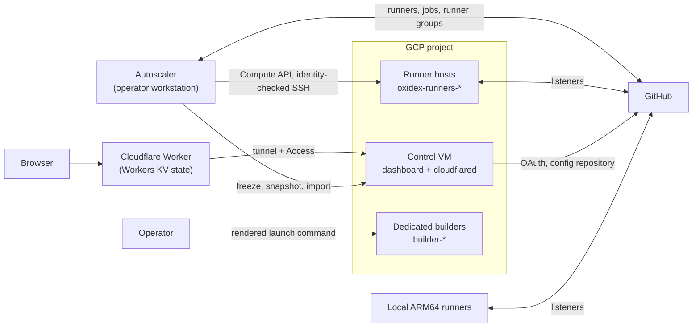

# Spot runner fleet and dedicated builders

This repository provisions and operates persistent GitHub Actions runners and dedicated Rust build VMs on GCP (Google's cloud platform) Spot instances. It mainly serves `swack-tools/oxidex`. It also includes a web dashboard hosted at the edge and a set of persistent local ARM64 Docker runners.

This site describes the source on `main`. Merging source doesn't update a running controller, container, or VM.
Inspect the deployed configuration and the actual tool versions before you route work to a host.

## What the repository contains

| Component | What it does |
| --- | --- |
| Runner fleet | Spot VMs named `oxidex-runners-*` run Docker containers that register as GitHub Actions listeners. A controller sizes, replaces, and drains them. |
| Autoscaler | A controller on an operator workstation that keeps a runner floor, scales by tier, rotates hosts when prices move, recovers lost hosts, and re-runs eligible interrupted jobs. |
| Dedicated builders | `builder-*` VMs that register no GitHub runner. They run Rust builds in one resource-limited, unprivileged container with persistent caches. |
| Dashboard | A web UI for fleet telemetry, runner patches, and administrators. It runs on a small control VM behind a Cloudflare Worker. |
| Local runners | Two persistent ARM64 Docker runners that run on a local host, outside the GCP fleet. |
| Price tools | Commands that read Spot prices, from the official Billing Catalog or Compute Engine price lookups, and the machine inventory. |

## Architecture

The autoscaler is the only long-running component that changes the fleet. It reads GitHub and GCP state, keeps its own
persisted operation state, and changes one host at a time. The dashboard doesn't run on runner hosts, and the control
VM dashboard has no `gcloud` or SSH path to them. A dashboard that an operator runs with
`DASHBOARD_HOT_PATCH_EXECUTOR=gcloud` can reach them over `gcloud compute ssh`. See the [security model](security.md).

## Where to start

- **New to the repository?** Start with [Getting started](getting-started.md), then run the read-only commands.
- **Operating the fleet?** Read [Fleet and autoscaler](fleet-and-autoscaler.md) and
  [Operations and troubleshooting](operations.md).
- **Changing runner hosts?** Read [Runner patches](runner-patches.md).
- **Running the dashboard?** Read [Dashboard](dashboard.md) and the
  [edge hosting guide](edge-dashboard.md).
- **Building Rust remotely?** Read [Set up a builder](dedicated-builders.md) and
  [Remote builds and clients](remote-builds.md).

## Choose a workflow

| Goal | Entry point | Creates or changes resources? |
| --- | --- | --- |
| List Spot compute prices by minimum CPU, RAM, and daily cap | `tools/spot_prices.py` | No |
| Find candidate Spot offers with deployment constraints | `src/spot_finder.py` | No |
| Inspect runners and VMs | `src/runner_fleet.py` | No |
| Preview or provision runner hosts and strict heavy pools | `src/spot_runner_manager.py` | Only with `--apply`, or `--patch-live` (which changes a running host without a preview) |
| Plan or manage runner capacity | `src/spot_runner_autoscaler.py` | Yes, except a tiered `--dry-run` without `--install-launch-agent` |
| Render a dedicated builder launch | `src/render_builder_startup.py` | Writes local files. The generated launch command creates a VM. |
| Build on an explicitly selected legacy host | `src/remote_rust_build.py` | Transfers source and starts a remote build |
| Install Cargo client commands | `src/install_remote_commands.py` | Writes local executable shims |
| Run the web dashboard | `src/web_dashboard.py` | Updates the local dashboard state file. With `SPOT_CONFIG_GH_TOKEN` or `GH_TOKEN` set, `POST /api/patches/save` creates a branch, commits, and opens a pull request on the config repository. With `DASHBOARD_HOT_PATCH_EXECUTOR=gcloud`, `/api/patches/hot-patch` changes running hosts. |
| Inspect, plan, or manage the control VM that hosts the dashboard | `src/control_vm.py` | Only with `--apply`; `render-startup` writes a local file |
| Update an occupied dedicated builder in place | `src/lib/builder_runtime_update.py` | Only with `--apply`, `--finish`, `--recover-finish`, or `--recover-committed` |

See the [command reference](commands.md) for every flag.

## Registered listeners aren't capacity

Twenty registered runners don't mean that twenty jobs can each use 32 GiB at once. Admission reserves memory
before a job starts. The physical host also needs space for its operating system, services, and idle listeners.
Keep the distinction between registered listeners and active jobs in mind whenever you read a runner count.
