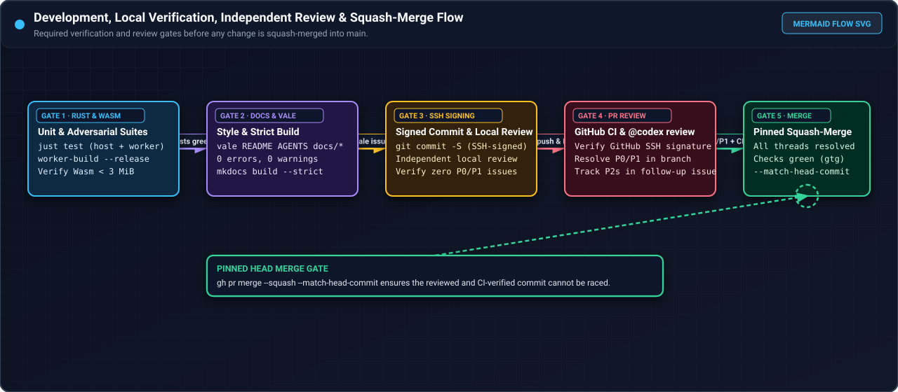
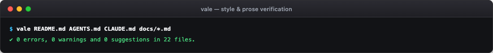
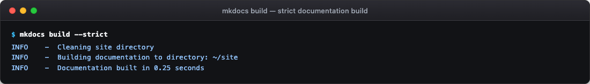

# Documentation maintenance and custom prompts

This folder (`docs/maintenance/`) holds the maintenance guides, tooling instructions, and custom AI agent
prompts needed to keep the GitHub Pages documentation (`docs/`, `mkdocs.yml`) and its visual assets
(`docs/images/`) up to date whenever the codebase changes.

<div class="carousel" markdown>
<div class="carousel-track" markdown>
<figure class="shot" markdown>

<figcaption markdown>Development verification and review gate flowchart: run Rust tests and Wasm build, run Vale and strict MkDocs build, sign commits with SSH, pass independent and `@codex` review, and squash-merge.</figcaption>
</figure>
<figure class="shot" markdown>

<figcaption markdown>Terminal output of `vale README.md AGENTS.md CLAUDE.md docs/*.md` passing with `0` errors, `0` warnings, and `0` suggestions under the Google developer documentation style guide.</figcaption>
</figure>
<figure class="shot" markdown>

<figcaption markdown>Terminal output of `mkdocs build --strict` verifying that every navigation entry, anchor, and embedded image resolves with zero warnings.</figcaption>
</figure>
<figure class="shot" markdown>

<figcaption markdown>Terminal output of `just test` running the `host-agent` and `cloudflare` unit, concurrency, and adversarial test suites.</figcaption>
</figure>
</div>
</div>
<!-- /shot -->

## What this folder contains

| File | Purpose |
| --- | --- |
| [README.md](README.md) | Explains the purpose of `docs/maintenance/`, the documentation maintenance workflow, verification gates, and the master prompt for auditing prose against the Rust source tree. |
| [RECREATE_PICTURES.md](RECREATE_PICTURES.md) | Step-by-step instructions, sanitization rules, callout overlay design, and custom AI agent prompts for recreating all 45 dashboard screenshots, 17 terminal captures, and 18 Mermaid-style SVG flowcharts. |

## When to update the documentation

Run the maintenance workflow in this folder whenever a change modifies any of the following components:

1. **Cloudflare Worker routes, UI controls, or KV keys** (`cloudflare/src/lib.rs`, `cloudflare/src/ui.rs`, `cloudflare/src/state.rs`, `cloudflare/src/reconciler.rs`, `cloudflare/src/patch.rs`, `cloudflare/src/patch_console.rs`, `cloudflare/src/auth.rs`).
2. **Host agent subcommands, flags, or security gates** (`host-agent/src/main.rs`, `host-agent/src/admission.rs`, `host-agent/src/clean_target.rs`, `host-agent/src/docker_admission.rs`, `host-agent/src/docker_wrapper.rs`, `host-agent/src/host_launcher.rs`).
3. **Startup templates, builder images, or local runner Compose files** (`cloud-init/*.sh`, `runner/*`, `builder/*`, `m4air/docker-compose.yml`).
4. **Build recipes, deployment flags, or environment variables** (`justfile`, `cloudflare/wrangler.toml`, `.env.example`).

## Maintenance checklist

Before opening a pull request that updates documentation or screenshots, complete every check in order:

1. **Register new files**:
   - Add an allowlist entry (`!docs/...`) in `.gitignore` so Git tracks new files without `git add -f`.
   - Add a `[docs/<path>.md]` section with `BasedOnStyles = Google` in `.vale.ini`.
   - Add the page to `nav:` in `mkdocs.yml`.
2. **Verify visual standards**:
   - Every page must include **at least 3 PNG screenshots** (average 3 or more per page), plus **Mermaid-style SVG flowcharts** (`docs/images/flow-*.svg`) on flow and process pages.
   - Every image must sit inside `<figure class="shot" markdown>` with a descriptive `<figcaption markdown>` **Reference** footer.
   - Every screenshot must include a visual callout indicator (rounded highlight box, vector arrow, and dark pill label) pointing to the relevant control or output line.
   - Zero real deployment identifiers may appear in prose, PNGs, or SVGs. See [RECREATE_PICTURES.md](RECREATE_PICTURES.md) for the exact synthetic values and leak-check commands.
3. **Run local verification**:
   ```bash
   vale sync
   vale README.md AGENTS.md CLAUDE.md docs/*.md docs/maintenance/*.md
   mkdocs build --strict
   just test
   ```

## Custom prompt for auditing and updating documentation prose

Copy and paste the following prompt into an AI coding agent session to audit and update the documentation
whenever the codebase changes:

```text
Audit and update the MkDocs GitHub Pages documentation in `docs/*.md`, `docs/maintenance/*.md`, and
`mkdocs.yml` so every page matches the current pure-Rust codebase (`cloudflare/` and `host-agent/`).

Requirements:
1. Read `AGENTS.md`, `docs/maintenance/README.md`, and `docs/maintenance/RECREATE_PICTURES.md` first.
2. Work in an isolated Git worktree branched from `origin/main`. Never mutate live cloud resources.
3. Verify every documented API route, status code, UI tab name, KV key, cron schedule, scaling threshold,
   environment variable, `just` recipe, and `host-agent` subcommand flag against the Rust source code.
4. Scrub all sensitive identifiers (real GCP project IDs, owner logins or numeric UIDs, KV or
   account IDs, runner group IDs, real VM names, real IPs, local home directory paths, and verbatim templates). Use
   synthetic placeholders (`example-ci-fleet`, `example-org`, `*-demoNN`, RFC 5737 IPs, `ci-owner`).
5. Ensure every page has at least 3 PNG screenshots (plus `flow-*.svg` diagrams on flow/process pages),
   each wrapped in `<figure class="shot" markdown>` with a descriptive `<figcaption markdown>` footer.
6. Run `vale README.md AGENTS.md CLAUDE.md docs/*.md docs/maintenance/*.md` (must report 0 errors and 0
   warnings under the Google style) and `mkdocs build --strict` (must exit 0 with 0 warnings).
7. Author and SSH-sign commits as configured in `AGENTS.md`, pass an independent review and `@codex review`, and
   squash-merge into `main`.
```
