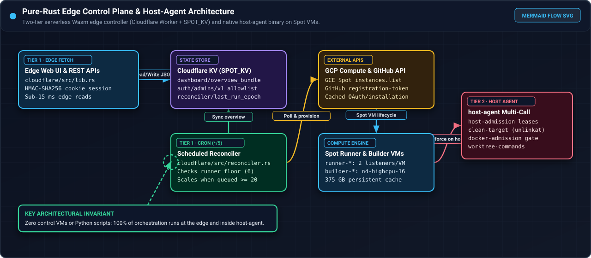
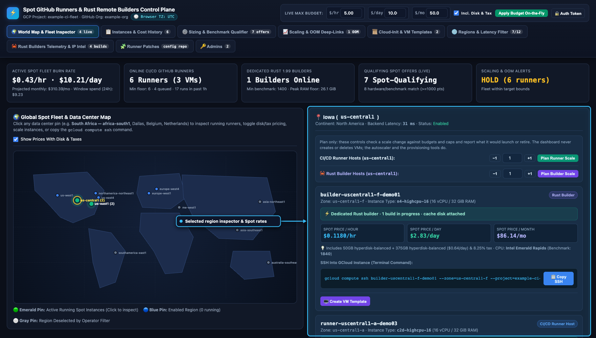
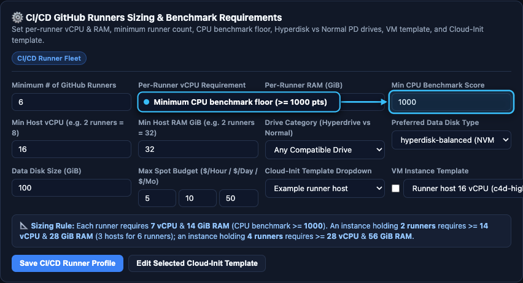
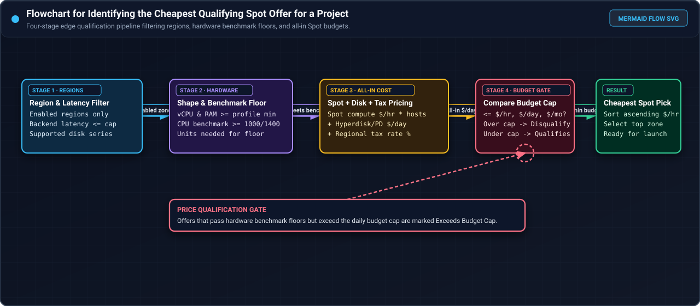
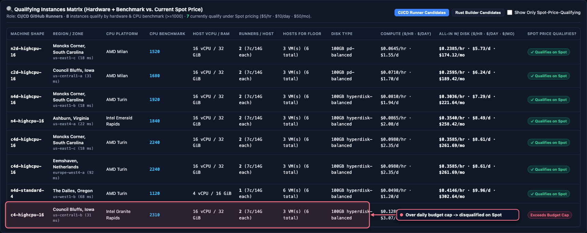

# Recreate pictures, callouts, and flowcharts

This guide explains how to regenerate, annotate, and embed every screenshot (`docs/images/*.png`) and
Mermaid-style SVG flowchart (`docs/images/flow-*.svg`) across the documentation site when the dashboard user
interface (UI), command-line output, or system architecture changes.

<div class="carousel" markdown>
<div class="carousel-track" markdown>
<figure class="shot" markdown>

<figcaption markdown>Example Mermaid-style SVG flowchart (`docs/images/flow-architecture-overview.svg`) with color-coded stage cards, curved vector connectors, and a dashed callout box.</figcaption>
</figure>
<figure class="shot" markdown>

<figcaption markdown>Example annotated dashboard screenshot (`docs/images/map-region-iowa.png`) showing a glowing blue highlight box around the region inspector panel with a vector arrow and callout badge.</figcaption>
</figure>
<figure class="shot" markdown>

<figcaption markdown>Example annotated panel screenshot (`docs/images/scaling-decision-scale-up.png`) highlighting the `SCALE_UP` evaluation triggered when queued jobs reach the `20`-job threshold.</figcaption>
</figure>
<figure class="shot" markdown>

<figcaption markdown>Example annotated security validation screenshot (`docs/images/patches-invalid.png`) highlighting the rejected `/var/run/docker.sock` mount error.</figcaption>
</figure>
</div>
</div>
<!-- /shot -->

## Visual standards and page requirements

Every visual asset on the documentation site follows five rules:

1. **Minimum image density**:
   - Every documentation page must contain **at least 3 PNG screenshots**, with an average of 3 or more PNG screenshots per page across the site.
   - Every flow or process page also includes **at least 1 Mermaid-style SVG flowchart** (`docs/images/flow-*.svg`). SVG flowcharts are not counted toward the minimum of 3 PNG screenshots per page.
2. **Reference footer on every figure**:
   - Every image (PNG or SVG) is wrapped in `<figure class="shot" markdown>` with a `<figcaption markdown>` element describing what the image holds for reference.
   - The style sheet (`docs/stylesheets/extra.css`) prefixes each footer with **`Reference —`** and styles it as a card footer attached to the bottom of the figure.
3. **Visual callout indicators inside screenshots**:
   - Every screenshot includes a rounded highlight box (`rx="8"`, `2.5px` stroke, translucent fill, drop shadow), a curved vector arrow with an explicit `<polygon>` arrowhead, and a dark pill badge (`#0f172a`) pointing to the focal UI section or terminal output line.
4. **Interactive carousels for multi-image sections**:
   - When two or more figures appear under the same heading, wrap them in `<div class="carousel" markdown><div class="carousel-track" markdown>...</div></div>`.
   - `docs/javascripts/carousel.js` automatically attaches **‹ Previous** and **Next ›** buttons and a slide counter (`1 / N`).
5. **In-page full-screen zoom and cycle viewer**:
   - Clicking any `.shot img` (PNG or SVG) opens the in-page full-screen viewer (`docs/javascripts/carousel.js`) without changing the browser URL or opening an iframe or popout window.
   - Left-clicking a specific area of the image zooms into that focal point (`100%` $\rightarrow$ `220%` $\rightarrow$ `340%`); dragging pans across the zoomed image.
   - The bottom bar displays the figure's **Reference** footer, a `100%`–`400%` zoom slider, and a **Reset 100%** button.
   - Pressing `ArrowLeft` / `ArrowRight` on the keyboard or clicking the side arrows (`‹` / `›`) cycles through all figures on the current page only; pressing `Escape` or clicking `✕` closes the viewer.

## Mandatory sanitization rules

The documentation site is public. Never capture screenshots from a live production session or include real
infrastructure identifiers. Use only the synthetic values below:

| Category | Forbidden in public docs and images | Required synthetic replacement |
| --- | --- | --- |
| GCP project ID | Real project IDs | `example-ci-fleet` |
| GitHub organization and repositories | Real organization or internal repository names | `example-org`, `example-org/service-a`, `example-org/service-b`, `example-org/spot-runners-config` |
| VM instance names | Production runner or builder hostnames | `runner-useast1-c-demo01`, `runner-useast1-b-demo02`, `runner-uscentral1-a-demo03`, `builder-uscentral1-f-demo01` |
| IP addresses and ASNs | Any routable public or private IP outside RFC 5737 | `192.0.2.x`, `198.51.100.24`, `203.0.113.57` (RFC 5737 TEST-NET) and `AS64500`, `AS64501` |
| User logins and UIDs | Real GitHub usernames or numeric UIDs | `ci-owner` (`100001`), `ops-admin` (`100002`), `release-bot-admin` (`100003`), `new-operator` (`100005`) |
| Local filesystem paths | Workstation home directory paths | `~` or `/tmp/demo/target` |
| Templates (`cloud-init`, patches) | Verbatim copies of `cloud-init/*.sh` or production manifests | Synthetic but schema-valid example YAML and shell snippets |

## Recreate the 45 dashboard UI screenshots

The dashboard UI is embedded in `cloudflare/src/ui.rs` as two raw HTML strings (`DASHBOARD_HTML` and
`LOGIN_HTML`). To recreate the 45 UI screenshots when `ui.rs` changes:

1. **Extract the embedded HTML templates** into a temporary scratch directory (outside the Git checkout):
   - Extract `DASHBOARD_HTML` from `cloudflare/src/ui.rs`, replace the static placeholder project text with `example-ci-fleet` and organization with `example-org`, and save as `dashboard.html`.
   - Extract `LOGIN_HTML` from `cloudflare/src/ui.rs` and save as `login.html`.
2. **Start a local Node mock server with Playwright**:
   - Serve `dashboard.html` at `/` and `login.html` at `/login`.
   - Serve synthetic JSON payloads for `/api/overview`, `/api/health`, `/api/auth/status`, `/api/patches`, `/api/patches/manifest`, `/api/patches/validate`, `/api/patches/save`, `/api/patches/preview`, `/api/admins`, `/api/admins/add`, `/api/inventory/refresh`, `/auth/device/code`, and `/auth/device/token`.
   - Ensure the mock data matches the real Rust response structures in `cloudflare/src/{lib,state,reconciler,patch,patch_console,auth}.rs`:
     - In the scale-up scenario (`scaling-decision-scale-up.png` and `ui-kpis-scale-up.png`), emit `direction: "scale_up"` with `{ trigger: "queued_jobs", summary: "24 queued jobs >= threshold 20" }` and `budget_capped: false` so the screenshot matches `cloudflare/src/reconciler.rs`.
     - In `qualifier-builders.png`, list `n4-highcpu-16` with `375 GB` `hyperdisk-balanced` storage.
     - In `patches-invalid.png`, return `{ valid: false, errors: [{ field: "container.mounts[0].source", message: "forbidden_mount_source: /var/run/docker.sock" }], patch_sha256: "", effective: null }` so `renderErrors` populates `#rp-errors` and clears `#rp-effective`.
     - When capturing `scaling-runner-policy.png` and `scaling-builder-policy.png`, isolate the runner policy section from `#builder-scaling-decision-box`'s parent container so each image shows its respective role controls.
     - When setting `#reg-max-latency` to `60` for `regions-low-latency.png`, also update `#reg-lat-val` text to `"60 ms"`.
3. **Inject the SVG callout indicator before each capture**:
   - Before calling `.screenshot()`, look up the target selector for the current filename in `UI_CALLOUTS`, compute `target.getBoundingClientRect()` relative to the screenshot container bounds, and append a fixed `<svg id="__doc_callout">` overlay containing:
     - A `<filter id="cglow" filterUnits="userSpaceOnUse">` drop shadow (always set `filterUnits="userSpaceOnUse"` so horizontal or vertical arrow paths with zero bounding-box height or width are never clipped).
     - A rounded highlight `<rect>` around the target element.
     - A cubic Bezier `<path>` and `<polygon>` arrowhead pointing from the callout pill to the edge of the highlight box.
     - A dark pill `<rect>` (`#0f172a`) with a colored status dot and bold white label text.
   - Remove `#__doc_callout` immediately after `.screenshot()` completes.

## Recreate the 20 terminal captures and VS Code screenshot

To recreate the `term-*.png` images and `vscode-remote-build.png` when command-line tool flags, test counts, or API shapes change:

1. **Capture real read-only command outputs** from a clean worktree (with `PATH="$HOME/.cargo/bin:$PATH"`):
   - `term-host-agent-help.png`: `cargo run -q --manifest-path host-agent/Cargo.toml -- --help` (displayed as `$ host-agent --help`).
   - `term-just-list.png`: `just --list`.
   - `term-cargo-test.png`: `just test` (condensed per-suite `Running tests/...` and `test result: ok. N passed` lines from the real run).
   - `term-vale.png`: `vale README.md AGENTS.md CLAUDE.md docs/*.md`.
   - `term-mkdocs-build.png`: `mkdocs build --strict` (with the Material 2.0 notice banner stripped).
   - `term-worker-build.png`: `cd cloudflare && worker-build --release` followed by `ls -lh build/index_bg.wasm`.
   - `term-fmt-check.png`: `just fmt-check`.
   - `term-host-agent-admission.png`, `term-clean-target.png`, `term-toolchain-probe.png`: real subcommand outputs against temporary paths (`/tmp/demo/target`).
   - `term-env-example.png`, `term-m4air-compose.png`: sanitized excerpts of `.env.example` and `m4air/docker-compose.yml`.
   - `term-gcp-project.png`, `term-api-health.png`, `term-api-scaling.png`, `term-patch-validate.png`, `term-builder-readiness.png`: example outputs matching the exact JSON structures in `cloudflare/src/` and `cloud-init/builder-startup.sh`.
   - `term-client-just-build.png`, `term-client-cargo-profiles.png`, `term-client-llm-agent.png`, `vscode-remote-build.png`: client workstation examples showing `select-idle-rust-builder` skipping a busy builder (`builder-uscentral1-f-demo01`) and selecting an idle builder (`builder-uscentral1-f-demo02`) for `just`, `cargo` (`debug` and `release`), VS Code `.vscode/tasks.json`, and LLM coding agents (`codex` / `claude`).
2. **Sanitize with word boundaries**:
   - Strip ANSI escape sequences, replace home directory paths with `~`, and use word-boundary regular expressions (`\b...\b`) when scrubbing local usernames so substrings inside words like `challenger` (`test_adversarial_challenger_1.rs`) are never altered.
3. **Render in the macOS terminal HTML template with callouts**:
   - Render each `.txt` capture inside a `1120px` dark terminal window (`.terminal-window`), locate the target `#callout-anchor` line, inject the SVG highlight box + vector arrow + callout pill (`filterUnits="userSpaceOnUse"`), and screenshot `.terminal-window` with Playwright.

## Recreate the 19 SVG flowcharts

The 19 `docs/images/flow-*.svg` files are standalone `1280×560` dark-slate SVG diagrams (`viewBox="0 0 1280 560"`):

- `flow-architecture-overview.svg` (`docs/index.md`)
- `flow-getting-started.svg` (`docs/getting-started.md`)
- `flow-spot-qualification.svg` (`docs/spot-pricing.md`)
- `flow-vm-provisioning.svg` (`docs/provisioning.md`)
- `flow-reconciler-scaling.svg` (`docs/fleet-and-autoscaler.md`)
- `flow-cron-reconciler-tick.svg` (`docs/cloud-run-autoscaler.svg` / `docs/cloud-run-autoscaler.md`)
- `flow-runner-patch-lifecycle.svg` (`docs/runner-patches.md`)
- `flow-device-signin.svg` (`docs/dashboard.md`)
- `flow-edge-worker-request.svg` (`docs/edge-dashboard.md`)
- `flow-dedicated-builder-launch.svg` (`docs/dedicated-builders.md`)
- `flow-builder-in-place-update.svg` (`docs/builder-runtime-updates.md`)
- `flow-remote-build-execution.svg` (`docs/remote-builds.md`)
- `flow-idle-builder-selection.svg` (`docs/client-workstation-setup.md`)
- `flow-local-arm64-lifecycle.svg` (`docs/local-arm64-runners.md`)
- `flow-config-precedence.svg` (`docs/configuration.md`)
- `flow-oom-classification.svg` (`docs/operations.md`)
- `flow-defense-in-depth.svg` (`docs/security.md`)
- `flow-pre-pr-verification.svg` (`docs/development.md` and `docs/maintenance/README.md`)
- `flow-workflow-simplification.svg` (`docs/simplification.md`)

When naming new `.svg` or `.png` files in `docs/images/`, avoid filenames containing `-us-` or `-oauth-` because Vale's `Google.We` and `Google.WordListCase` rules lint image paths inside Markdown links.

## Embed figures and carousels in Markdown pages

Use the following HTML/Markdown structure (enabled by `md_in_html` in `mkdocs.yml`) so both the carousel and
the full-screen zoom/cycle viewer work automatically:

```html
<!-- Single figure -->
<figure class="shot" markdown>

<figcaption markdown>CI/CD Runner Sizing profile configuring minimum runners, per-runner vCPU and RAM, minimum CPU benchmark score, data disk size, and budget caps.</figcaption>
</figure>
<!-- /shot -->

<!-- Multi-image carousel (2 or more figures, including SVG flowcharts) -->
<div class="carousel" markdown>
<div class="carousel-track" markdown>
<figure class="shot" markdown>

<figcaption markdown>Flowchart for identifying the cheapest qualifying Spot runner or builder offer for a specific project: filter enabled regions and latency, check the hardware benchmark floor, add disk and tax costs, and compare against the active budget cap.</figcaption>
</figure>
<figure class="shot" markdown>

<figcaption markdown>Qualifying Instances Matrix for CI/CD runner candidates comparing CPU benchmark scores and all-in Spot rates against the daily budget cap.</figcaption>
</figure>
</div>
</div>
<!-- /shot -->
```

## Custom prompt for recreating all pictures and flowcharts

Copy and paste the following prompt into an AI coding agent session whenever you want to regenerate the
screenshots, callout annotations, and SVG flowcharts from scratch:

```text
Regenerate all sanitized documentation screenshots (`docs/images/*.png`) and Mermaid-style SVG flowcharts
(`docs/images/flow-*.svg`) and update their placements across `docs/*.md` and `docs/maintenance/*.md`.

Follow `docs/maintenance/RECREATE_PICTURES.md` and `AGENTS.md`:
1. Work in an isolated Git worktree based on `origin/main`. Do not run any command that mutates cloud
   resources (`wrangler deploy`, `gcloud compute` writes, or GitHub runner mutations).
2. Extract the current `DASHBOARD_HTML` and `LOGIN_HTML` from `cloudflare/src/ui.rs` into a scratch
   directory and render all 45 UI screenshots via headless Playwright Chromium (`1760x1000`, `UTC`) against
   synthetic mock data (`example-ci-fleet`, `example-org`, `*-demoNN`, RFC 5737 IPs, `ci-owner`, and
   schema-valid synthetic templates).
3. Run the read-only local CLI/test commands (`host-agent --help`, `just --list`, `just test`, `vale`,
   `mkdocs build --strict`, `worker-build --release`, `just fmt-check`, `host-agent admission`,
   `host-agent clean-target`, `host-agent toolchain-probe`), sanitize paths with word-boundary regexes, and
   render all 17 `term-*.png` captures in the dark macOS terminal wrapper (`1120px` width).
4. Inject a visual callout indicator (rounded highlight box, curved vector arrow with `<polygon>` arrowhead,
   and `#0f172a` pill badge with `filterUnits="userSpaceOnUse"`) into every UI and terminal screenshot
   before calling `.screenshot()`.
5. Regenerate the 18 dark-themed `1280x560` SVG flowcharts (`docs/images/flow-*.svg`) covering all flow and
   process pages.
6. Ensure every page has at least 3 PNG screenshots (average >= 3 per page) plus SVG flowcharts on
   flow/process pages, wrapped in `<figure class="shot" markdown>` with a descriptive `<figcaption markdown>`
   Reference footer and `<div class="carousel" markdown>` when a section has multiple images.
7. Verify zero sensitive leaks across all PNGs, SVGs, and Markdown files; run
   `vale README.md AGENTS.md CLAUDE.md docs/*.md docs/maintenance/*.md` (0 errors, 0 warnings) and
   `mkdocs build --strict` (0 warnings); commit with an SSH signature per `AGENTS.md`, get an independent
   review and `@codex review`, and squash-merge into `main`.
```
