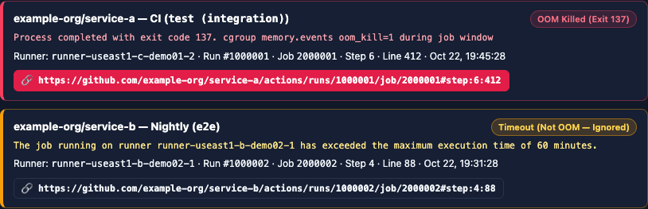

# Operations and troubleshooting

This page collects operational safety rules, telemetry log paths, state storage locations,
recovery procedures, and troubleshooting guidance for the pure-Rust runner fleet and dedicated builders.

## Safety rules

### Preview before changing resources

Code or documentation edits do not authorize live cloud mutations. Before creating, modifying,
draining, or deleting GCP VMs, persistent disks, GitHub runner registrations, or Cloudflare edge resources,
obtain explicit authorization.

| Tool or action | Read-only effect | What applies mutations |
| --- | --- | --- |
| `just check`, `just test` | Validates Rust code and runs local test suites | Nothing in the cloud |
| `wrangler dev` | Emulates Worker execution and Workers KV locally | Nothing in the cloud |
| `just deploy-worker` | Prints the gcloud project that it deploys with | Deploys Worker bundle and updates edge Cron Triggers |
| `host-agent toolchain-probe` | Validates compiler, browser, and cgroup limits | Emits structured JSON without modifying system state |
| Edge reconciler (`cloudflare/src/reconciler.rs`) | Evaluates fleet state against policy on schedule | Executes GCE REST calls when runner demand changes |

### Never replay fresh-host bootstrap

The bootstrap scripts `cloud-init/startup.sh` and `cloud-init/builder-startup.sh` are intended solely for fresh
VM instances. Never replay them on an occupied runner host or dedicated builder:

- Runner hosts execute `startup.sh` once during initial boot; the script deletes its metadata upon completion.
- Builder bootstrap scripts check `/var/lib/oxidex-builder-bootstrap.complete` and hold execution with exit status 75
  if existing runner processes or admission services are detected.
- To update runtime binaries or toolchains on a dedicated builder, follow the update procedure in
  [Runtime updates](builder-runtime-updates.md).

### Never delete or hand-edit protective state

Do not remove or edit protective state files to bypass holds, drains, or recovery locks:

- The admission lease ledger `/var/lib/gha-admission/leases.json` on runner hosts and builders.
- Drain markers `/run/gha-runner-cordon/draining` and `/run/oxidex-build-draining`.
- Builder readiness receipts in `/var/lib/oxidex-builder/` and bootstrap markers.
- Edge state snapshots stored under the `dashboard:state` key in Workers KV.

A hold records why execution paused. Resolve the underlying cause and permit the subsystem that placed
the hold to clear it.

### Keep runner and builder lifecycles separate

| Property | Runner host | Dedicated builder |
| --- | --- | --- |
| Instance naming | `oxidex-runners-*` | `builder-*` |
| GitHub registration | Registers runner listeners in designated runner group. | Registers zero GitHub runners. |
| Attached disk | Data disk provisioned with `auto-delete=yes`. Deleting VM removes disk. | Cache disk provisioned with `auto-delete=no`. Disk survives VM deletion. |
| Drain mechanism | Cordon host, transition runners to drain group, await job completion. | Deny new builds, await active compilations, leases, and cache locks. |

Runner idleness does not indicate dedicated builder availability, and builder drains do not apply to runner hosts.

### Classify out-of-memory exits with evidence



*The OOM panel separates confirmed out-of-memory kills (exit code 137 with cgroup evidence) from timeouts, and links to the exact job step and log line.*

Exit status 137 indicates that a process received `SIGKILL`. It does not confirm an out-of-memory event or
identify the affected boundary. Correlate kernel and cgroup metrics within the exact job execution interval:

- A kernel line containing `Out of memory: Killed process` or `constraint=CONSTRAINT_NONE` confirms a host-level OOM.
- A line containing `Memory cgroup out of memory: Killed process` or `constraint=CONSTRAINT_MEMCG` confirms a container OOM.

### Label evidence accurately

Local test discovery, remote container runs, GitHub Actions CI runs, and live cloud observations prove different
facts. State the exact command, environment, and commit SHA when reporting results. Do not claim production
qualification from local tests or bootstrap probes.

## Logs and state locations

| Subsystem | Telemetry and logs | State files and markers |
| --- | --- | --- |
| Edge control plane (Cloudflare Worker) | Cloudflare Worker real-time logs via `wrangler tail`. | Workers KV namespace binding `SPOT_KV` key `dashboard:state`. |
| Runner host | `/var/log/gha-runner-bootstrap.log`, `journalctl -u google-startup-scripts.service`. | `/var/lib/gha-runner-bootstrap.complete`, `/var/lib/gha-admission/leases.json`, `/run/gha-runner-cordon/draining`. |
| Dedicated builder | `/var/log/oxidex-builder-bootstrap.log`. | `/var/lib/oxidex-builder-bootstrap.complete`, `/var/lib/oxidex-builder-readiness.json`, `/run/oxidex-build-draining`. |
| Host agent daemon | Systemd service journal for `gha-admission.service`. | UNIX socket at `/run/gha-admission/socket`, state in `/run/gha-docker-wrapper/`. |

## Inspect a host

Connect to the runner host or dedicated builder through an approved administrative connection and inspect
state without mutating files:

```bash
# Check bootstrap logs
sudo journalctl -u google-startup-scripts.service --no-pager

# Check builder readiness and toolchain verification
sudo cat /var/lib/oxidex-builder-readiness.json

# Check admission leases and memory headroom
sudo cat /var/lib/gha-admission/leases.json
host-agent admission headroom --json

# Check active container limits
sudo docker inspect --format \
  '{{.HostConfig.NanoCpus}} {{.HostConfig.Memory}} {{.HostConfig.MemorySwap}}' \
  CONTAINER_ID
```

Memory limits are expressed in bytes; `NanoCpus` is expressed in billionths of a CPU. A zero CPU field does not
prove an unconstrained container. Inspect `cpu.max`, `memory.max`, and `memory.swap.max` in the container cgroup directory.

## Recovery procedures

The edge reconciler and host agent handle standard recovery scenarios automatically.

### Lost runner hosts and failed jobs

The edge reconciler evaluates VM instances against GitHub runner registrations:

- If a Spot instance is preempted, the reconciler identifies the missing host during its scheduled check.
- Stale runner registrations belonging to the preempted host are deregistered through GitHub REST API calls.
- Replacement runner capacity is provisioned when queued workflow demand warrants it.

### Interrupted builder runtime update or bootstrap

If a dedicated builder bootstrap or runtime update is interrupted:

- Check the bootstrap log at `/var/log/oxidex-builder-bootstrap.log` or systemd startup service logs:
  ```bash
  sudo journalctl -u google-startup-scripts.service --no-pager
  ```
- Check whether a bootstrap lock or drain is held:
  ```bash
  ls -l /run/oxidex-builder-bootstrap.lock /run/oxidex-build-draining
  ```
- Verify admission service status and lease ledger:
  ```bash
  sudo systemctl status gha-admission.service
  host-agent admission headroom --json
  ```
- If an in-place container rebuild was interrupted, verify Docker images and run the toolchain probe:
  ```bash
  sudo docker images
  sudo /usr/local/bin/oxidex-remote-build bootstrap-tools /usr/local/bin/oxidex-toolchain-probe
  ```
- If host state remains inconsistent, drain the instance and rotate to a fresh VM instance while preserving the persistent cache disk.

### Workers KV edge state reconciliation

The Cloudflare Worker edge reconciler reads stored fleet state from Workers KV using the `SPOT_KV` binding.
If an edge write conflict occurs, the reconciler re-reads current GCE instance lists and GitHub runner inventory,
evaluates capacity against policies, and commits a fresh JSON state snapshot.

## Troubleshooting

| Symptom | Cause and recovery action |
| --- | --- |
| Job fails before first step with `Runner host is being retired` | The reconciler cordoned the host after GitHub assigned a job. GitHub does not reassign it automatically. Re-run the job in GitHub Actions. |
| Log shows `Retirement held for <host>` | The host runner containers lack the cordon hook or mount. The host remains in service until replaced by a cordon-capable instance. |
| Log shows `Retirement held: live heavy route has no verified replacement` | The reconciler protects active heavy-runner routes until a replacement host is verified. Verify replacement host capacity and registration. |
| Dashboard sign-in fails with HTTP 403 | GitHub OAuth 2.0 user lacks administrator permissions on controlled repositories or organizations. Verify `DASHBOARD_GLOBAL_ADMINS` or repository roles. |
| Dashboard patch save fails | Token lacks pull request write permissions on configuration repository. Verify `SPOT_CONFIG_GH_TOKEN` or `GH_TOKEN` scopes. |
| Dedicated builder rejects build with exit 75 | The builder is draining, bootstrap is incomplete, or memory admission denied the lease. Check `/run/oxidex-build-draining` and active leases. |
| Uploader transfer permission denied | User account or key does not match approved uploader mapping. Verify `/etc/oxidex-remote-build.json` and SSH keys. Do not broaden file permissions. |
| Process killed with exit status 137 | Examine cgroup and kernel logs for OOM signatures. Distinguish host memory pressure from container limits before modifying allocations. |
| Runner registration timeout | Bootstrap did not complete within the timeout threshold. Check `/var/log/gha-runner-bootstrap.log` and verify network reachability and GitHub token validity. |
