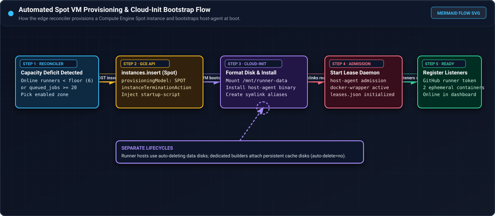
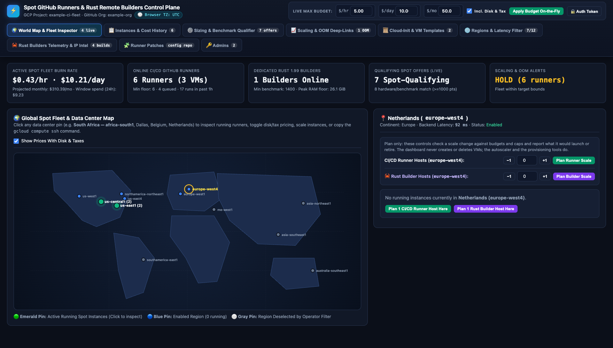
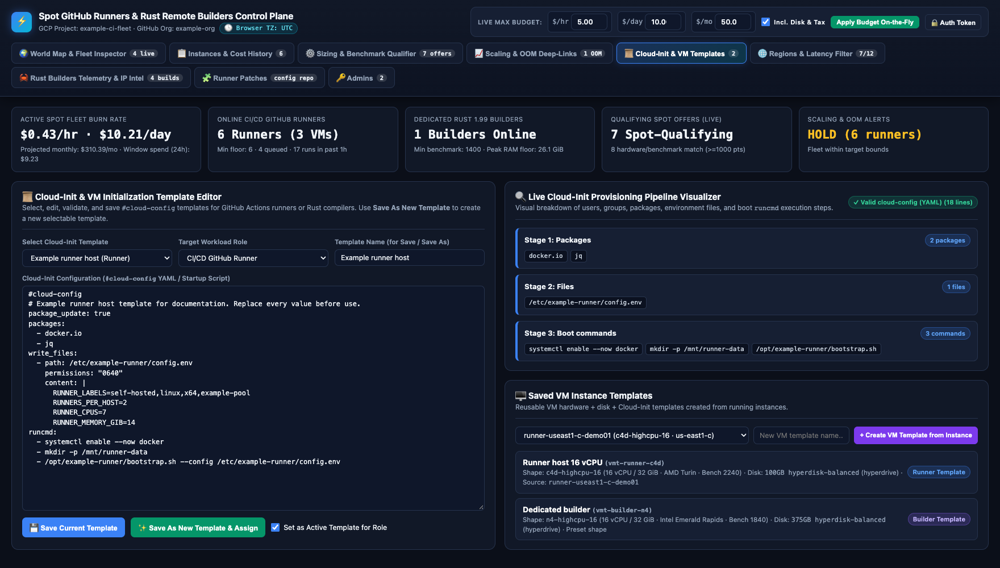
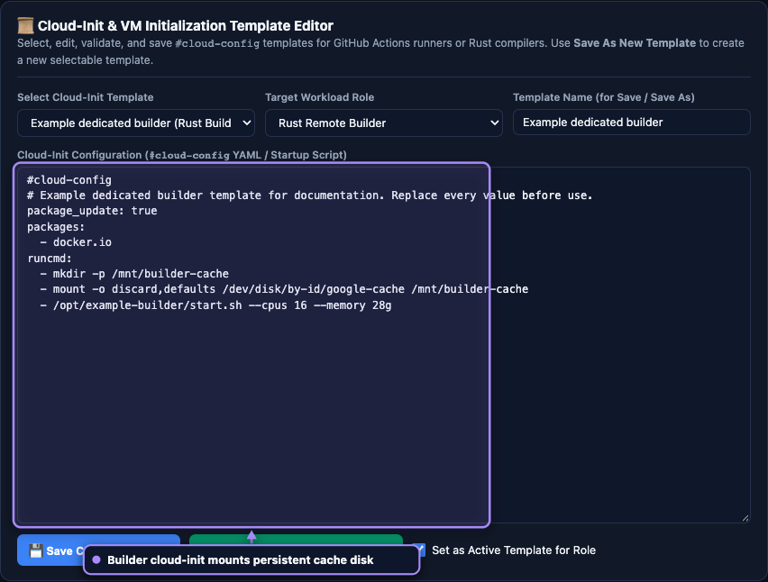
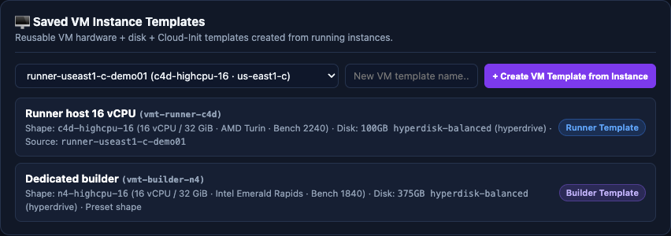
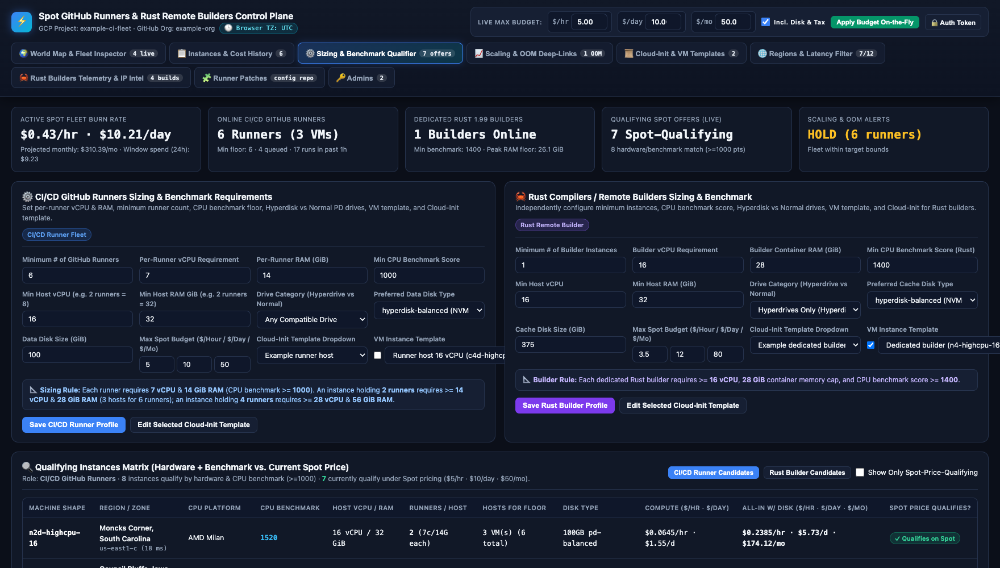

# Provision runner hosts

Runner host provisioning is automated by the Cloudflare Worker edge reconciler, which renders `cloud-init/startup.sh`
into Compute Engine instance metadata and provisions instances using the Compute Engine REST API (`instances.insert`).
The startup script installs the native pure-Rust `host-agent` binary and configures symlinks for `clean-target`,
`host-admission`, and `docker-wrapper`.

## Automated provisioning by the edge reconciler

<div class="carousel" markdown>
<div class="carousel-track" markdown>
<figure class="shot" markdown>

<figcaption markdown>Automated provisioning flowchart showing how the edge reconciler detects a capacity deficit, calls the Compute Engine Spot insert API, runs `cloud-init`, and registers listeners.</figcaption>
</figure>
<figure class="shot" markdown>

<figcaption markdown>World Map and Fleet Inspector with Iowa selected, showing active runner and builder Spot VMs alongside plan-only regional scale controls.</figcaption>
</figure>
<figure class="shot" markdown>

<figcaption markdown>World Map and Fleet Inspector for an enabled European region with zero running VMs, illustrating plan-only preview buttons that never mutate live capacity.</figcaption>
</figure>
</div>
</div>
<!-- /shot -->

The edge reconciler evaluates runner demand on a 5-minute cron cadence:

- **Floor target maintenance**: ensures at least one 16-vCPU Spot runner host per configured controlled target (`controlled_targets`).
- **Backlog scale-up**: launches additional runner hosts when queued job backlog reaches or exceeds 20 jobs (`queued_jobs >= 20`).
- **JIT configuration minting**: requests 2-slot Just-in-Time (JIT) configurations from GitHub Actions API (`generate-jitconfig`)
  with automatic fallback to registration tokens.
- **Preempted VM cleanup**: detects instances in `TERMINATED` status and cleans up orphaned resources.

## Startup bootstrap and host agent installation

<div class="carousel" markdown>
<div class="carousel-track" markdown>
<figure class="shot" markdown>

<figcaption markdown>The `cloud-init` and VM Templates studio showing an example runner host configuration alongside parsed boot stages.</figcaption>
</figure>
<figure class="shot" markdown>

<figcaption markdown>The `cloud-init` editor loaded with an example dedicated Rust builder template that mounts the persistent cache disk.</figcaption>
</figure>
<figure class="shot" markdown>

<figcaption markdown>Saved VM templates panel showing reusable machine shapes, CPU platforms, benchmark scores, and data disk configurations.</figcaption>
</figure>
</div>
</div>
<!-- /shot -->

When a new runner host boots, `cloud-init/startup.sh` executes the bootstrap sequence:

1. **Storage formatting**: formats the persistent data disk with ext4, mounts it to `/mnt/runner-data`, and sets permissions.
2. **Host agent installation**: downloads and installs the native `host-agent` binary to `/usr/local/bin/host-agent`.
3. **Symlink configuration**: creates symlinks for `/usr/local/bin/clean-target`, `/usr/local/bin/host-admission`, and `/usr/local/bin/docker-wrapper`.
4. **Admission daemon setup**: starts the `gha-admission` systemd service listening on Unix domain socket `/run/gha-admission/socket`.
5. **Container launcher**: launches the runner container listeners with `host-agent docker-wrapper`.

## Storage architecture

Runner VMs use a 40 GiB boot disk and a 100 GiB data disk. Newer machine families (such as C4D and N4D) use
Hyperdisk Balanced with NVMe. Older families use Persistent Disk types (`pd-balanced` or `pd-ssd`).
Runner data disks use auto-delete, so terminating a Spot VM automatically removes its data disk.

Dedicated builder cache disks are different: they use `auto-delete=no` and persist across VM replacements.
See [Set up a builder](dedicated-builders.md).

## Runner sizing and admission

<div class="carousel" markdown>
<div class="carousel-track" markdown>
<figure class="shot" markdown>

<figcaption markdown>CI/CD Runner Sizing profile configuring minimum runners, per-runner vCPU and RAM, minimum CPU benchmark score, data disk size, and budget caps.</figcaption>
</figure>
<figure class="shot" markdown>

<figcaption markdown>Full Sizing and Benchmark Qualifier tab displaying the CI/CD runner profile and dedicated Rust builder profile side by side.</figcaption>
</figure>
</div>
</div>
<!-- /shot -->

Runner hosts use 16-vCPU shapes with at least 32 GiB RAM:

```text
runner_count = 2
runner_cpu = 7 vCPUs each
runner_memory = 14 GiB each
host_overhead = 4 GiB (reserved for OS and Docker services)
```

Before a job begins, the job admission hook reserves memory through the local socket:

- **Acquire lease**: `runner/job-started.sh` calls `host-agent host-admission acquire`, blocking if total memory leases exceed available headroom.
- **Release lease**: `runner/job-completed.sh` calls `host-agent host-admission release` upon job termination.
- **Target cleanup**: `runner/job-completed.sh` executes `host-agent clean-target <path>` using descriptor-relative `unlinkat` with `AT_SYMLINK_NOFOLLOW`. It refuses to follow symlinks to prevent directory traversal attacks.

## Runner images

Runner images include Rust 1.99.0, rustfmt, clippy, and cross-compilation target libraries. The tools live
under `/opt/runner-rust` in a shared read-only volume. Cargo downloads and tools that jobs install use
the writable `/work/.cargo` cache.

After a job completes, the cleanup hook removes only the validated workspace `target/` directory. Setting
`EXAMPLE_RUST_PROJECT_CLEAN_TARGET=0` turns off automatic cleanup.
