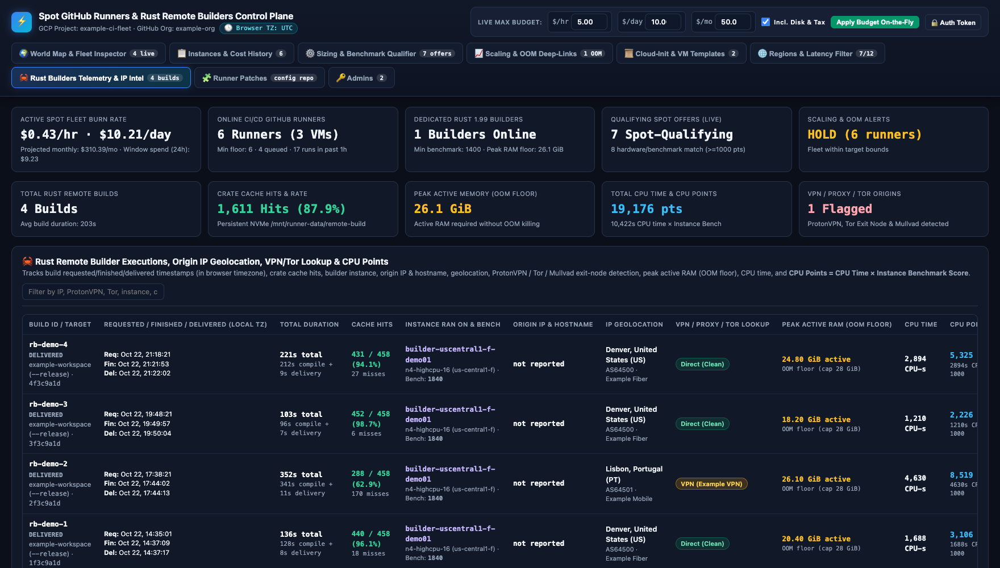
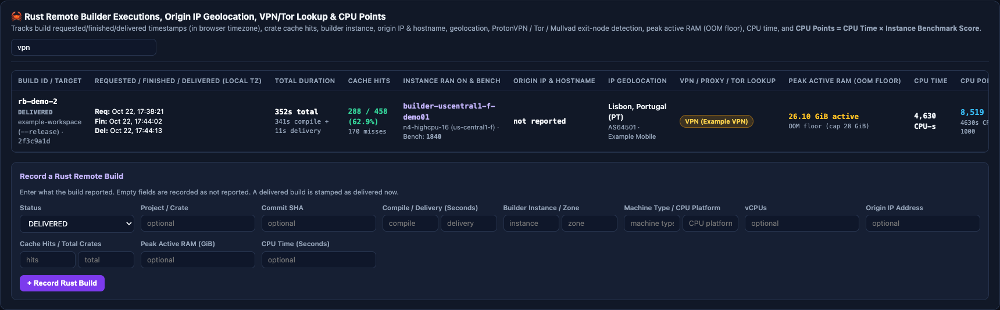
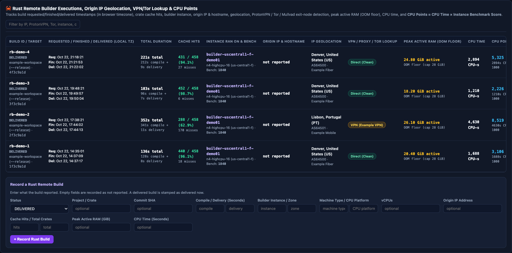

# Remote builds and clients

This page describes the host launcher on a dedicated builder, the clients that start a build, and where build
data lives. To create a builder, see [Set up a builder](dedicated-builders.md). To change a builder that already
runs jobs, see [Runtime updates](builder-runtime-updates.md).

## Host launcher

The host launcher is `/usr/local/bin/oxidex-remote-build` (backed by `host-agent host-launcher`). Its configuration is `/etc/oxidex-remote-build.json`.
It checks the project identifier, the allowed command, and the image identity. The Docker admission wrapper
(`host-agent docker-admission`) then checks the mounts and limits and takes the admission ledger lease before the container starts. Containers run as UID and GID 1001 without a Docker socket, added capabilities, or
privilege escalation. See the [security model](security.md).

Use the approved uploader account for source transfer. A control account with `sudo` access is not necessarily
allowed to traverse the source directories. Do not change directory permissions to work around an identity
mismatch.

On a host with an already prepared source project, an example build command is:

```bash
sudo -n /usr/local/bin/oxidex-remote-build oxidex-example \
  cargo build --release --locked --bin oxidex
```

- `prepare` creates the project directories, gives the uploader source access, and gives UID 1001 the
  project's target directory and the shared Cargo directory. It does not erase existing source or stop a
  build. It is refused while the builder drains.
- Every launcher call on a dedicated builder resets the shared parent directories to `root:1001` with mode
  `0710` and refuses symbolic links in those paths.
- `cleanup` removes everything in the project's source directory after it checks the cache locks and
  container mounts. It keeps the targets, and it runs during a drain.
- Transfer the source completely before you start the build. Do not prepare or synchronize a project that
  another build is using.
- Cancellation and reconciliation checks in the admission and Docker adapter paths depend on exact run and
  container identities. They do not authorize a broad container stop.

Two Rust compilations can run inside the one aggregate container, but they share its CPU and memory limits.
They are not two independent 28 GiB reservations. Measure the actual concurrent workload before you claim that
it fits.

## Remote build client workflow

<div class="carousel" markdown>
<div class="carousel-track" markdown>
<figure class="shot" markdown>

<figcaption markdown>Each remote build: duration, cache hits, builder, origin location, peak memory, and CPU points. The API redacts origin IP addresses and hostnames.</figcaption>
</figure>
<figure class="shot" markdown>

<figcaption markdown>The search box filters builds by project, builder, location, or network badge.</figcaption>
</figure>
<figure class="shot" markdown>

<figcaption markdown>Record a build manually; fields left empty are stored as not reported.</figcaption>
</figure>
</div>
</div>
<!-- /shot -->

OxiDex repository-owned `just` recipes and worker configuration are maintained in the OxiDex repository. Configure
that client for the approved dedicated host, uploader identity, source, image, and cache before you enable its
route. This repository does not update OxiDex's workflow or registry. See
[Simplify remote builds](simplification.md) for the target workflow.

### Execute builds remotely

The build client snapshots tracked source files, synchronizes them to the dedicated builder through authenticated
`rsync` over SSH as `oxidex-uploader`, and executes the build using `/usr/local/bin/oxidex-remote-build`:

```bash
# Transfer source to builder
rsync -avz --delete \
  --exclude='.git' --exclude='target' \
  ./ oxidex-uploader@BUILDER_HOST:/mnt/runner-data/remote-build/sources/oxidex/

# Execute remote compilation through host launcher
ssh oxidex-uploader@BUILDER_HOST \
  "sudo -n /usr/local/bin/oxidex-remote-build oxidex cargo build --release --locked"

# Download compiled artifact
scp oxidex-uploader@BUILDER_HOST:/mnt/runner-data/remote-build/targets/oxidex/release/oxidex \
  ./target/remote-linux/release/oxidex
```

- Use a dedicated evidence directory for each run to retain verification receipts and artifact hashes.
- Dedicated builders accept only direct authenticated SSH for `oxidex-uploader` with pinned host keys. Never use
  `gcloud compute ssh` to bypass uploader isolation.
- Linux artifacts from remote builders do not run natively on macOS. Cross targets and SDK-free framework interfaces
  do not replace native artifact validation. A full ExifTool comparison needs its own pinned oracle, fixtures, and
  qualification workflow: the standalone Dockerfile does not install the full oracle corpus.

## Qualification source admission

Projects with the dedicated qualification contract authenticate signed source, bundle, and run identities before
they import any executable. A bounded importer and supervisor keep protective locks until all descendants are
reaped. The adapter seals executable source separately from writable measurement Git metadata, and it validates
the required mounts and the allowed oracle fetch.

These source controls do not certify an installed deployment. Production qualification still needs evidence from
the actual startup, authority, mounts, process lifetime, disk, network, and workload. Do not mark a worker
qualified from a successful source-only test suite or a bootstrap tool probe.

## Storage and cache lifecycle

<figure class="shot" markdown>

<figcaption markdown>Cache hit rate and peak active memory across builds.</figcaption>
</figure>
<!-- /shot -->

| Data | Host path |
| --- | --- |
| Docker images and cache | `/mnt/runner-data/docker` |
| containerd layers | `/mnt/runner-data/containerd` |
| Runner state | `/mnt/runner-data/instances/<runner>` |
| Runner workspaces | `/mnt/runner-data/work/<runner>` |
| Build source | `/mnt/runner-data/remote-build/sources/<project>` |
| Cargo downloads | `/mnt/runner-data/remote-build/cargo` |
| Per-project targets | `/mnt/runner-data/remote-build/targets/<project>` |
| Exported artifacts (client transactions only, created and removed for each run) | `/mnt/runner-data/remote-build/exports/<run>` |

Mounting only the Docker data root is not enough if containerd still stores layers on the boot disk. Bootstrap
configures both on attached storage. Caches persist across builds on the same surviving disk. That retention
is not a backup, and it does not prove cache reuse across VMs. Do not format, delete, or detach an existing cache
disk to make a failed bootstrap retry succeed.

Builder drains deny new builds while active builds, units, leases, and cache or upload and export locks finish.
Preserve foreign or uncertain work, and record why a drain is blocked. Runner drains and builder drains have
different completion tests. See [Fleet and autoscaler](fleet-and-autoscaler.md).
