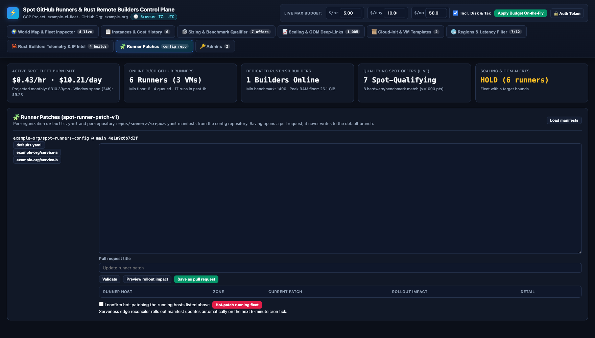
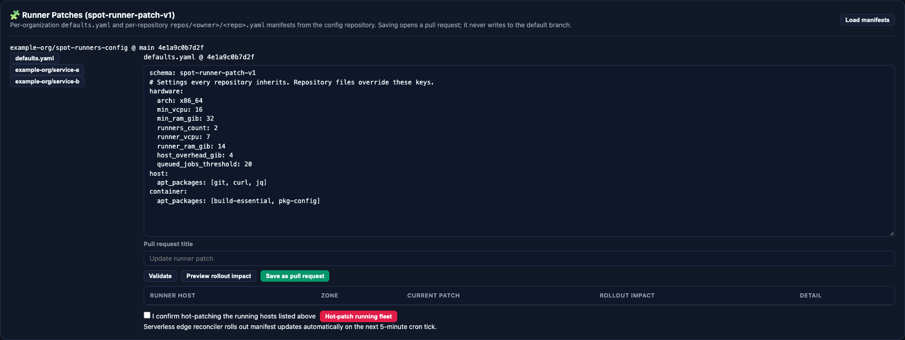
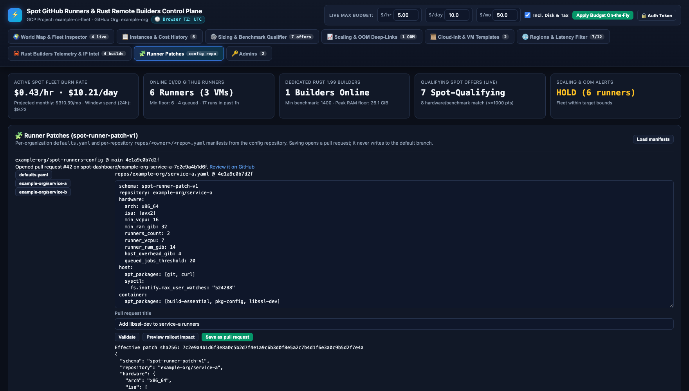

# Runner patches

A runner patch is a declarative customization of the runner hosts and runner containers that serve one repository. The patch is a manifest in the `spot-runner-patch-v1` format. It installs packages, writes files, sets kernel parameters (sysctl), adds container mounts, and sets hardware requirements such as a minimum vCPU count or a CPU instruction set. The tools render the manifest into the host startup script, the runner image, and the `docker run` flags, so a reviewed manifest replaces hand edits on a host.

This page covers the manifest, how the tools classify a change, the receipts that prove a patch, GitHub label sync, and the operator procedures. For the dashboard console that edits manifests, see [Dashboard](dashboard.md) and [Runner patches in the edge dashboard reference](edge-dashboard.md#runner-patches).

!!! warning "Operator procedures change live resources"
    The commands on this page create, patch, or replace Compute Engine virtual machines (VMs) and relabel GitHub runners. A request to edit code or documentation does not authorize any of them. Run each one only when you intend the live change, and complete the preview step first.

## Where manifests live

<div class="carousel" markdown>
<div class="carousel-track" markdown>
<figure class="shot" markdown>

<figcaption markdown>The console lists `defaults.yaml` and each repository manifest in the configuration repository.</figcaption>
</figure>
<figure class="shot" markdown>

<figcaption markdown>An example `defaults.yaml` that every repository inherits.</figcaption>
</figure>
</div>
</div>
<!-- /shot -->

Manifests live in the central configuration repository (`CONFIG_REPO`, for example `example-org/spot-runners-config`).

| File | Purpose |
| --- | --- |
| `defaults.yaml` | Settings that every repository inherits. Optional. |
| `repos/<owner>/<repo>.yaml` | The override for one repository. |

When resolving manifests for a repository `OWNER/REPO`, the Runner Patch Console and Worker reconciler pin the default branch head commit in the configuration repository and read both files at that commit. A missing `defaults.yaml` is treated as empty. A missing repository file is an error.

A manifest that declares a `repository` must name the target repository, compared without regard to case. A manifest that names another repository is refused, and so is a merged result that does.

### Supported formats

The pure-Rust loader (`cloudflare/src/patch.rs`) parses JSON and YAML manifests. The parser supports nested mappings, lists, block scalars, flow lists such as `[a, b]`, flow mappings, quoted strings, and comments. Anchors are not supported. A `>` folded scalar is not supported either, so use `|` or `|-` for multi-line text.

## Manifest schema

All keys are optional except where noted. A missing `schema` defaults to `spot-runner-patch-v1`, and any other value is an error.

!!! note "Unknown keys"
    The Runner Patch Console strictly rejects unknown top-level keys and unknown keys inside a section, so a typo shows up as a field error. Validate a manifest in the dashboard before you merge it.

### Top-level keys

| Key | Type and limits |
| --- | --- |
| `schema` | The string `spot-runner-patch-v1`. |
| `repository` | `OWNER/REPO`, matching `[A-Za-z0-9_.-]+/[A-Za-z0-9_.-]+`. The dashboard forbids it in `defaults.yaml`. |
| `hardware` | Mapping. See the next table. |
| `host` | Mapping. See the next table. |
| `container` | Mapping. See the next table. |

### The `hardware` section

| Key | Type and limits |
| --- | --- |
| `arch` | `x86_64` (aliases `x64`, `amd64`) or `arm64` (alias `aarch64`). Case-insensitive. Default `x86_64`. |
| `isa` | List of instruction set architecture (ISA) names. Names are lowercased, `_` becomes `-`, and `avx-512` becomes `avx512`. Each name must match `arch`. Duplicates are removed. The combination must leave at least one Compute Engine CPU platform. |
| `extra_labels` | List of extra GitHub runner labels. Each matches `^[A-Za-z0-9][A-Za-z0-9._-]{0,62}$`. |
| `min_vcpu` | Positive integer. Booleans are refused. |
| `min_ram_gib` | Positive integer, in GiB. |
| `runners_count` | Positive integer. Sets the number of runner containers per host (for example, `2` on a 16 vCPU and 32 GiB host). |
| `runner_vcpu` | Positive integer. Sets the vCPU limit allocated to each runner container (for example, `7` vCPU per runner). |
| `runner_ram_gib` | Positive integer, in GiB. Sets the memory limit allocated to each runner container (for example, `14` GiB per runner). |
| `host_overhead_gib` | Positive integer, in GiB. Reserves host RAM for the Linux kernel and Docker engine (for example, `4` GiB on a 32 GiB host). |
| `queued_jobs_threshold` | Positive integer. Sets the minimum number of queued jobs before queue backlog triggers scale-up (for example, `20`). |
| `qualify_command` | Shell script text. It runs as the last step of the host script. The image build and the container steps come after it. A failure stops the patch from completing. |

The supported ISA names, the `/proc/cpuinfo` flags that the host script requires, and the Compute Engine machine families and CPU platforms that provide them are:

| ISA | Architecture | Required CPU flags | Machine family and CPU platform |
| --- | --- | --- | --- |
| `avx2` | `x86_64` | `avx2` | `c4d` and `n4d` on AMD Turin; `c4` on Intel Granite Rapids and Emerald Rapids; `n4` on Emerald Rapids; `c2d` and `n2d` on AMD Milan; `n2` on Intel Ice Lake and Cascade Lake |
| `avx512` | `x86_64` | `avx512f`, `avx512bw`, `avx512vl` | The `avx2` list without `c2d` and `n2d` |
| `avx512-vbmi2` | `x86_64` | `avx512f`, `avx512_vbmi2` | `c4d` and `n4d` on AMD Turin; `c4` on Granite Rapids and Emerald Rapids; `n4` on Emerald Rapids; `n2` on Ice Lake only |
| `amx` | `x86_64` | `amx_tile`, `amx_bf16`, `amx_int8` | `c4` on Granite Rapids and Emerald Rapids; `n4` on Emerald Rapids |
| `avx10.1` | `x86_64` | `avx512f`, `avx512_vbmi2`, `amx_tile` | `c4` on Granite Rapids |
| `neon` | `arm64` | `asimd` | `c4a` on Google Axion; `t2a` on Ampere Altra |
| `sve` | `arm64` | `asimd`, `sve` | `c4a` on Google Axion |
| `sve2` | `arm64` | `asimd`, `sve`, `sve2` | `c4a` on Google Axion |

When a manifest lists several ISA names, a host needs a platform that appears in every list.

### The `host` section

| Key | Type and limits |
| --- | --- |
| `apt_packages` | List of package names matching `^[a-z0-9][a-z0-9+.-]*(=[0-9A-Za-z.+:~-]+)?$`. Append `=VERSION` to pin a version. Duplicates are removed. |
| `sysctl` | Mapping of kernel parameter keys, such as `vm.max_map_count`, to values. A key matches `^[a-z0-9_]+(\.[a-z0-9_-]+)+$`. A value is a string or number, never a boolean, and it must be a single non-empty line. |
| `files` | List of mappings with `path`, `content`, `mode`, and `owner`. `path` is an absolute normalized path that isn't `/` and has no `//` or control characters. `content` is a string (default empty). `mode` is 3 or 4 octal digits (default `0644`). `owner` is `user:group` (default `root:root`). Duplicate paths are refused. |
| `boot_mkdirs` | List of absolute normalized directory paths to create. Duplicates are removed. |
| `boot_script` | Shell script text that runs as root with `bash -euo pipefail` at provisioning, and again on every live apply of the patch, so write it to be safe to repeat. |

### The `container` section

| Key | Type and limits |
| --- | --- |
| `apt_packages` | Same rules as `host.apt_packages`. Installed into the runner image. |
| `sysctl` | Same rules as `host.sysctl`. Passed to the container as `--sysctl` flags. |
| `files` | Same rules as `host.files`. Written into the runner image. |
| `mounts` | List of mappings with `source`, `target`, and `read_only` (boolean, default `false`). Both paths are absolute and normalized, and neither contains `:`. Duplicate targets are refused. |
| `dockerfile_run` | Shell script text that runs during the image build, and on a live apply also inside each running runner container. |

A mount source can't be the Docker socket (`/var/run/docker.sock` or `/run/docker.sock`), `/run/gha-admission`, `/var/lib/gha-admission`, `/etc`, `/root`, `/proc`, `/sys`, or `/dev`. The check also refuses any path inside one of those paths, and any parent directory of one, such as `/var/lib`.

## Merge and override rules

For a repository, the loader merges `defaults.yaml` with the repository file. The repository file wins on conflicts, and the merge works per key.

| Setting | Merge rule |
| --- | --- |
| `schema`, `repository` | The repository file's value, else the default's. |
| `hardware.arch`, `min_vcpu`, `min_ram_gib`, `runners_count`, `runner_vcpu`, `runner_ram_gib`, `host_overhead_gib`, `queued_jobs_threshold` | The repository file's value when the key is present, else the default's. |
| `hardware.qualify_command` | The repository file's value when it isn't empty, else the default's. |
| `isa`, `extra_labels`, `apt_packages`, `boot_mkdirs` | The union, with default entries first, and duplicates removed. |
| `sysctl` | Mapping merge. The repository file wins for a key that both define. |
| `files` (host and container) | Merged by `path`. The repository file replaces a default entry for the same path. |
| `mounts` | Merged by `target`. |
| `boot_script`, `dockerfile_run` | Concatenated with a newline, default first, skipping empty parts. |

After the merge, the result passes the same validation as a single manifest. A repository file that is valid alone can still fail after the merge. For example, an `isa` entry that is incompatible with an inherited `arch` fails. The dashboard validates each repository file as merged.

### Canonical JSON and the SHA-256

The identity of a patch is the SHA-256 digest of its canonical JSON. The tools build that JSON from the validated patch without `source_commit` and `source_branch`, sort the keys, and use `,` and `:` separators with no whitespace. Two manifests that differ only in format, mapping key order, or comments have the same digest. The order of list entries is part of the digest, so reordering a list changes it. A change to `repository` changes the digest. The dashboard shows the digest as the effective patch SHA-256, and every receipt and metadata key on this page refers to it.

## How a patch applies

The Runner Patch Console computes rollout classifications to preview how a target manifest compares with a baseline manifest. The `/api/patch-console/preview` endpoint (aliased as `/api/patches/preview`) compares the request's `current_manifest` with the target manifest:

| Classification | Meaning | Preview description |
| --- | --- | --- |
| `noop` | The baseline already matches the target. The digests match. | No changes detected. |
| `hot_patch` | Changes only add packages or files. | In-place package or file updates. Direct live hot-patching (`POST /api/patches/hot-patch`) is deprecated; the edge preview evaluates manifest differences only. |
| `recreate_containers` | Container mounts or `dockerfile_run` scripts differ. | Container recreation indicated by manifest diff. |
| `replace_vm` | Hardware settings, host boot scripts, or host sysctls differ. | Host replacement indicated by manifest diff. |

The Patch Console bootstrap endpoint (`GET /api/patch-console/bootstrap`, aliased as `/api/patches`) reports `executor.available=false` with the reason "Serverless edge reconciler rolls out manifest updates automatically on the next 5-minute cron tick." All manifest changes are submitted as pull requests, reviewed, and merged into `main`. The reconciler does not automate container recreation or VM replacement driven by patches; classifications serve as previews only.

### Classification rules

The classification function compares the baseline manifest with the target patch:

1. If the digests match, the result is `noop`.
2. If hardware settings, host boot scripts, or host sysctl values differ, the result is `replace_vm`.
3. If container mounts or Dockerfile commands differ, the result is `recreate_containers`.
4. If only packages or files differ, the result is `hot_patch`.

#### The destructive-diff rule

The live script only installs and writes. It never uninstalls a package, deletes a file or directory, resets a sysctl value, or reverses a script. A host can therefore move only to a target whose effects include every applied effect. Any of the following forces `replace_vm`, and the reason names what the target drops:

- A package that `host.apt_packages` or `container.apt_packages` drops.
- A sysctl key that `host.sysctl` or `container.sysctl` drops.
- A path that `host.files` or `container.files` drops.
- A directory that `host.boot_mkdirs` drops.
- A change to a non-empty `host.boot_script`, because that script already ran.
- A change to a non-empty `container.dockerfile_run`, because that script already ran.

A target can still add packages, files, directories, and sysctl keys, and it can rewrite a file or a sysctl value in place. The same rules apply when you revert to an earlier patch. The `hardware` section is excluded from this rule because labels sync in full, and the tools check size and ISA separately.

#### Hardware constraint checks

Before any change, the tools check the observed host against every hardware constraint of the target:

- The machine family must match `hardware.arch`.
- `hardware.min_vcpu` and `hardware.min_ram_gib` must not exceed the host's observed vCPU count and RAM.
- For `hardware.isa`, the machine family and CPU platform must appear in the preceding ISA table.

A violation means the host can never run the patch, so the dashboard classifies it as `replace_vm`. A value that the tools can't observe, such as a missing CPU platform, is `unknown`.

#### Additional dashboard rules

The dashboard classifies each host in this order and stops at the first match:

1. A host found only by its name prefix, with no recorded patch metadata, is `unknown`. The host predates patch recording.
2. A hardware violation is `replace_vm`, and a constraint that the dashboard can't verify is `unknown`.
3. A host with pending patch metadata is `unknown`, even when the applied keys match.
4. In the edge dashboard, the reconciler classifies from the patch recorded in instance metadata. The result is `unknown` when that record is missing, fails its SHA-256 check, has no boot binding, or names a boot other than the instance's current `lastStartTimestamp`. A manifest that was too large to record is `unknown` unless its digest equals the target's. Reprovision the host or submit an updated manifest via the patch console.

## Receipts and metadata

Four records exist for a patch. Only the first proves what runs on the host.

| Record | Location | Meaning |
| --- | --- | --- |
| Completion receipt | `/var/lib/gha-runner-patch/state.json` on the host | The last patch that fully applied, with its boot ID. |
| Pending marker | `/var/lib/gha-runner-patch/pending.json` on the host | A patch whose apply started and didn't finish. |
| Instance metadata | The VM's Compute Engine metadata | The patch that the manager recorded after it confirmed the apply. |
| `spot-runner-patch` label | The VM's Compute Engine labels | A filter aid only. It isn't proof. |

### Host receipt and pending marker

Each patch step sequence first writes the pending marker, then runs, and writes the completion receipt only after every step succeeds. The tools replace both files by atomic rename.

- **Pending marker:** a JSON mapping with `receipt_schema` and `pending_patch_sha256`.
- **Completion receipt:** a JSON mapping with `boot_id` (from `/proc/sys/kernel/random/boot_id`) and a `receipt` that holds `receipt_schema` (`gha-runner-patch-receipt-v2`), `schema`, `repository`, `source_commit`, `patch_sha256`, and the canonical `manifest`. The tools remove the pending marker last.

For a provisioned host, the pending marker is written before the host patch script runs, and the receipt is written after every runner container starts. For a live patch, the steps include the image build and every container.

Only a completion receipt from the current boot, with no pending marker, proves which patch a host runs. A receipt written for an earlier boot, or by an earlier version of the tooling (without `receipt_schema`), doesn't count as proof. A failed attempt leaves the earlier receipt and the marker in place.

### Instance metadata keys

The manager writes the applied keys and the label only after the host confirms the patch. A provisioned host confirms it when its bootstrap writes the completion marker for this deployment, every runner is online, GitHub labels sync, and the storage check passes. A live patch confirms it when the host prints `LIVE_PATCH_APPLIED:<sha256>`.

| Key | Content |
| --- | --- |
| `spot-runner-patch` | The canonical manifest JSON. Omitted when larger than 64 KiB, and then only the digest is recorded. |
| `spot-runner-patch-sha256` | The digest, or `none` for a host without a patch. |
| `spot-runner-patch-target` | The `OWNER/REPO` the patch belongs to. |
| `spot-runner-patch-boot` | The `lastStartTimestamp` of the boot in which the manager confirmed the patch. A later boot makes the record stale. |
| `spot-runner-patch-pending-sha256` | The digest (or `none`) of a patch that was requested and not yet confirmed. |
| `spot-runner-patch-pending` | The manifest of the pending patch, or a placeholder when it exceeds the size limit. |
| `spot-runner-prefix`, `spot-runner-count`, `spot-runner-label`, `spot-runner-region`, `spot-runner-heavy-pool` | Deployment details that a live patch needs to find the host's runners and labels. |
| `spot-runner-registration-target`, `spot-runner-group-id` | The GitHub scope the runners registered with (an organization or `OWNER/REPO`) and, for organizations, the runner group. |

The `spot-runner-patch` label holds the first 16 characters of the digest, or `none`.

While a startup script applies a patch, or after it fails, the requested patch sits under the pending keys, and the applied keys keep their earlier value. A live patch writes only the two pending keys, right before it runs the live script, so a live patch that fails part-way leaves the host pending. After success, the manager writes the applied keys and the label, and it removes the pending keys last, so a host never looks confirmed before its applied record is complete.

## Label sync

Each runner registers with a label list, and the manager keeps that list in sync on GitHub. The desired custom labels are, in order and without duplicates:

1. The runner label (`--runner-label`).
2. The machine type (`--instance-type`).
3. The region (`--region`).
4. The patch labels: the `hardware.isa` names, then `hardware.extra_labels`.

GitHub's built-in labels (`self-hosted`, `Linux`, `X64`, `Windows`, `macOS`, `ARM64`, and `ARM`) are excluded from the comparison. For each expected runner (`<prefix>-<vm>-<n>`), a mismatch triggers a `PUT` that replaces the runner's custom labels, and the manager reads the result back and checks it.

Label sync runs when a runner host is provisioned:

- **At provisioning:** runner labels (`RUNNER_LABELS`) are configured when a host is launched based on the machine type, zone, and target parameters. The reconciler does not perform per-tick label synchronization.

## Apply a patch

<div class="carousel" markdown>
<div class="carousel-track" markdown>
<figure class="shot" markdown>

<figcaption markdown>Validate shows the effective patch and its SHA-256 digest.</figcaption>
</figure>
<figure class="shot" markdown>

<figcaption markdown>A manifest that mounts the Docker socket fails validation.</figcaption>
</figure>
<figure class="shot" markdown>

<figcaption markdown>Example validation API response for a forbidden mount.</figcaption>
</figure>
<figure class="shot" markdown>

<figcaption markdown>Save as pull request opens a pull request on the configuration repository.</figcaption>
</figure>
<figure class="shot" markdown>

<figcaption markdown>The rollout preview. Per-host results are empty because the edge preview compares manifests, not live hosts; live hot-patching is off.</figcaption>
</figure>
</div>
</div>
<!-- /shot -->

To apply a patch, commit the manifest to the configuration repository (`CONFIG_REPO`, for example `example-org/spot-runners-config`). Operators author, validate, and preview manifests in the Runner Patch Console on the edge dashboard or through its REST APIs. Saving a manifest opens a pull request on the configuration repository. After review and merge into the default branch (`main`), the autonomous Cloudflare Worker fleet reconciler (`cloudflare/src/reconciler.rs`) provisions replacement Spot instances or rotates running hosts according to the merged manifest.

### Validate and preview with the patch console

Before applying any change, validate the manifest syntax and preview its classification against the running fleet. You can perform these checks in the dashboard Web UI or by calling the edge endpoints:

1. **Manifest validation (`POST /api/patch-console/validate`):** the endpoint (aliased as `/api/patches/validate`) verifies the schema version (`spot-runner-patch-v1`), parses YAML or JSON syntax, checks hardware sizing floors (at least 16 vCPUs, 32 GiB host RAM, 2 runners at 7 vCPUs and 14 GiB RAM each, 4 GiB host overhead, and `queued_jobs_threshold >= 20`), and verifies that container mounts do not expose forbidden paths such as `/var/run/docker.sock` or `/var/lib/gha-admission`. It returns the canonical SHA-256 digest:

```bash
curl -X POST https://spot.swacktech.com/api/patch-console/validate \
  -H "Content-Type: application/json" \
  -H "Cookie: __Host-spot_session=<session-cookie>" \
  -d '{"content": "schema: spot-runner-patch-v1\nrepository: example-org/example-repo\nhardware:\n  min_vcpu: 16\n  min_ram_gib: 32\n  runners_count: 2\n  runner_vcpu: 7\n  runner_ram_gib: 14\n  host_overhead_gib: 4\n  queued_jobs_threshold: 20\n"}'
```

2. **Rollout classification preview (`POST /api/patch-console/preview`):** the preview endpoint (aliased as `/api/patches/preview`) compares the request's `current_manifest` against the target manifest:
   - `noop`: the manifests are identical (SHA-256 digests match).
   - `hot_patch`: changes only add packages or files.
   - `recreate_containers`: container mounts or `dockerfile_run` commands differ.
   - `replace_vm`: hardware settings, host boot scripts, or host sysctls differ.

### Submit changes through the pull request workflow

Saving a patch creates a pull request on the configuration repository (`CONFIG_REPO`, for example `example-org/spot-runners-config`) using `POST /api/patch-console/save` (aliased as `/api/patches/save`):

```bash
curl -X POST https://spot.swacktech.com/api/patch-console/save \
  -H "Content-Type: application/json" \
  -H "Cookie: __Host-spot_session=<session-cookie>" \
  -d '{"path": "repos/example-org/example-repo.yaml", "manifest": {"schema": "spot-runner-patch-v1", "repository": "example-org/example-repo", "hardware": {"min_vcpu": 16, "min_ram_gib": 32, "runners_count": 2, "runner_vcpu": 7, "runner_ram_gib": 14, "host_overhead_gib": 4, "queued_jobs_threshold": 20}}}'
```

The pull request workflow enforces configuration safety:

- **Dedicated branch creation:** the Worker generates a unique branch named `spot-dashboard/<target-slug>-<digest-prefix>` (first 12 hex characters of the digest) from the default branch head.
- **Atomic commit:** the Worker commits the canonical JSON representation of the manifest to the manifest path (`defaults.yaml` or `repos/<owner>/<repo>.yaml`).
- **Pull request creation:** the Worker opens a pull request targeting `main` with the manifest digest and description. The Worker rejects direct commits to `main`.

### Automated fleet reconciliation and provisioning

After operators review and merge the pull request into the default branch (`main`), the Cloudflare Worker reconciler (`cloudflare/src/reconciler.rs`) automates fleet updates on its 5-minute scheduled cron cadence (`#[event(scheduled)]`):

1. **Target manifest rendering:** on each tick, the reconciler renders a baseline valid manifest for each target (`patch_console::make_valid_manifest_json(target)`). Reading merged manifests from `CONFIG_REPO` during reconciliation is not implemented yet.
2. **Floor maintenance:** for each controlled target in `controlled_targets`, the reconciler ensures at least one 16-vCPU Spot runner host is active. If no host exists or an existing host requires replacement, the reconciler provisions a new Spot VM.
3. **Template rendering and JIT configuration:** the reconciler renders `cloud-init/startup.sh` with the target manifest, requests 2-slot Just-In-Time (JIT) credentials from GitHub Actions (`POST /orgs/{org}/actions/runners/generate-jitconfig`), and records the canonical `spot-runner-patch-sha256` digest in instance metadata.
4. **Demand-driven autoscaling:** if GitHub Actions reports a backlog of 20 or more queued jobs (`queued_jobs >= 20`), the reconciler provisions additional Spot runner hosts up to the configured fleet limit.
5. **Preemption and stale cleanup:** the reconciler removes terminated Spot instances along with their attached disks, and deletes offline runner registrations.
6. **Diff-gated state durability:** the reconciler computes a SHA-256 state fingerprint and skips writing to `SPOT_KV` on unchanged ticks, keeping write operations below 50 writes per day.

## Example: 16 vCPU and 32 GiB baseline with 2 runners

To enforce a minimum host size of 16 vCPU and 32 GiB of RAM across every monitored repository, with 2 runners per host (7 vCPU and 14 GiB of RAM per runner, reserving 2 vCPU and 4 GiB of RAM for the host operating system and Docker engine) and a 20-job queue threshold before scale-up, set those values in `defaults.yaml` in the configuration repository:

```yaml
schema: spot-runner-patch-v1

hardware:
  arch: x86_64
  isa:
    - avx2
  min_vcpu: 16
  min_ram_gib: 32
  runners_count: 2
  runner_vcpu: 7
  runner_ram_gib: 14
  host_overhead_gib: 4
  queued_jobs_threshold: 20

host:
  apt_packages:
    - curl
    - git
  sysctl:
    net.core.somaxconn: 4096
```

A repository manifest under `repos/<owner>/<repo>.yaml` inherits those defaults and can add repository-specific ISA flags (such as `avx512` or `avx512-vbmi2`), extra scheduling labels (`fast-compute`), host directories, container mounts, and Dockerfile commands:

```yaml
schema: spot-runner-patch-v1
repository: example-org/example-repo

hardware:
  arch: x86_64
  isa:
    - avx512
    - avx512-vbmi2
  extra_labels:
    - fast-compute
  min_vcpu: 16
  min_ram_gib: 32
  runners_count: 2
  runner_vcpu: 7
  runner_ram_gib: 14
  host_overhead_gib: 4
  queued_jobs_threshold: 20

host:
  boot_mkdirs:
    - /mnt/runner-data/custom-cache

container:
  mounts:
    - source: /mnt/runner-data/custom-cache
      target: /cache/custom
      read_only: false
```

## Source files

| Topic | Source |
| --- | --- |
| Schema validation, merge, and classification | [`cloudflare/src/patch.rs`](https://github.com/swack-tools/spot-github-runners/blob/main/cloudflare/src/patch.rs) |
| Manifest parsing and validation | [`cloudflare/src/patch.rs`](https://github.com/swack-tools/spot-github-runners/blob/main/cloudflare/src/patch.rs) |
| Patch console API and pull request generation | [`cloudflare/src/patch_console.rs`](https://github.com/swack-tools/spot-github-runners/blob/main/cloudflare/src/patch_console.rs) |
| Edge reconciliation and deployment | [`cloudflare/src/reconciler.rs`](https://github.com/swack-tools/spot-github-runners/blob/main/cloudflare/src/reconciler.rs) |
