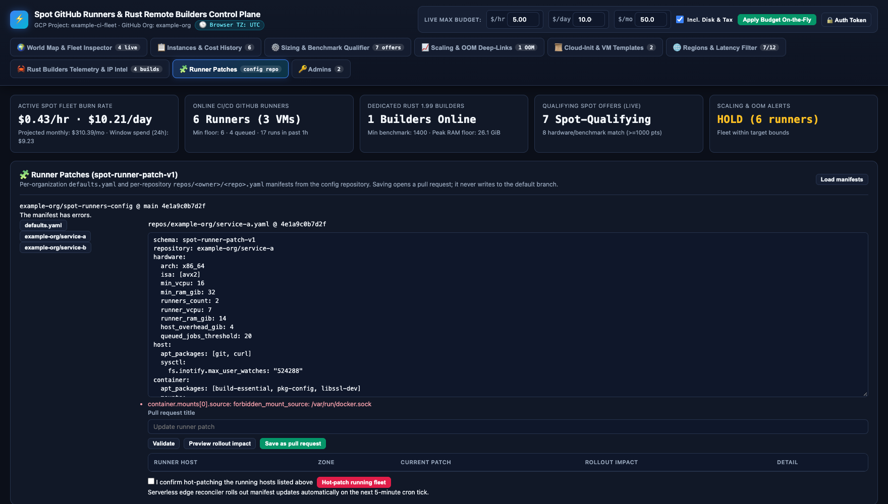
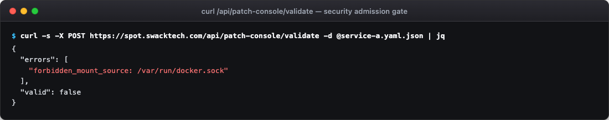

# Security model

This page describes trust boundaries, security controls, and secret management in the pure-Rust
runner and builder architecture.

!!! warning "Keep security boundaries intact"
    Do not weaken `host-agent` admission controls, `docker-admission` container limits, `host-launcher`
    path verifications, or uploader mapping checks. When a check cannot confirm an identity, budget,
    or lease ownership, it refuses the operation and logs the failure evidence.

## Trust boundaries

| Subsystem | Execution environment | Capabilities | Restrictions |
| --- | --- | --- | --- |
| Operator workstation | Workstation with `cargo`, `just`, and `wrangler`. | Compiles Rust workspaces, runs test suites, manages secrets via Wrangler, and previews deployments. | Operations are bounded by the cloud credentials and GitHub tokens configured on the workstation. |
| Edge control plane | Cloudflare Worker (`cloudflare/`) at `https://spot.swacktech.com`. | Authenticates web dashboard users, stores telemetry in Workers KV, reconciles fleet capacity against policy, and calls GCE REST APIs. | Has no SSH access to runner hosts or builders; interacts with cloud providers strictly through scoped REST APIs. |
| Runner host | Spot VM named `oxidex-runners-*`. | Runs the root-owned `host-agent` admission daemon and unprivileged runner containers. | Cannot mount host Docker daemon socket into runner containers. `cloud-init/startup.sh` refuses socket binding. |
| Runner container | Docker container per runner instance, running as user `runner` (UID 1001). | Executes workflow job steps. | Cannot alter host admission budgets, release peer leases, or modify host cordon markers. Admission directories are read-only. |
| Dedicated builder | Spot VM named `builder-*`, shape `n4-highcpu-16`. | Runs one admitted Rust compilation container for the approved uploader account. | Registers zero GitHub runners; launches with no VM service account and blocks project-wide SSH keys. |
| Build container | Docker container on builder VM, running as UID 1001:GID 1001. | Compiles OxiDex source trees inside 16 vCPU and 28 GiB RAM aggregate bounds. | Cannot access Docker socket, has zero Linux capabilities (`--cap-drop=ALL`), and cannot escalate privileges (`no-new-privileges`). |
| Signed-in web user | Web browser session. | Views fleet telemetry, inspects runner allocations, and previews runner configuration patches. | Non-administrator users cannot view administrative endpoints or commit configuration changes. |

## Keep untrusted pull requests off persistent runners

Runner hosts maintain persistent data disks where Cargo caches, toolchains, Docker layers, and workspaces
survive across job runs. Workflows from untrusted external forks can leave malicious processes or files
behind on the disk. Route untrusted pull requests to ephemeral GitHub-hosted runners, and reserve self-hosted
Spot runners for trusted internal pipelines.

Runner labels alone do not enforce security isolation. Workflows selecting default labels can match any runner
in the organization group. Ensure runner group permissions restrict access strictly to authorized repositories.

## Job admission on runner hosts

<figure class="shot" markdown>

<figcaption markdown>`host-agent admission` reserves memory before a job starts.</figcaption>
</figure>
<!-- /shot -->

Registered GitHub runner listener counts do not equal available physical memory capacity. The root-owned
`host-agent admission` daemon manages memory allocations before jobs begin.

### Memory leases

- The admission daemon listens on UNIX domain socket `/run/gha-admission/socket` (mode `0660`, owned by `root:1001`).
- Runner containers mount the socket directory read-only.
- The daemon authenticates callers using kernel peer credentials (`SO_PEERCRED`), rejecting client-supplied credentials.
- Active leases are recorded in `/var/lib/gha-admission/leases.json` (mode `0700`).
- Leases are reclaimed only after confirming that the owning process has terminated.
- When memory pressure is high, the job-started hook polls every 5 seconds until capacity becomes available.

### Owner verification

Before issuing a lease, the admission daemon verifies caller process attributes:

- Runner requests must originate from UID 1001 inside an admitted Docker container cgroup.
- The lease binds the container ID, start time, and runner worker process PID.
- For heavy runner tiers, actual container memory and CPU limits are verified against the tier reservation.

### Host cordon mechanism

To retire a runner host cleanly, the reconciler places the root-owned marker `/run/gha-runner-cordon/draining`.
Runner containers mount this directory read-only. The runner `job-started.sh` hook inspects the marker and refuses
new jobs before admission or step execution, allowing existing jobs to complete undisturbed.

## Dedicated builder security

<div class="carousel" markdown>
<div class="carousel-track" markdown>
<figure class="shot" markdown>

<figcaption markdown>Manifests that mount the Docker socket are rejected.</figcaption>
</figure>
<figure class="shot" markdown>

<figcaption markdown>Example validation response for a forbidden mount.</figcaption>
</figure>
</div>
</div>
<!-- /shot -->

Dedicated builders execute remote compilations for the approved uploader account under strict containment.

### Root launcher

The uploader invokes `/usr/local/bin/oxidex-remote-build` (symlinked to `host-agent host-launcher`):

- Enforces execution as root via `/etc/sudoers.d/oxidex-build`.
- Accepts only alphanumeric project identifiers and rejects symbolic links.
- Restricts build commands to an approved toolchain list (`cargo`, `rustc`, `rustfmt`, `clippy-driver`, `just`, `uv`, `python3`, `cbindgen`).
- Verifies that the builder container image matches the pinned toolchain ID.
- Rejects new compilations when the host drain marker `/run/oxidex-build-draining` is present.

### Build container policy

The builder launches compilation containers with strict limits:

```text
docker run --rm --user=1001:1001 --cpus=16 --memory=28g --memory-swap=28g \
  --pids-limit=4096 --cap-drop=ALL --security-opt=no-new-privileges ...
```

- Compilations execute as unprivileged UID and GID 1001.
- Memory and swap limits are identical (`28g`), preventing swap exhaustion.
- Linux capabilities are dropped completely (`--cap-drop=ALL`).
- Volume mounts are restricted to `/src`, `/target`, and `/cargo` under `/mnt/runner-data/remote-build`.
- The Docker socket is never mounted into the container.

### Docker admission wrapper

On the builder, `/usr/local/bin/docker` is symlinked to `host-agent docker-admission`. It parses `docker run`
arguments, validates that options match the approved policy, verifies volume mounts, acquires an admission lease,
and executes the real Docker binary.

### Approved uploader identity mapping

Dedicated builders accept an explicit, root-approved mapping file conforming to `root-approved-ssh-mapping-v1`:

- Enforces an Ed25519 public key whose SHA-256 matches the mapping checksum.
- Requires numeric UID of at least 1000 (excluding 1001, which is reserved for build containers).
- Restricts `sudo` configuration so the uploader can execute only the launcher binary.
- Requires direct authenticated SSH connections; `gcloud compute ssh` is forbidden.

## Edge dashboard security and authentication

<div class="carousel" markdown>
<div class="carousel-track" markdown>
<figure class="shot" markdown>

<figcaption markdown>Only the owner and added administrators can sign in.</figcaption>
</figure>
<figure class="shot" markdown>

<figcaption markdown>Owners add and remove administrators by numeric GitHub user ID.</figcaption>
</figure>
<figure class="shot" markdown>

<figcaption markdown>Device sign-in.</figcaption>
</figure>
</div>
</div>
<!-- /shot -->

The web dashboard is served directly from Cloudflare Worker memory (`cloudflare/src/ui.rs`), providing an
isolated control interface without intermediate VM hops.

- **Authentication flow**: runs the GitHub OAuth 2.0 app authorization-code flow with Proof Key for Code Exchange (PKCE) using `S256`.
- **Session management**: signed `__Host-spot_session` cookies with HMAC-SHA256 under `SESSION_SECRET`.
  Cookies include `Secure`, `HttpOnly`, `SameSite=Lax`, and `Path=/`.
- **Scope limitation**: requests minimal OAuth 2.0 scopes (`repo read:org`).
- **Authorization**: users must match `DASHBOARD_GLOBAL_ADMINS` or have administrative rights on controlled repositories.
- **Request limits**: sign-in payloads are capped at 16 KiB; standard JSON requests are capped at 256 KiB.
- **Cross-site protections**: requires `Content-Type: application/json` on state-changing requests and enforces origin matching.

## Secrets management

Secrets are stored securely in Cloudflare secret storage using `wrangler secret put` and in local `.env` files (mode `0600`):

| Secret | Subsystem | Purpose |
| --- | --- | --- |
| `GH_TOKEN` | Worker reconciler | Manages runner registrations and queries GitHub workflow job demand. |
| `SPOT_CONFIG_GH_TOKEN` | Worker patch console | Commits runner configuration patch pull requests. |
| `GCP_SERVICE_ACCOUNT_KEY` | Worker reconciler | Authenticates Compute Engine REST API calls to create and delete Spot instances. |
| `SESSION_SECRET` | Worker authentication | Cryptographic key of at least 32 bytes for signing session cookies. |
| `GITHUB_OAUTH_CLIENT_SECRET` | Worker authentication | OAuth 2.0 client secret for GitHub app sign-in. |
| `CLOUDFLARE_API_TOKEN` | Wrangler command-line tool | Authorizes Cloudflare Worker and Workers KV deployments. |

Rules for handling secrets:

- Never commit secrets to Git. The `.env` file is excluded in `.gitignore`.
- Maintain SSH private keys and approved uploader JSON files outside the repository checkout.
- Grant minimal IAM permissions to the GCP service account (`compute.instances.create`, `compute.instances.delete`, `compute.instances.list`).

## Scope and limitations

- Source-only tests do not certify live cloud deployment. Unit tests, remote builder proofs, and live VM behavior prove different properties.
- Bootstrap tool probes verify binary presence, not workload qualification.
- Runner group labels do not enforce hardware limits without active `host-agent` admission daemons.
- Cloudflare Workers KV is eventually consistent. The reconciler uses diff-gated updates to prevent redundant writes.
