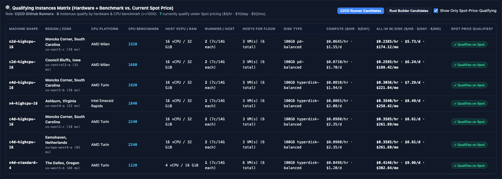
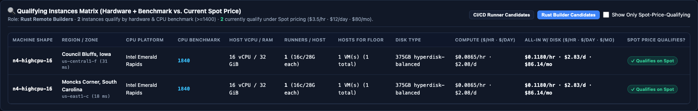
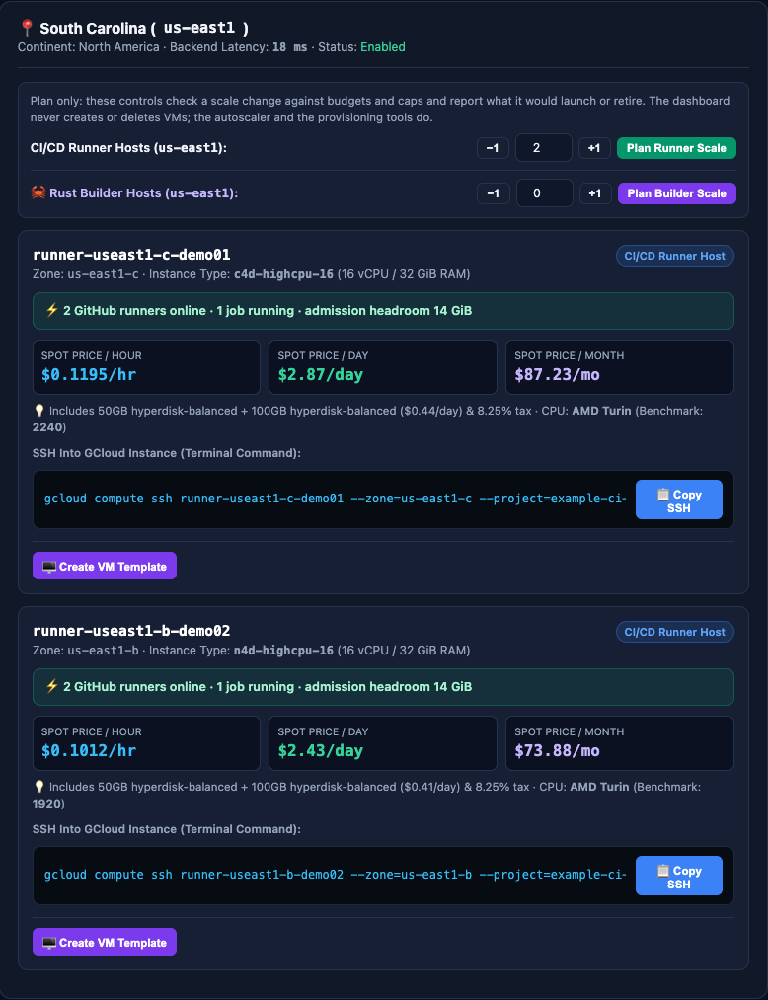
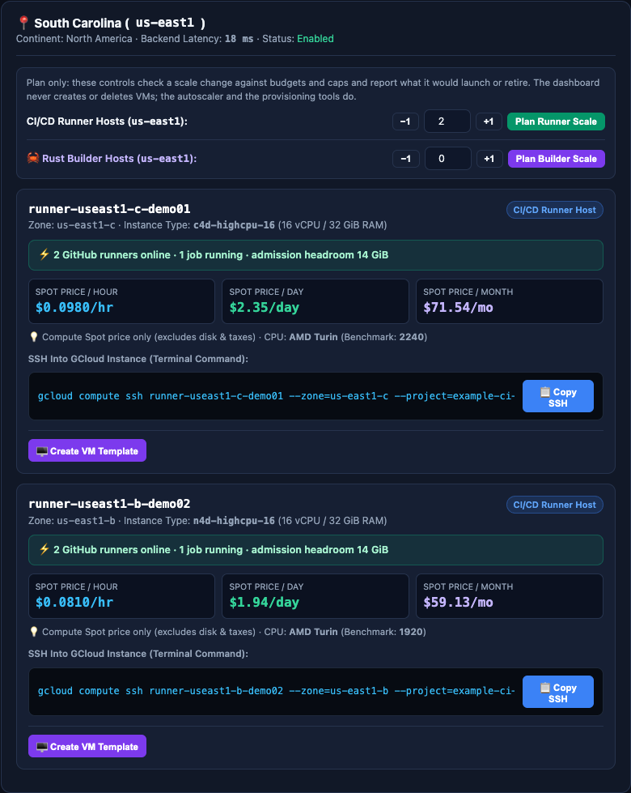
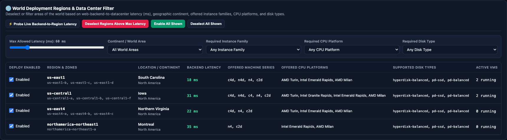
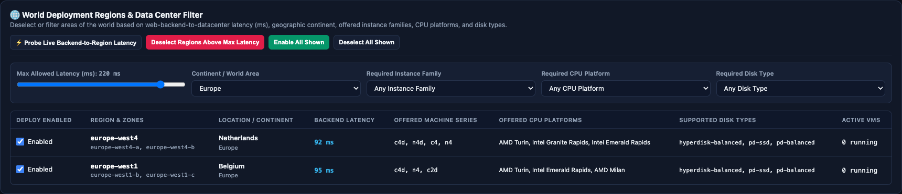

# Spot pricing and offers

Spot compute pricing discovery and machine inventory evaluation are integrated into the Cloudflare Worker
edge control plane. The edge reconciler evaluates candidate machine shapes before provisioning runner hosts,
and the web dashboard surfaces real-time Spot pricing, qualification status, and discount alerts.

Neither price queries nor dashboard views create VMs, reserve capacity, or mutate cloud settings.

## Spot offer evaluation at the edge

<div class="carousel" markdown>
<div class="carousel-track" markdown>
<figure class="shot" markdown>

<figcaption markdown>Runner candidates compared with the benchmark floor and the Spot budget. Offers over the budget show Exceeds Budget Cap.</figcaption>
</figure>
<figure class="shot" markdown>

<figcaption markdown>Show Only Spot-Price-Qualifying hides offers that exceed the budget.</figcaption>
</figure>
<figure class="shot" markdown>

<figcaption markdown>Rust builder candidates use the builder benchmark floor and budget.</figcaption>
</figure>
<figure class="shot" markdown>

<figcaption markdown>The region inspector shows Spot price per hour, day, and month for each running host.</figcaption>
</figure>
<figure class="shot" markdown>

<figcaption markdown>Clearing Show Prices With Disk & Taxes shows the compute Spot price alone.</figcaption>
</figure>
</div>
</div>
<!-- /shot -->

The edge reconciler evaluates qualifying Spot offers against deployment constraints on every reconciliation tick:

- **Hardware sizing floor**: runner hosts require shapes with at least 16 vCPUs and 32 GiB RAM, providing capacity
  for 2 runner containers (7 vCPUs, 14 GiB RAM each) and 4 GiB host overhead.
- **Permitted machine families**: sizing evaluates supported GCP families including `c4d-highcpu-16`,
  `n4d-highcpu-16`, `n4-highcpu-16`, and `c2d-highcpu-16`.
- **Daily cost cap**: offers are ranked by total cost (compute plus 40 GiB boot disk and 100 GiB data disk) to
  guarantee the daily run rate stays under the floor budget (default $1.50 per day).
- **Discount alerts**: the engine detects offers that are at least 95 percent below the standard on-demand price.

Operators inspect real-time pricing and qualifying shapes directly through the web dashboard at
`https://spot.swacktech.com` or via the read-only REST API endpoint `/api/overview`.

## Inspecting pricing via the API

<div class="carousel" markdown>
<div class="carousel-track" markdown>
<figure class="shot" markdown>

<figcaption markdown>Regions with their latency, machine families, CPU platforms, and disk types.</figcaption>
</figure>
<figure class="shot" markdown>

<figcaption markdown>A 60 ms latency limit narrows the region list.</figcaption>
</figure>
<figure class="shot" markdown>

<figcaption markdown>The continent filter shows one world area.</figcaption>
</figure>
<figure class="shot" markdown>

<figcaption markdown>The live budget bar sets the hourly, daily, and monthly caps from any tab.</figcaption>
</figure>
</div>
</div>
<!-- /shot -->

You can query the current precomputed pricing and fleet inventory from the edge control plane:

```bash
curl -sS https://spot.swacktech.com/api/overview | jq '.pricing'
```

The overview payload includes:

- Ranked candidate offers across target regions (`us-central1`, `us-east1`, `us-west1`).
- Hourly, daily, and monthly rates for compute and compatible storage.
- Active runner count and calculated cost per runner.
- Discount percentage compared to on-demand baselines.

## Treat results as candidates

A candidate offer is not a reservation. Before the edge reconciler provisions an instance, it verifies:

- **Zone availability and quota**: a listed shape can still experience temporary capacity exhaustion or regional quota exhaustion.
- **Compatible storage**: newer machine families (such as C4D and N4D) use Hyperdisk Balanced with NVMe, whereas older families use Persistent Disk types.
- **Total cost**: attached boot and data disks cost money, so an hourly compute limit alone is not a daily budget. The reconciler budget caps compute plus storage.
- **Price changes**: the Spot price of a running VM can fluctuate. The edge reconciler continuously tracks active VM spend and rotates hosts if prices exceed configured caps.

When you want to preview scaling behavior, inspect `/api/scaling` or use the Runner Patch Console to preview
configuration updates before submitting pull requests.
